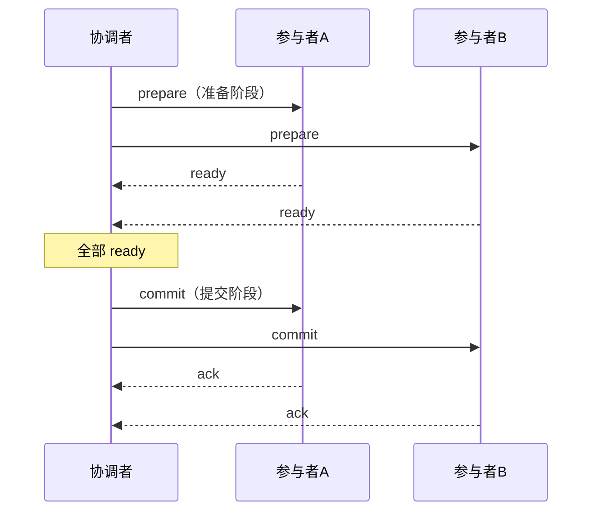

# 分布式事务

> 一个业务动作要同时写多个库/多个服务时，单机 ACID 失效了。分布式事务就是要在「跨节点」的前提下，尽量靠近「要么全成、要么全败」的语义——同时付出性能与复杂度的代价。

## 1. 先问三句话，再谈方案

很多所谓的「分布式事务」其实是设计问题的症状。动手前先自问：

1. **能不能改成单库本地事务？** 把强关联的数据放在同一个库，是成本最低的解法。
2. **能不能改成异步最终一致？** 只要业务允许「短暂不一致、稍后收敛」，就不需要强一致的分布式事务。
3. **一致性要求到底是多强？** 是「绝对不超卖」，还是「最终不超卖、允许短时误差」？

如果答案是「必须强一致、跨库、不可异步」，才进入下面的方案选择。

## 2. 方案全景

| 方案 | 一致性 | 业务侵入 | 性能 | 典型落地 |
|------|--------|----------|------|----------|
| 2PC / XA | 强一致 | 低（由框架/驱动处理） | 低（同步阻塞） | 数据库 XA、部分中间件 |
| TCC | 强一致（业务补偿） | 高（写三个方法） | 中 | 资金、支付 |
| Saga | 最终一致 | 中（写正向+补偿） | 高 | 长流程、订单 |
| 本地消息表 | 最终一致 | 中 | 高 | 通用、易落地 |
| 事务消息 | 最终一致 | 低 | 高 | RocketMQ 等 |
| 最大努力通知 | 最终一致 | 低 | 高 | 对账、异步通知 |
| 全异步（binlog） | 最终一致 | 极低 | 高 | Canal / MaxWell |

## 3. 逐一说清

### 3.1 2PC / XA（两阶段提交）

**两阶段提交（Two-Phase Commit, 2PC）** 引入一个**协调者（Coordinator）**，把提交分成两步：



- **阶段一（Prepare）**：协调者询问各参与者是否可提交，参与者**执行但不提交**，锁定资源。
- **阶段二（Commit/Rollback）**：全部 ready 则提交，任一失败则回滚。
- **XA** 是 X/Open 定义的 2PC 接口规范，MySQL、Oracle 等数据库都支持 `XA START/END/PREPARE/COMMIT`。

**缺点**：
- **同步阻塞**：Prepare 后资源被锁，直到第二阶段结束，吞吐低。
- **协调者单点**：协调者宕机，参与者可能长期处于「不确定状态」。
- **数据不一致风险**：第二阶段部分 commit 成功、部分失败时，需要人工介入。

### 3.2 TCC（Try-Confirm-Cancel）

TCC 把「一个操作」拆成业务层面的三个方法：

| 阶段 | 作用 | 例子（扣款） |
|------|------|-------------|
| **Try** | 预留业务资源（冻结） | 冻结用户 100 元 |
| **Confirm** | 确认执行（用预留的资源） | 扣减冻结的 100 元 |
| **Cancel** | 取消预留（释放） | 解冻 100 元 |

```java
public interface PaymentTcc {
    // Try：冻结资金
    boolean tryFreeze(String txId, String userId, BigDecimal amount);
    // Confirm：确认扣款（必须幂等）
    boolean confirm(String txId);
    // Cancel：解冻（必须幂等，且允许空回滚）
    boolean cancel(String txId);
}
```

要点：
- **三个方法都必须幂等**，因为网络超时会触发重试。
- **允许空回滚**：Try 还没执行就收到 Cancel，要能安全返回。
- **防悬挂**：Cancel 先于 Try 到达时，后续的 Try 不能再生效。
- 优点是不依赖数据库长事务、性能好；缺点是**业务侵入极高**，每个服务都要写三套逻辑。

### 3.3 Saga

**Saga** 把长事务拆成一串本地事务 $T_1, T_2, ..., T_n$，每个 $T_i$ 都有对应的**补偿事务** $C_i$。任一 $T_i$ 失败，则依次执行 $C_{i-1}, ..., C_1$ 回滚。

- **编排式（Orchestration）**：由一个中心协调器驱动各步骤。
- **协同式（Choreography）**：各服务通过事件互相触发，无中心。

Saga 的特点是**没有「锁」，靠补偿撤销**，因此：
- 适合**长流程**（如旅行预订：机票 → 酒店 → 租车）；
- **不满足隔离性**，中间状态对外可见，必须配合业务上的容忍；
- 补偿事务要幂等，且补偿本身也可能失败，需要重试与人工兜底。

### 3.4 本地消息表 / Outbox

不需要额外中间件、最实用的方案之一：

1. 在业务库里开一张**消息表**；
2. **在同一个本地事务里**，既更新业务数据，又往消息表插入一条「待发送」消息——两者要么都成功要么都失败；
3. 一个后台任务/线程**轮询消息表**，把待发送消息投递到 MQ，投递成功后标记为已发送。

```sql
-- 同一事务内完成
BEGIN;
  UPDATE account SET balance = balance - 100 WHERE id = 1;
  INSERT INTO outbox(event_id, payload, status) VALUES ('e1', '{...}', 'PENDING');
COMMIT;
-- 后台任务：SELECT ... WHERE status='PENDING' -> 发送MQ -> UPDATE status='SENT'
```

优点是**可靠、无需强一致中间件**；缺点是消息表与业务库耦合、需要轮询（可通过 CDC 消除轮询）。

### 3.5 事务消息（如 RocketMQ）

把「本地消息表」的思想下沉到消息中间件：

1. 生产者发送一条**半消息（Half Message）**，此时消费者看不到；
2. 半消息发送成功后，生产者执行**本地事务**；
3. 生产者根据本地事务结果，向 MQ **提交或回滚**半消息；
4. 若 MQ 长时间未收到确认，会**回查**生产者的本地事务状态。

这样「本地事务」与「消息投递」达成最终一致，业务代码比本地消息表更简洁，代价是依赖支持事务消息的 MQ。

### 3.6 最大努力通知

用于「尽力而为」的场景：系统 A 处理完后，**多次、逐步延长间隔**地通知系统 B，直到收到成功响应或超过最大次数，最后靠**对账**兜底。适合支付结果回调、异步开户通知等，不保证强一致，但工程简单。

### 3.7 基于 binlog 的异步方案（Canal / MaxWell）

**MaxWell** 和 **Canal** 通过伪装成 MySQL 从库，解析 **binlog**，把数据变更以事件形式投递出去：

- 无需在业务代码里写消息表，**业务零侵入**；
- 天然顺序、可靠；
- 代价是引入额外组件、有延迟，且解析的是物理变更，语义仍需业务侧处理。

## 4. 中间件：Seata 概览

**Seata**（Simple Extensible Autonomous Transaction Architecture）是常用的开源分布式事务框架，提供多种模式：

| 模式 | 原理 | 一致性 |
|------|------|--------|
| AT | 自动生成 undo_log，拦截 SQL，二阶段自动回滚 | 强一致（近似） |
| TCC | 手动实现三方法 | 强一致 |
| Saga | 状态机驱动补偿 | 最终一致 |
| XA | 包装数据库 XA | 强一致 |

AT 模式最省事：业务只需一个 `@GlobalTransactional`，框架通过**全局锁 + undo_log** 实现自动回滚。但 AT 也有全局锁开销与脏读风险，写热点数据时性能会下降。

## 5. 怎么选

```text
强一致、跨库、性能要求不高  → 2PC/XA
金融核心、允许业务改造       → TCC
长流程、可容忍中间态           → Saga
通用、想少引入组件             → 本地消息表 / 事务消息
支付回调、异步通知             → 最大努力通知
想零侵入、已有 CDC 能力        → Canal / MaxWell
```

## 6. 落地清单（比选方案更重要）

无论选哪种方案，下面几件配套缺一不可：

- **幂等键**：每个操作带唯一业务 ID，重复执行不产生副作用。
- **状态机**：用明确状态描述流程（待支付 → 支付中 → 已支付 → 已完成/已取消），便于补偿与排查。
- **对账任务**：周期性扫描两侧数据，发现不一致并告警/修复。
- **可观测**：记录每一步的输入、结果、耗时，出问题能定位到具体环节。
- **人工补偿入口**：自动化兜不住时，必须有人工介入的手段。

## 7. 小结

- 动手前先问：能否本地事务、能否异步最终一致——多数场景不需要真正的分布式事务。
- 2PC/XA 强一致但阻塞、有单点；TCC 性能好但业务侵入极高；Saga 适合长流程但要容忍无隔离性。
- 本地消息表、事务消息、binlog 解析（Canal/MaxWell）是**最终一致**的实用主力。
- Seata 提供 AT/TCC/Saga/XA 多种模式，AT 最省事但有全局锁成本。
- 方案之上，**幂等、状态机、对账、可观测**才是真正决定成败的部分。
