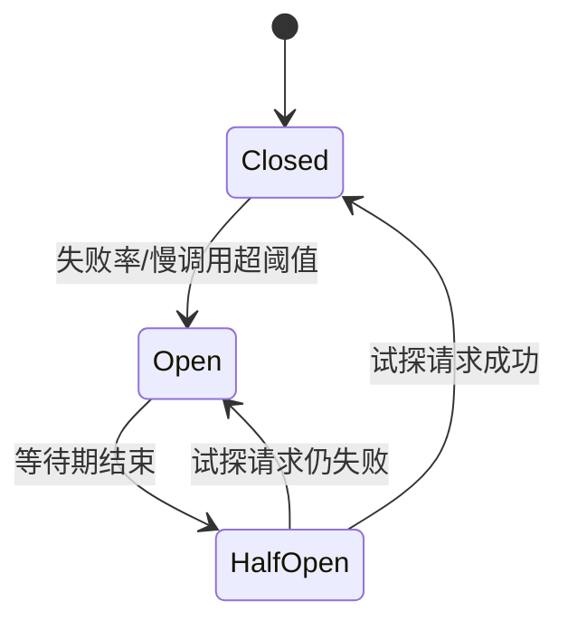

# 限流降级熔断

> 高并发下，系统迟早会遇到「流量超过处理能力」或「依赖变慢/挂掉」。限流**保护自己**，熔断**保护依赖**，降级**保住核心**——三者是同一套保护体系的三道防线。

## 1. 三者的分工

先厘清概念，避免混用：

| 手段 | 保护对象 | 触发条件 | 结果 |
|------|----------|----------|------|
| **限流** | 自己 | 流量超过阈值 | 拒绝/排队多余请求 |
| **熔断** | 调用方（隔离坏依赖） | 依赖失败率/慢调用超阈值 | 快速失败，不再调用依赖 |
| **降级** | 核心业务 | 系统压力大或依赖不可用 | 关闭非核心，返回兜底 |

它们的关系：**限流是入口的闸门，熔断是依赖的保险丝，降级是出事时的应急预案**，通常一起出现在网关和服务内部。

## 2. 限流算法

### 2.1 固定窗口计数

把时间切成固定窗口（如每秒一个），每个窗口独立计数，超过阈值就拒绝。

- **优点**：实现最简单。
- **缺点**：**临界问题**——窗口边界处可能出现 2 倍流量。例如阈值 100，前一个窗口最后 100ms 来了 100 个、后一个窗口前 100ms 又来了 100 个，实际 200ms 内就放过了 200 个。

### 2.2 滑动窗口

把大窗口切成多个小格子，随时间滑动，统计「当前时刻往前一个窗口」的请求数。它解决了固定窗口的临界突变问题，是**Sentinel 采用的核心算法**。

```text
窗口 1 秒，切成 2 个 500ms 的格子：
统计 = 当前所在格 + 前一个格  →  边界更平滑
```

### 2.3 漏桶（Leaky Bucket）

请求先进入桶，桶以**固定速率**流出（被处理）。桶满则拒绝。

- 特点是**输出速率恒定**，不管输入多突发，都能平滑整形；
- 缺点是无法应对合理的突发流量（即使系统有余量也只能匀速放行）。

### 2.4 令牌桶（Token Bucket）

以**固定速率往桶里放令牌**，桶有容量上限；请求来了先取一个令牌，取到才放行，取不到就拒绝或等待。

- 允许**一定程度突发**（桶里积累的令牌可被一次性消耗）；
- 是**最常用**的限流算法，Guava `RateLimiter` 就是令牌桶实现。

```java
// Guava RateLimiter：每秒放行 100 个请求，允许突发（桶容量）
private final RateLimiter limiter = RateLimiter.create(100.0);

public void handle() {
    // 阻塞等待令牌，返回等待时间（秒）
    double waitSeconds = limiter.acquire();
    // 或用 tryAcquire 非阻塞：立即取，取不到就拒绝
    if (!limiter.tryAcquire()) {
        throw new IllegalStateException("请求过于频繁，请稍后重试");
    }
    // ... 业务处理
}
```

| 算法 | 允许突发 | 输出平滑 | 复杂度 | 典型实现 |
|------|----------|----------|--------|----------|
| 固定窗口 | 否（有临界问题） | 否 | 低 | 计数器 |
| 滑动窗口 | 否 | 较平滑 | 中 | Sentinel |
| 漏桶 | 否 | 是（严格匀速） | 中 | Nginx `limit_req` |
| 令牌桶 | 是 | 较平滑 | 中 | Guava RateLimiter |

## 3. 分布式限流

单机限流只保护单个实例；集群整体限流需要**共享计数**，通常用 Redis：

```lua
-- 基于 Redis + Lua 的滑动/计数限流（固定窗口简化版）
-- KEYS[1]=限流key  ARGV[1]=阈值  ARGV[2]=窗口秒数
local current = redis.call('INCR', KEYS[1])
if current == 1 then
    redis.call('EXPIRE', KEYS[1], ARGV[2])
end
if current > tonumber(ARGV[1]) then
    return 0   -- 拒绝
end
return 1       -- 放行
```

要点：

- Lua 脚本保证「计数 + 判断 + 过期」**原子**执行；
- Redis 是新的单点，要**高可用**，且要考虑 Redis 抖动时的**本地兜底**（如降级为本地限流）；
- 网关层（Nginx/Sentinel/APISIX）常做**全局限流**，服务内部做**单机兜底限流**，形成两层防护。

## 4. 熔断

熔断器模拟电路保险丝，有三个状态：



- **Closed（关闭）**：正常放行，同时统计失败率/慢调用比例。
- **Open（打开）**：达到阈值后断路器打开，**所有请求快速失败**（不再真正调用依赖），给依赖恢复的时间。
- **Half-Open（半开）**：经过一个等待窗口后，**放少量请求试探**；成功则关闭恢复，失败则继续打开。

关键参数：**失败率阈值**、**慢调用比例/耗时阈值**、**最小请求数**（样本太少不触发）、**打开时长**、**半开试探数量**。

```java
// Resilience4j 熔断 + 降级
@CircuitBreaker(name = "payment", fallbackMethod = "payFallback")
public PayResult pay(PayRequest req) {
    return paymentClient.pay(req);
}

// fallback 方法签名需与被保护方法一致，末尾多一个 Throwable 参数
public PayResult payFallback(PayRequest req, Throwable t) {
    // 降级：进入待支付队列，稍后异步重试
    return PayResult.queued(req.getOrderId());
}
```

## 5. 降级

降级是「资源不够时，放弃次要、保住核心」：

| 降级手段 | 例子 |
|----------|------|
| 返回兜底数据 | 推荐服务不可用，返回默认推荐或缓存结果 |
| 关闭非核心功能 | 大促时关闭评论、足迹、个性化推荐 |
| 缓存/静态兜底 | 动态接口挂掉，返回上一次的缓存快照 |
| 排队与限流提示 | 秒杀排队页、「当前人数过多，请稍候」 |
| 异步化 | 同步扣款改为「受理成功，稍后通知」 |

降级要有**开关**（可动态配置）和**明确的触发条件**，且要预先演练——临时抱佛脚往往来不及。

## 6. Sentinel 落地

**Sentinel** 是阿里巴巴开源的流量治理组件，覆盖限流、熔断、系统自适应保护，是 Java 微服务的常用选择。

依赖：

```xml
<dependency>
    <groupId>com.alibaba.cloud</groupId>
    <artifactId>spring-cloud-starter-alibaba-sentinel</artifactId>
</dependency>
```

代码中定义资源并指定兜底方法：

```java
@Service
public class OrderService {

    // value=资源名；blockHandler=被限流/熔断时调用；fallback=业务异常时调用
    @SentinelResource(value = "createOrder",
                      blockHandler = "createOrderBlocked",
                      fallback = "createOrderFallback")
    public Order createOrder(CreateOrderCmd cmd) {
        // ... 业务逻辑
        return order;
    }

    // 限流/熔断兜底：签名与原方法一致，末尾多 BlockException
    public Order createOrderBlocked(CreateOrderCmd cmd, BlockException ex) {
        throw new BizException("当前下单人数过多，请稍后重试");
    }

    // 业务异常兜底：末尾多 Throwable
    public Order createOrderFallback(CreateOrderCmd cmd, Throwable t) {
        return Order.pending(cmd);
    }
}
```

限流规则（也可在控制台动态配置）：

```java
List<FlowRule> rules = new ArrayList<>();
FlowRule rule = new FlowRule();
rule.setResource("createOrder");
rule.setGrade(RuleConstant.FLOW_GRADE_QPS);  // 按 QPS 限流（也可按线程数）
rule.setCount(200);                          // 阈值：每秒 200
rule.setControlBehavior(RuleConstant.CONTROL_BEHAVIOR_WARM_UP); // 预热（冷启动保护）
rules.add(rule);
FlowRuleManager.loadRules(rules);
```

Sentinel 的核心概念：

| 概念 | 作用 |
|------|------|
| Resource（资源） | 被保护的逻辑单元，如一个接口、一个方法 |
| Rule（规则） | 限流/熔断/系统保护规则 |
| `FlowRule` | 流控规则：QPS/线程数、快速失败/预热/排队等待 |
| `DegradeRule` | 熔断规则：慢调用比例、异常比例、异常数 |
| `SystemRule` | 系统自适应保护：按 Load、CPU、RT、线程数整体兜底 |
| `Slot Chain` | 责任链，限流、熔断等能力以 Slot 形式串起来 |

::: tip 冷启动保护
`WARM_UP`（预热）模式让系统在启动初期用较低阈值，逐步放开到最高阈值，避免冷启动时缓存未预热、连接池未建立就被打满——是限流里的实用细节。
:::

## 7. 实践要点与常见坑

1. **限流阈值靠猜**：应基于压测得到的系统上限设定，并留安全余量。
2. **只有入口限流**：服务内部、下游调用也要有保护，否则内部调用照样打爆。
3. **降级方法忘记幂等**：降级路径同样可能被重试，要保证幂等。
4. **熔断不设半开**：一直打开会让依赖永远无法恢复；一直关闭则失去保护。
5. **限流被当作业务拒绝**：限流失败要返回**明确、可重试**的提示，而不是笼统的 500。
6. **阈值硬编码**：应可动态配置、实时生效，配合监控调整。

## 8. 小结

- **限流保护自己**：固定窗口有临界问题，滑动窗口更平滑，漏桶严格匀速，**令牌桶最常用**（Guava）。
- **分布式限流**用 Redis + Lua 做共享计数，网关全局 + 服务单机两层防护。
- **熔断保护依赖**：Closed → Open → Half-Open 三态，失败率/慢调用超阈值即打开。
- **降级保住核心**：返回兜底、关闭非核心、排队提示，需开关与演练。
- **Sentinel** 一站提供限流、熔断、系统自适应保护，`@SentinelResource` + 动态规则是常见落地方式。
