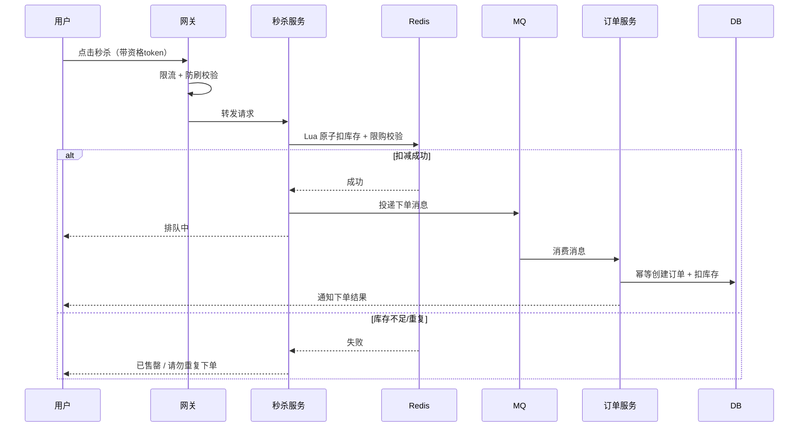

# 秒杀系统设计

> 秒杀是把高并发的所有难题压缩到几秒钟里：**瞬时洪峰、防超卖、防刷、且不能拖垮整个站点**。它是检验一套架构保护能力的「压力测试场」。

## 1. 秒杀难在哪

| 挑战 | 具体表现 |
|------|----------|
| 瞬时流量 | 平时几乎为零，开抢瞬间几十万 QPS |
| 库存极热 | 少量 SKU 被所有用户争抢，单点压力极大 |
| 防超卖 | 库存绝对不能扣成负数 |
| 防刷与黄牛 | 脚本、机器人抢单 |
| 不能影响主站 | 秒杀流量不能拖垮正常交易 |
| 公平与可对账 | 结果要可解释、可核对 |

核心思路只有一句话：**把绝大部分流量挡在到达数据库之前**，让最终落到 DB 的请求量与库存量级相当。

## 2. 分层架构

```text
用户 → CDN/静态页 → 网关(限流/防刷) → 秒杀服务(Redis 预扣) → MQ → 订单服务 → DB
```

各层职责：

| 层 | 目标 | 手段 |
|----|------|------|
| 前端 / CDN | 流量不到服务器 | 页面静态化、按钮置灰防重复点击、验证码 |
| 网关 | 削峰、防刷 | 限流（IP/用户/设备）、黑名单、token 校验 |
| 秒杀服务 | 快速判库存 | Redis 预扣库存（Lua 原子）、用户限购 |
| 消息队列 | 异步削峰 | 把下单请求排队，后端匀速消费 |
| 订单服务 | 可靠落单 | 幂等创建订单、DB 扣减兜底 |

## 3. 关键设计逐条拆解

### 3.1 页面静态化 + 前端限流

- **静态资源走 CDN**，商品详情页尽量静态化，避免动态渲染压力；
- **按钮防重**：点击后立即置灰，前端拦截重复提交；
- **答题/验证码**：拉长机器人请求，削掉一部分瞬时流量；
- **倒计时本地化**：靠客户端时间近似，减少服务端校时请求。

### 3.2 网关限流与防刷

- 按 **IP / 用户 ID / 设备指纹** 维度限流（见 [限流降级熔断](./ratelimit.md)）；
- 黑名单：已知的黄牛 IP/账号直接拒绝；
- **强制登录 + 唯一资格**：秒杀前先拿到一个「秒杀资格 token」，没有 token 的请求直接丢弃。

### 3.3 Redis 预扣库存（防超卖的核心）

把库存**预热到 Redis**，用 **Lua 脚本原子地「判断库存 + 扣减 + 记录用户」**，把并发控制从 DB 挪到内存：

```lua
-- KEYS[1]=库存key  KEYS[2]=已购用户集合key
-- ARGV[1]=用户ID  ARGV[2]=本次购买数量
-- 返回 1=成功  0=库存不足  -1=重复购买
local stock = tonumber(redis.call('get', KEYS[1]))
if stock == nil or stock < tonumber(ARGV[2]) then
    return 0
end
-- 用 Set 判断该用户是否已购买，实现「限购一件」
if redis.call('sismember', KEYS[2], ARGV[1]) == 1 then
    return -1
end
redis.call('decrby', KEYS[1], ARGV[2])
redis.call('sadd', KEYS[2], ARGV[1])
return 1
```

要点：

- **Lua 保证原子性**，避免「查完扣」之间的竞态导致超卖；
- **限购用 Set 记录已购用户**，比查 DB 快得多；
- Redis 扣减成功后，才把请求丢进 MQ；**Redis 是「守门员」，DB 是「终极账本」**；
- Redis 与 DB 的库存最终要靠**异步落单 + 对账**校准。

### 3.4 消息队列异步下单

Redis 预扣成功的请求不直接同步写 DB，而是**投递到 MQ**：

```text
秒杀服务 → 预扣成功 → 发送 MQ 消息 → 返回「排队中」
订单服务 → 消费 MQ → 幂等创建订单 → DB 扣库存 → 通知用户
```

好处：

- **削峰**：后端按自己的处理能力匀速消费，不被瞬时流量冲垮；
- **解耦**：秒杀服务只管判库存，下单逻辑独立；
- **用户体验**：前端显示「排队中」，轮询结果。

### 3.5 数据库兜底（终极防超卖）

即使 Redis 把关，DB 也要有最后一道保险：

```sql
-- 乐观扣减：库存不足时影响行数为 0，天然防超卖
UPDATE seckill_stock
   SET stock = stock - 1
 WHERE sku_id = ? AND stock >= 1;
```

配合**唯一索引**防止同一用户重复下单：

```sql
-- 用户 + 活动 唯一约束，重复插入直接失败
ALTER TABLE seckill_order ADD UNIQUE KEY uk_user_activity (user_id, activity_id);
```

### 3.6 幂等与防重

从网关到 MQ 消费，每一步都可能因重试而重复执行，必须**幂等**：

- 幂等键：`用户ID + 活动ID`；
- 下单用**唯一索引**或**分布式锁**（见 [分布式锁](../distributed/distributed-lock.md)）保证只创建一次；
- MQ 消费方要能安全处理重复消息。

### 3.7 库存预热与缓存一致性

- 活动开始前，把库存、商品信息**预热进 Redis**；
- 活动结束后，把 Redis 的扣减结果与 DB **对账**，修正差异；
- Redis 宕机要有预案：可**降级**为「直接限流到 DB」或暂停活动，绝不能放行导致超卖。

预热的一个细节：预热时 Redis 库存必须与 DB 严格一致，活动期间 Redis 只做扣减；若因故障重启导致库存跳变，应**以 DB 为准**，并**立即暂停秒杀入口**，待人工核验后再开放——宁可漏卖，不可超卖。

## 4. 完整时序



## 5. 对账与补偿

秒杀强依赖「Redis 与 DB 的最终一致」，必须收尾：

- **活动结束对账**：Redis 剩余库存 vs DB 实际库存 vs 成功订单数，三者核对；
- **异常补偿**：MQ 消费失败要重试，超过次数进死信队列人工处理；
- **超时订单回收**：未支付的订单超时后释放库存（回补 Redis 与 DB）；
- **可解释**：每个成功/失败结果都能追踪到原因，便于客服与投诉处理。

## 6. 实践要点与常见坑

1. **只做网关限流，不做库存预扣**：DB 依然会被打垮。
2. **先查库存再扣库存**（非原子）：并发下必超卖，必须用 Lua 或 DB 原子扣减。
3. **Redis 扣减成功但消息丢失**：要保证「预扣 → 投递」的可靠性（事务消息或本地消息表，见 [分布式事务](../distributed/distributed-transaction.md)）。
4. **秒杀流量打到主库**：应与主站**隔离**（独立集群、独立库），避免影响正常交易。
5. **忽略黄牛**：单靠 IP 限流不够，要结合账号、设备、行为风控。
6. **没有对账**：Redis 与 DB 的差异无人发现，最终变成超卖事故。

## 7. 小结

- 秒杀的本质是**分层拦截**：把流量挡在 DB 之前，让落到 DB 的量级与库存相当。
- **Redis 预热 + Lua 原子预扣**是防超卖的核心；**MQ 异步下单**是削峰的关键。
- **DB 乐观扣减 + 唯一索引**是最后一道保险；**幂等**贯穿全链路。
- 必须做**对账与补偿**，因为整个链路是最终一致而非强一致。
- 秒杀系统要与主站**隔离**，宁可牺牲秒杀也不能拖垮正常业务。
