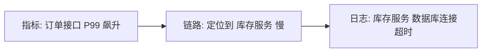

# 可观测性

> 服务拆成几十个之后，「出问题了看哪里」成了头号难题。可观测性要回答的不是「系统挂了吗」，而是「**为什么慢了、哪一环错了**」——它由日志、指标、链路三大支柱支撑。

## 1. 从监控到可观测

传统监控是**已知问题的告警**（CPU 高了报警），而可观测性是**用系统对外输出的数据，去推断任意未知问题的根因**。两者的差别：

- 监控回答「系统是否正常」——基于预设的、已知的指标。
- 可观测性回答「为什么不正常」——面向未知问题，能自由下钻。

在单体里，一个异常栈就能定位；在微服务里，一次请求穿过七八个服务，必须靠**贯穿全链路的关联标识**把它们串起来。

## 2. 三大支柱

| 支柱 | 数据形态 | 回答什么 | 常用工具 |
|------|----------|----------|----------|
| **日志 Logs** | 离散事件 | 发生了什么（细节、堆栈） | ELK、Loki |
| **指标 Metrics** | 聚合数值 | 总体趋势、是否健康 | Prometheus、Grafana |
| **链路 Traces** | 调用链条 | 请求经过了谁、慢在哪 | SkyWalking、Jaeger |

三者的关系：**指标发现异常 → 链路定位到出问题的服务/接口 → 日志找到具体原因**。缺一不可。



## 3. 日志（Logs）

**结构化日志**是可观测的前提——把日志写成可解析的 JSON/KV，而不是纯文本拼接：

```java
// 使用 SLF4J + 结构化输出（示意）
log.info("order created orderId={} userId={} amount={} cost={}ms",
        orderId, userId, amount, cost);
```

关键实践：

- **统一 traceId**：每个请求进入系统时生成（或透传）一个 traceId，写进每条日志。这样一次请求在所有服务的日志都能被串起来。
- **分级与采样**：DEBUG 不开生产；高频日志要采样，避免磁盘被打满。
- **集中采集**：应用只写 stdout/文件，由采集器（Filebeat/Fluent Bit）送到 ELK 或 Loki 统一检索。
- **不打印敏感信息**：手机号、身份证、密码要脱敏。

```text
# 理想的一条日志（带 traceId）
2026-03-15T10:23:41.512Z INFO [order-service] traceId=7f3a... spanId=b1c2...
  order created orderId=1024 userId=88 amount=199.00 cost=42ms
```

## 4. 指标（Metrics）

指标是**可聚合、低成本、适合告警**的数据。分两类常用模型：

- **RED**（面向请求/服务）：**R**ate（请求速率）、**E**rrors（错误率）、**D**uration（耗时分布）。
- **USE**（面向资源）：**U**tilization（利用率）、**S**aturation（饱和度）、**E**rrors（错误）。

Prometheus 是事实标准，应用通过 `/actuator/prometheus` 暴露指标，Prometheus 定时拉取，Grafana 展示：

```yaml
# Spring Boot 暴露 Prometheus 指标
management:
  endpoints:
    web:
      exposure:
        include: health,metrics,prometheus
  metrics:
    tags:
      application: order-service
```

关键指标最少要覆盖：

| 层级 | 关键指标 |
|------|----------|
| 应用 | QPS、错误率、响应时间（P50/P95/P99）、线程池/连接池使用率 |
| JVM | 堆内存、GC 次数与耗时、线程数 |
| 中间件 | Redis 命中率、MQ 堆积、DB 慢查询、连接数 |
| 主机 | CPU、内存、磁盘、网络 |

::: tip 关注分位数而非平均值
平均响应时间 100ms 可能掩盖「1% 的请求耗时 5 秒」。监控要看 **P95 / P99 尾延迟**，它才是用户体验的真实体现。
:::

## 5. 链路追踪（Traces）

一次分布式请求会经过多个服务，链路追踪把它表示为一棵 **Span 树**：

- **Trace**：一次完整请求；
- **Span**：一个工作单元（一次 RPC、一次 DB 查询），带 `traceId`、`spanId`、`parentSpanId`、耗时。

```java
// 基于 OpenTelemetry 的手动埋点（示意），框架通常自动注入上下文
Span span = tracer.spanBuilder("queryInventory").startSpan();
try (Scope scope = span.makeCurrent()) {
    span.setAttribute("sku", sku);
    return inventoryClient.query(sku);
} finally {
    span.end();
}
```

主流的跨服务传播靠 W3C Trace Context 标准头（`traceparent`），保证不同组件互认。常用组件：

- **SkyWalking**：国产、APM 一体化，Java 探针零侵入。
- **Jaeger / Zipkin**：经典开源链路系统。
- **OpenTelemetry**：**厂商中立的标准**，统一了指标/日志/链路的采集 API 与协议，是当前演进方向。

## 6. 三者的关联

真正的价值在于**关联**：从一条指标异常，跳到对应时间段的链路，再跳到某个 Span 的日志。要做到这一点，必须让三者共享标识：

- 日志里带 `traceId`；
- 链路 Span 上打业务标签（如 `orderId`）；
- 指标带统一的 `application`/`service` 标签。

发现问题时的标准动作：

```text
指标告警（错误率>1%）→ 看是哪个服务/接口 → 链路里找最慢/报错的 Span
→ 用 traceId 检索该请求的日志 → 定位根因（慢 SQL / 依赖超时 / 异常）
```

## 7. 告警原则

告警的价值在于**可行动**。一条好告警必须能回答：

1. **谁处理**（明确负责人/值班）；
2. **怎么处理**（是否有对应的排查手册 Runbook）；
3. **影响面多大**（是否影响用户、影响多少）。

反面清单：

- **噪音告警**：频繁误报，最终被无视——应基于**症状**（用户可感知的错误率/延迟）而非**原因**（偶尔波动的 CPU）来告警。
- **无分级**：所有告警一样紧急，导致真正的 P0 被淹没。
- **无收敛**：一个故障触发几百条告警，需要做告警聚合与去重。

## 8. 落地优先级

从零搭建时不必一次上齐，按投入产出比排序：

1. **先统一日志**：结构化日志 + `traceId` 透传，是最便宜、收益最直接的一步。
2. **再加指标与看板**：暴露 Prometheus 指标，建核心看板（QPS、错误率、P99），为告警打基础。
3. **再接链路追踪**：调用链变复杂、定位变难时才引入，优先选支持零侵入探针的方案。
4. **最后做告警治理**：基于症状告警、分级、聚合、配 Runbook，避免告警疲劳。

## 9. 小结

- 可观测性 = **日志 + 指标 + 链路**，用于回答「为什么」，而非只回答「是否正常」。
- 日志要**结构化 + 带 traceId**；指标要看 **RED/USE 与分位数**；链路用 **traceId/spanId 串起调用树**。
- 三者必须**可关联**，才能从告警一路下钻到根因。
- **OpenTelemetry** 正在统一采集标准，是落地时的优先选项。
- 告警要**可行动**：有负责人、有手册、有影响面判断，减少噪音。
