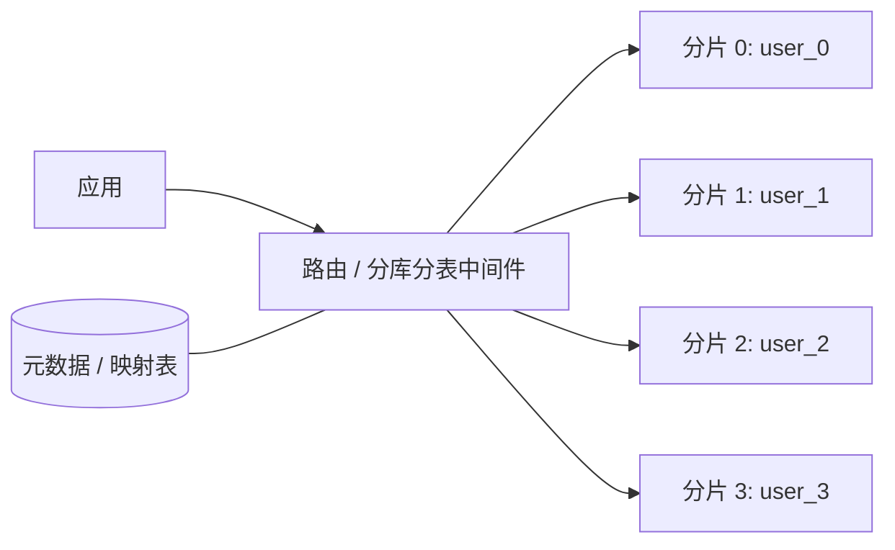

# MySQL - 分表分库 

> 当单表数据量达到千万级、单库连接与写入逼近上限时，「加索引」和「升级硬件」终会到顶。分库分表通过**拆分**把数据与压力分散到多个节点，代价是引入路由、全局 ID、跨分片查询与分布式事务等一整套复杂度。本文梳理拆分的两条主线（垂直 / 水平）、分片策略与随之而来的问题及解法。

## 1. 为什么要拆分

单库单表在数据量增长后会依次撞上几堵墙：

- **单表体积**：B+ 树层数加深，索引无法全部驻留内存，查询 I/O 上升；DDL（加索引、改字段）耗时且锁表风险高。
- **写入与连接**：单机磁盘 IOPS、CPU、连接数都有上限，单库写入无法线性扩展。
- **备份与恢复**：几十上百 GB 的表备份慢、恢复慢，故障影响面大。

拆分的本质是**分而治之**：把一个逻辑上的大表 / 大库，物理上切成多份，让每份都能落在不同节点上。

## 2. 垂直拆分

**垂直分库**：按业务边界把不同业务的表拆到不同数据库，例如把电商库拆成商品库、订单库、用户库。它对应微服务的**服务自治**，让每个服务只访问自己的库，天然降低耦合并支持独立扩容。

**垂直分表**：把一张「宽表」按列拆成多张，通常按**访问频次**或**列长度**切分：

- 高频、短小的列（如 `id`、`name`、`status`）放主表；
- 低频、大字段（如 `detail`、`content`、`avatar`）放扩展表，用主键关联。

垂直拆分的优点是业务边界清晰、单表变小、热点分离；缺点是**跨库 JOIN 消失**，原本一次查询要拆成多次，事务变成跨库。

## 3. 水平拆分（Sharding）

水平拆分是把**同一张表的行**按规则分散到多个结构相同的表中（可能在不同库 / 实例），每一份叫一个「分片（shard）」。每个分片只保存全量数据的一部分，合起来才是完整数据。

判定何时该分片，常见信号：

- 单表行数超过千万级且持续增长，索引优化已无收益；
- 单库写入 QPS / TPS 接近上限；
- 单表容量超过单机舒适区（如 100GB 以上）。

规则示例：`user_0 ~ user_3` 四张分片表，由 `user_id` 取模决定落到哪张（`user_id % 4`）。分片数量要在**初期留足余量**，因为后续扩分片很麻烦（见第 8 节）。典型的访问链路是「应用 → 路由/中间件 → 各分片」，路由依据元数据（映射表或算法）决定去向：

## 4. 分片键与路由策略

**分片键（shard key）**是决定数据落在哪个分片的字段，选得好坏直接决定拆分成败。常见路由算法：

| 策略 | 规则 | 优点 | 缺点 |
| --- | --- | --- | --- |
| 哈希取模 | `hash(key) % N` | 分布均匀，实现简单 | 扩容需重新分布，几乎要迁移全量数据 |
| 范围分片 | 按 ID 段或时间范围 | 范围查询友好、易追加新分片 | 易热点（按时间递增时新分片写压力集中） |
| 一致性哈希 | 环形哈希 + 虚拟节点 | 扩容只迁移少量数据 | 实现复杂、分布需调优 |
| 映射表 | 单独的表记录 key→分片 | 灵活、可随时调整 | 映射表本身成为瓶颈和单点 |

选分片键的原则：**尽量让常用查询都带上分片键**，使查询能精确定位到单个分片（避免全分片扫描）；同时保证分布均匀、避免热点。

## 5. 全局唯一 ID

分片后各分片不能再依赖本地自增主键（会冲突），需要全局唯一 ID。方案对比：

| 方案 | 说明 | 特点 |
| --- | --- | --- |
| UUID | 直接生成 | 简单，但无序、占空间，作主键会导致页分裂 |
| 数据库自增步长 | 各分片设不同起始值与步长 | 依赖数据库，扩展性差 |
| 号段模式 | 一次从 DB 取一段 ID 缓存在内存 | 性能好、趋势递增；依赖 DB、有跳号 |
| Snowflake 类 | 时间戳 + 机器位 + 序列号 | 趋势递增、高性能；依赖时钟，需防回拨 |
| Redis INCR | 集中式自增 | 简单高性能；Redis 成为单点 |

工程上常用「号段模式」或「Snowflake 类」，核心诉求是**全局唯一 + 趋势递增 + 高性能**：趋势递增能让主键索引写入更友好，避免随机主键造成的页分裂。

## 6. 跨分片查询

拆分后，原本一个 SQL 能做的事往往要改写：

- **跨分片 JOIN**：不能依赖数据库 JOIN。常见解法是「字段冗余」（把常查的列冗余到本分片）、「广播表」（小维度表在每个分片各存一份），或把复杂分析交给搜索引擎 / 数仓。
- **跨分片分页**：`LIMIT offset, size` 不能简单下发。做法通常是各分片各取前 `offset + size` 行，再在内存中归并排序取目标区间；深分页代价极高，常改用「按有序键游标翻页」（`WHERE id > last_id ORDER BY id LIMIT size`）。
- **跨分片聚合**：`COUNT`、`SUM` 等需要各分片分别计算，再由中间层合并。

## 7. 分布式事务

跨分片写操作不再是一个本地事务，需要在一致性上做取舍：

- **2PC / XA**：两阶段提交，强一致但同步阻塞、性能差、协调者单点风险高。
- **TCC**：Try-Confirm-Cancel，业务层面预留资源再确认 / 取消，侵入性强但可控。
- **Saga**：把长事务拆成一串本地事务，失败时按反向补偿，最终一致，适合长流程。
- **本地消息表 / 事务消息**：把「业务写 + 消息发出」放进同一本地事务，再异步驱动下游，达到**最终一致**。

绝大多数互联网业务选择**最终一致**而非强一致，因为强一致在可用性与性能上的代价太高。跨分片读一致性、接口幂等与补偿设计是重点。

## 8. 扩容与数据迁移

哈希取模扩容时，路由从 `% N` 变成 `% 2N`，几乎所有数据都要重新分布，代价极大。常见缓解手段：

- **成倍扩容 + 双写**：新老分片同时写，历史数据后台迁移，校验一致后切读。
- **一致性哈希 / 定制路由**：让扩容只影响相邻分片。
- **中间件代管**：由分库分表中间件（如 ShardingSphere、MyCat 等）统一维护路由与迁移逻辑，应用尽量少感知。

## 9. 实践要点与常见坑

1. **能不分就不分**：优先靠索引、读写分离、归档、分区表、缓存解决；分片是最后手段。
2. **分片键选错等于白拆**：没有分片键的查询会广播到所有分片。
3. **初期预留分片数**：宁可多分几片（每片小），也不要频繁扩容。
4. **避免跨分片事务**：用最终一致 + 补偿，保证接口幂等。
5. **全局 ID 要趋势递增**：无序主键会让 B+ 树页分裂严重、写入放大。
6. **运维复杂度**：分片后备份、监控、DDL 都要按分片批量执行，工具化很重要。

## 10. 小结

- 垂直拆分沿「业务 / 列」切，水平拆分沿「行」切，两者常结合使用。
- 分片键 + 路由算法决定分布与查询效率：哈希取模均匀但难扩容，范围分片易热点，一致性哈希迁移少。
- 全局 ID 要有序（Snowflake / 号段），以避免随机主键带来的页分裂。
- 跨分片 JOIN、分页、聚合与事务都要在中间层或应用层重写，通常选择最终一致。
- 分片既是能力也是负债：先穷尽单机优化，再考虑拆分。

## 延伸阅读

- [MySQL 知识体系](./sql-mysql-overview.md)
- [主从复制与读写分离](./sql-mysql-slave.md)
- [MySQL 性能优化](./sql-mysql-performance.md)
- [MySQL 存储引擎](./sql-mysql-engine.md)
