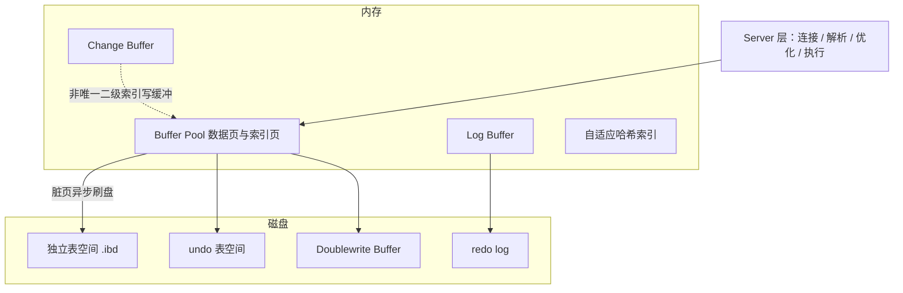

# MySQL - 存储引擎 

> 存储引擎决定最基础的事实：数据怎么存、怎么取、事务与锁如何工作。MySQL 采用「插件式」引擎架构，同一实例里不同表可用不同引擎，但现代业务表绝大多数都用 InnoDB。理解 InnoDB 与 MyISAM 的差异、聚簇索引、行格式与 Buffer Pool，是看懂 MySQL 性能与一致性的前提。

## 1. 插件式引擎架构

MySQL 的 Server 层（连接、解析、优化、执行）与存储引擎层解耦，引擎通过统一接口负责数据的实际读写。`CREATE TABLE ... ENGINE=InnoDB` 就为这张表选定了引擎。常用引擎及定位：

| 引擎 | 事务 | 锁粒度 | 主要用途 |
| --- | --- | --- | --- |
| **InnoDB** | 支持 | 行级（默认） | 默认引擎，通用 OLTP，要求事务/外键/崩溃恢复 |
| MyISAM | 不支持 | 表级 | 只读或读多写少、对数据完整性要求低的历史场景 |
| Memory | 不支持 | 表级 | 临时表、缓存型数据，重启即丢失 |
| Archive | 不支持 | 行级（仅插入） | 日志归档，压缩率高、极少更新 |
| CSV | 不支持 | 表级 | 以 CSV 文件存储，便于与外部工具交换 |

## 2. InnoDB 的内存与磁盘结构

InnoDB 的性能核心是「用内存缓存磁盘页」。主要部件：

- **Buffer Pool（缓冲池）**：缓存数据页与索引页，是 InnoDB 最关键的组件。读写先在内存进行，脏页由后台线程异步刷回磁盘。它使用改良 LRU：新页插入链表中部（midpoint），将链表分成 young（热）与 old（冷）两段，避免全表扫描把热数据一次性挤出。
- **Change Buffer（写缓冲）**：对「非唯一二级索引」的写，若目标页不在 Buffer Pool，先记入 Change Buffer 而不立即读页，等页被读入时再合并，减少随机 I/O。
- **Log Buffer → redo log**：修改先写日志（WAL），`innodb_flush_log_at_trx_commit` 控制提交时的刷盘策略。
- **undo 表空间**：存放 undo log，支撑回滚与 MVCC。
- **Doublewrite Buffer（双写缓冲）**：防止「页写到一半断电」造成页损坏——先顺序写一份副本，再写原位。
- **自适应哈希索引（Adaptive Hash Index）**：对频繁等值访问的索引页自动建立哈希索引，加速点查，由 InnoDB 自动维护。

一个常被忽略的事实：**InnoDB 默认把表数据放在独立表空间文件 `.ibd`**（`innodb_file_per_table=ON`），系统表空间 `ibdata1` 主要存数据字典、undo、双写缓冲等。整体结构可归纳为：



## 3. 聚簇索引：主键即数据

InnoDB 的表按主键组织成一棵 B+ 树，**叶子节点直接存放整行数据**，这棵树就是**聚簇索引（clustered index）**。由此衍生出几条重要结论：

- **必须有主键**：没有显式主键时，InnoDB 会选一个唯一非空索引；都没有则内部生成隐藏主键。因此最好显式指定。
- **主键要短且有序**：主键值会被每个二级索引引用，主键越长二级索引越大；随机主键（如 UUID）导致插入位置随机，容易引起**页分裂**与空间碎片。因此推荐**自增整型主键**。
- **二级索引要回表**：二级索引叶子只存「索引列 + 主键值」，用它查到主键后再去聚簇索引取整行，这一步叫**回表**。若查询所需列都在索引里，就不必回表，即**覆盖索引**。

```sql
-- 主键索引即数据本身；idx_name 是二级索引
SELECT id, name FROM user WHERE name = 'tom';
-- name -> 定位主键 id -> 回表取整行（此处 id 已在索引中，可覆盖）
```

主键与索引的更多细节见 [MySQL 索引与 B+ 树](./sql-mysql-b-tree.md)。

## 4. 行格式（ROW_FORMAT）

InnoDB 以「行」为单位组织页内数据，常见行格式：

| 行格式 | 特点 |
| --- | --- |
| REDUNDANT | 老格式，空间利用率低，基本已不用 |
| COMPACT | 紧凑格式，变长字段前缀可能仍存于行内 |
| **DYNAMIC**（8.0 默认） | 大字段（TEXT/BLOB/长 VARCHAR）整行溢出到溢出页，行内只留 20 字节指针 |
| COMPRESSED | 在 DYNAMIC 基础上对页做压缩，节省空间、增加 CPU 开销 |

DYNAMIC 相比 COMPACT 的关键改进是**溢出策略**：COMPACT 会把变长字段前缀（约 768 字节）留在行内，DYNAMIC 则尽量整值外置，使主记录更紧凑、能塞进更多行。可用 `SHOW TABLE STATUS` 或 `information_schema` 查看实际行格式与平均行长。

## 5. MyISAM 的取舍

MyISAM 把表分成多个文件：数据 `.MYD`、索引 `.MYI`、结构（8.0 前为 `.frm`，8.0 起进数据字典）。它的特点：

- **不支持事务与外键**，一次写入无法回滚。
- **表级锁**：读加共享锁、写加排它锁，读写基本互斥；它支持在表已被读时**并发插入（CONCURRENT INSERT）**作为折中。
- **依赖操作系统缓存**：索引页缓存交给 OS，不如 InnoDB 的 Buffer Pool 可控。
- **崩溃易损坏**：需要用 `REPAIR TABLE` 或 `myisamchk` 修复，且可能丢数据；`DELAY_KEY_WRITE` 进一步延迟索引写盘，能提升写入，但崩溃后索引损坏概率更高。

## 6. 对比与选型

| 维度 | InnoDB | MyISAM |
| --- | --- | --- |
| 事务 | 支持（commit/rollback） | 不支持 |
| 锁粒度 | 行级 + 间隙锁 | 表级 |
| 外键 | 支持 | 不支持 |
| 崩溃恢复 | 基于 redo/undo 自动恢复 | 手工修复，易丢数据 |
| 在线热备份 | 支持 | 不支持（需停写） |
| 索引组织 | 聚簇索引 + 二级索引 | 非聚簇，索引与数据分离 |

结论很直接：**除非有非常明确的理由（如纯只读归档、极简单的计数场景），否则一律用 InnoDB。** MyISAM 在 MySQL 5.5 之后就不再是默认引擎，长期维护成本高。

## 7. 实践要点

1. 主键用自增整型，避免随机 UUID 引发的页分裂与索引膨胀。
2. 重点调优 `innodb_buffer_pool_size`：InnoDB 最该调的参数，专用库常设为物理内存的 50%~75%。
3. 大字段（长文本、图片）单独拆表或改用对象存储，减少主记录溢出与 I/O 放大。
4. 非唯一二级索引可受益于 Change Buffer，唯一索引不能（需读页判重）。
5. 用 `SHOW ENGINE INNODB STATUS` 观察 Buffer Pool 命中率、锁等待、历史链表长度等健康指标。

## 8. 常见误区

- **「改了引擎数据会自动转换」**：`ALTER TABLE ... ENGINE=MyISAM` 会**重建整表**并搬运数据，大表上极其耗时且可能锁表，不是元数据级的即时切换。
- **「InnoDB 一定有隐藏主键可用」**：内部隐藏主键不可见、不可查询，且无法保证顺序，因此业务表应显式指定主键，别依赖它。
- **「MyISAM 读更快所以只读表该用它」**：MyISAM 的读并没有普遍优势，且缺少崩溃恢复与热备份；只读场景用 InnoDB 同样可行。
- **「Buffer Pool 越大越好」**：过大可能挤压操作系统与其他进程内存，专用库上通常留出系统与连接开销后再分配。
- **「事务隔离靠引擎无关」**：事务、行锁、MVCC 都是 InnoDB 的能力，MyISAM 表根本不参与事务，混用引擎会让事务范围不可控。

## 9. 小结

- MySQL 是插件式引擎；InnoDB 是默认与通用选择，MyISAM 只在特定场景残留。
- Buffer Pool 是 InnoDB 的性能核心；Change Buffer 优化非唯一二级索引写、Doublewrite 防页损坏。
- InnoDB 的表是聚簇索引：主键即数据，二级索引需回表，主键应短且有序。
- 行格式（默认 DYNAMIC）决定大字段如何溢出，影响单页能装多少行。
- 选型结论：默认 InnoDB；MyISAM 无事务、表锁、崩溃易损坏。

## 延伸阅读

- [MySQL 知识体系](./sql-mysql-overview.md)
- [MySQL 索引与 B+ 树](./sql-mysql-b-tree.md)
- [MySQL MVCC 与事务](./sql-mysql-mvcc.md)
- [MySQL 一条 SQL 的执行过程](./sql-mysql-execute.md)
