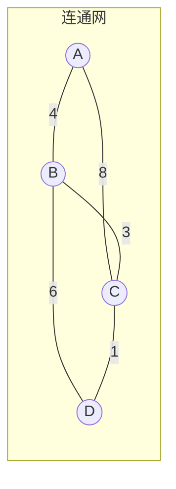

# 图 - 最小生成树(Prim & Kruskal) 

> 最小生成树（Minimum Spanning Tree, MST）解决的是「用最小的总代价把若干个点连成一张连通网」的问题。Kruskal 算法从**最小权重的边**着手，把森林里的树逐渐合并；Prim 算法从**顶点**出发，在一个根节点的基础上把树逐步长大。

## 1. 名词约定

在无向图 $G=(V,E)$ 中，边带有权重（代表距离、造价等代价）：

- **连通图**：无向图中任意两个顶点之间都有路径相通；
- **强连通图**：有向图中任意两个顶点之间都有路径相通（本文只讨论无向图）；
- **连通网**：连通图的每条边都对应一个权重，权重代表连接两点的代价；
- **生成树**：连通图的一个连通子图，含有全部 $n$ 个顶点、但只有恰好 $n-1$ 条边。$n$ 个顶点的生成树有且仅有 $n-1$ 条边，再添一条边就必然成环；
- **最小生成树**：所有生成树中，**边权和最小**的那一棵。



上图中连通网各边权重依次为 A-B=4、A-C=8、B-C=3、B-D=6、C-D=1。按权重从小到大加入不构成环的边，即可得到 $n-1=3$ 条边的最小生成树。

## 2. 两大算法的共同本质：两种切割定理

Prim 和 Kruskal 都基于同一类贪心思想，其正确性由**切割定理**保证：

- **割性质（cut property）**：对图的任意一种「把顶点分成两部分的切割」，**横跨该切割的最小权重边**一定属于某棵最小生成树。
- **环性质（cycle property）**：对图中任意一个环，**环上权重最大的边**一定不属于任何最小生成树。

**割性质的证明思路**：设有切割 $(S, V-S)$，$e$ 是横跨它的最小边。若某棵最小生成树 $T$ 不含 $e$，则把 $e$ 加入 $T$ 会形成唯一的环；该环上必有另一条横跨切割的边 $e'$，由 $e$ 的最小性知 $w(e) \le w(e')$。用 $e$ 替换 $e'$ 后仍是一棵生成树、且总权不增，故存在一棵含 $e$ 的最小生成树。**环性质**同理可由割性质导出。

Prim 每步都在维护「已加入集合 $u$」与「未加入集合 $v$」之间这条虚拟切割，选择跨越切割的最小边——正是割性质；Kruskal 则按权重从小到大加边，遇到构成环的边就跳过——正是环性质（环上当前这条边是已选边里最大的）。两条路径不同，贪心结论一致。

::: tip 唯一性
当所有边的权重互不相同时，最小生成树唯一；存在等权边时，最小生成树可能有多棵，但它们的总权值相同。
:::

## 3. Kruskal 算法（加边法）

思路：把所有边按权重升序排列，依次尝试加入，**只要不构成环就留下**，直到选够 $n-1$ 条边。

1. 把图中所有边按权重从小到大排序；
2. 把 $n$ 个顶点各自看作一棵独立的树，构成 $n$ 棵树的森林；
3. 按权重顺序取出边 $(u_i, v_i)$：若两个端点**属于不同的树**，则加入该边，并合并这两棵树；
4. 重复第 3 步，直到所有顶点连成一棵树，或已选够 $n-1$ 条边。

**用 §1 的图走一遍**（边排序后：C-D=1、B-C=3、A-B=4、B-D=6、A-C=8）：

| 步骤 | 考察的边 | 端点是否同树 | 动作 |
| --- | --- | --- | --- |
| 1 | C-D(1) | 否 | 加入，{C,D} 合并 |
| 2 | B-C(3) | 否 | 加入，{B,C,D} 合并 |
| 3 | A-B(4) | 否 | 加入，{A,B,C,D} 合并，已 3 条边，结束 |

结果总权 $1+3+4=8$。边 B-D=6、A-C=8 因会成环被跳过。判断「两端点是否已属于同一棵树」正是**并查集（Disjoint Set Union, DSU）**的职责。

```java
// Kruskal 骨架：边按权升序后，用并查集判环
class DSU {
    int[] parent, rank;
    DSU(int n) {
        parent = new int[n];
        rank = new int[n];
        for (int i = 0; i < n; i++) parent[i] = i;
    }
    int find(int x) {                     // 路径压缩
        if (parent[x] != x) parent[x] = find(parent[x]);
        return parent[x];
    }
    boolean union(int a, int b) {         // 按秩合并
        int ra = find(a), rb = find(b);
        if (ra == rb) return false;       // 已连通，加入这条边会成环
        if (rank[ra] < rank[rb]) { int t = ra; ra = rb; rb = t; }
        parent[rb] = ra;
        if (rank[ra] == rank[rb]) rank[ra]++;
        return true;
    }
}

int kruskal(int n, int[][] edges) {       // edges[i] = {u, v, w}
    java.util.Arrays.sort(edges, (x, y) -> x[2] - y[2]);
    DSU dsu = new DSU(n);
    int total = 0, count = 0;
    for (int[] e : edges) {
        if (dsu.union(e[0], e[1])) {
            total += e[2];
            if (++count == n - 1) break;  // 已够 n-1 条边
        }
    }
    return count == n - 1 ? total : -1;   // -1 表示图不连通
}
```

**并查集是 Kruskal 的效率命门**。朴素实现下 `find` 最坏 $O(n)$（链表状挂法可能退化）；加上两种优化后近似常数：

- **路径压缩**：`find` 时把沿途节点直接挂到根上，后续查询近乎一步到位；
- **按秩 / 按大小合并**：总是把浅树挂到深树下，避免树被拉长。

二者结合后，$m$ 次操作的总代价为 $O(m\,\alpha(n))$，其中 $\alpha$ 是增长极慢的反阿克曼函数（在可想象的 $n$ 范围内都不超过 5），实务中可视作接近 $O(1)$。

**复杂度**：对边排序 $O(E\log E)$ 是主导项，并查集部分 $O(E\,\alpha(V))$，整体 $O(E\log E)$，空间 $O(V+E)$。因为复杂度由边数决定，**Kruskal 适合稀疏图**。

## 4. Prim 算法（加点法）

思路：从任一顶点 $s$ 开始，维护「已在树中的集合 $u$」与「树外的集合 $v$」，每步选一条跨越两个集合、权重最小的边，把对应顶点并入 $u$。

1. 初始令 $u=\{s\}$，$v=V-u$；
2. 在 $u$ 与 $v$ 之间所有边中，选出代价最小的一条 $(u_0, v_0)$，把 $v_0$ 并入 $u$；
3. 重复第 2 步，直到生成树有 $n-1$ 条边或 $n$ 个顶点。

由于集合 $u$ 不断长大，每个树外顶点到树的「最近距离」需要动态更新，通常用距离数组 `lowcost[]` 维护：

| 数组 | 含义 |
| --- | --- |
| `inTree[v]` | $v$ 是否已进树 |
| `lowcost[v]` | $v$ 到当前树的最小边权 |
| `parent[v]` | 该最小边在树内的端（便于重建生成树） |

**朴素 Prim**（邻接矩阵 + 每轮线性扫描找最小 `lowcost`）复杂度 $O(V^2)$，与边数无关，**适合稠密图**。用**最小堆（优先队列）**优化后，每次取最小边降到 $O(\log V)$，配合邻接表总复杂度 $O(E\log V)$，此时同样适合稀疏图。

```java
// Prim 骨架：最小堆版本，graph[u] 存 {v, w} 列表
int prim(int n, List<int[]>[] graph) {
    boolean[] inTree = new boolean[n];
    PriorityQueue<int[]> pq = new PriorityQueue<>((a, b) -> a[0] - b[0]); // {w, v}
    pq.offer(new int[]{0, 0});            // 从顶点 0 出发，初始权重 0
    int total = 0, count = 0;
    while (!pq.isEmpty() && count < n) {
        int[] cur = pq.poll();
        int w = cur[0], v = cur[1];
        if (inTree[v]) continue;          // 惰性删除：跳过已入树的陈旧堆项
        inTree[v] = true;
        total += w;
        count++;
        for (int[] e : graph[v]) {        // 用新入树顶点松弛邻居
            if (!inTree[e[0]]) pq.offer(new int[]{e[1], e[0]});
        }
    }
    return count == n ? total : -1;
}
```

::: warning Prim 与 Dijkstra 别混淆
两者都从起点向外扩张、都用「距离数组 + 优先队列」的骨架，但含义不同：**Prim** 维护的是「树外顶点到整棵已建树的最小边权」，每个顶点只入树一次，求的是把图连通的最小代价；**Dijkstra** 维护的是「到源点的最短**路径长度**」（路径可含多条边、需做累加松弛），求的是单源最短路径。把 Prim 的松弛写成累加、或把 Dijkstra 的松弛写成取单边权，都会得到错误结果。详见 [图 - 最短路径(Dijkstra & Floyd)](./alg-basic-graph-min-distance.md)。
:::

## 5. Prim 与 Kruskal 对比

| 维度 | Kruskal | Prim |
| --- | --- | --- |
| 策略 | 加边法，按权升序选边 | 加点法，从起点向外扩张 |
| 核心结构 | 并查集（判环） | 距离数组 / 最小堆 |
| 时间复杂度 | $O(E\log E)$ | 朴素 $O(V^2)$；堆优化 $O(E\log V)$ |
| 适合图型 | 稀疏图 | 朴素版适合稠密图；堆优化后适合稀疏图 |
| 中间状态 | 多棵树组成森林 | 始终只有一棵不断长大的树 |
| 不连通图 | 循环结束后边数小于 $n-1$ | 堆空或入树点数小于 $n$ |

工程选择上可记一条经验：**边少（稀疏）用 Kruskal，点少边多（稠密）用朴素 Prim**；若稀疏图又想用 Prim，就上堆优化。两者都能正确处理含等权边、甚至含负权边的无向图——与最短路径的 Dijkstra 不同，**MST 不要求边权非负**，因为贪心选择与权重符号无关。

## 6. 典型应用

- **网络布线 / 通信网建设**：在若干城市间铺设线路，使总造价最低；
- **电路板走线、管道铺设**：以最短总长度连通全部节点；
- **聚类与图像分割**：先把点集建成 MST，再「剪掉」权重最大的若干条边，即得到自然的簇划分（单链聚类思想）；
- **近似算法基础**：旅行商问题的 2-近似解、MST 常用于构造网络骨干。

## 7. 边界与常见坑

- **图必须连通**：若图不连通，不存在生成树；两种算法循环结束后选中边数会小于 $n-1$，实现里应返回失败标记而不是报出一个错误的总权。
- **自环与重边**：Kruskal 中自环的两个端点同属一棵树，会被自动跳过；重边则按权重择优选其一。
- **边权相等**：不影响正确性，但可能得到结构不同的最小生成树（总权相同）。
- **Prim 起点可任取**：图连通时，起点不影响最终生成树的总权。
- **按图型选算法**：不要对稠密图用「给所有边排序」的 Kruskal，也不要用邻接矩阵的朴素 Prim 去跑稀疏图。

## 8. 小结

- 最小生成树用 $n-1$ 条边连通全部 $n$ 个顶点，并使总权最小。
- Kruskal（加边法）按权排序 + 并查集判环，复杂度 $O(E\log E)$，适合稀疏图。
- Prim（加点法）从起点扩张，朴素 $O(V^2)$ 适合稠密图，堆优化后 $O(E\log V)$。
- 并查集的路径压缩 + 按秩合并让判环近乎 $O(1)$，是 Kruskal 的效率关键。
- 正确性由割性质与环性质支撑；边权两两不同时最小生成树唯一；MST 允许负权边。

相关阅读：[图 - 基础与存储](./alg-basic-graph.md)、[图 - 最短路径(Dijkstra & Floyd)](./alg-basic-graph-min-distance.md)、[图 - 拓扑排序](./alg-basic-graph-topo-sort.md)、[图 - 关键路径(AOE)](./alg-basic-graph-aoe.md)。
