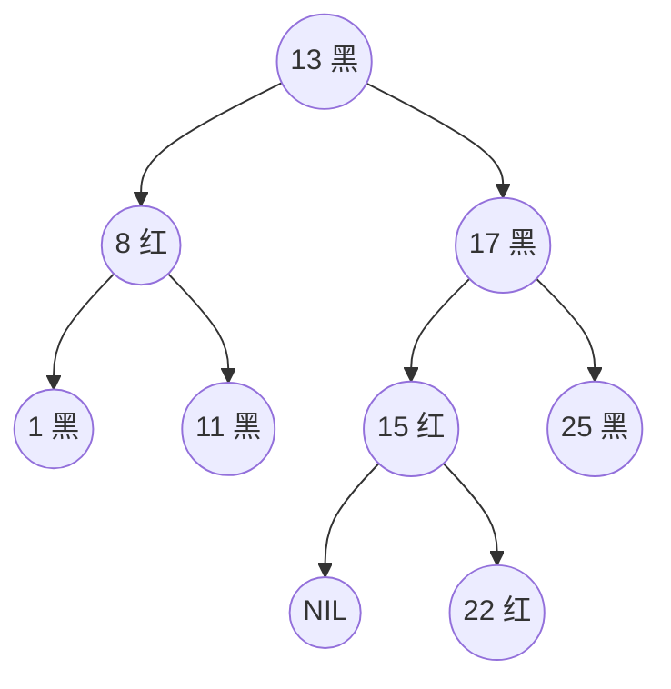
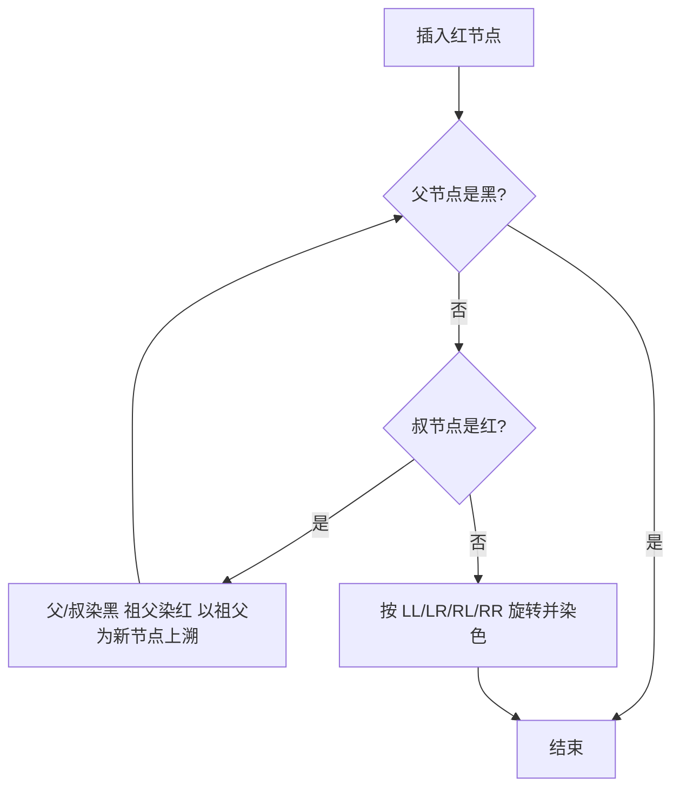

# 树 - 红黑树(R-B Tree) 

> 红黑树（Red-Black Tree, RBT）是一种自平衡二叉查找树，它在每个节点上增加一位颜色信息（红或黑），用一组颜色约束把树高牢牢钉在 $O(\log n)$。它是工程上出场率最高的平衡树：JDK 的 `TreeMap`、Java 8 起 `HashMap` 的树化桶、C++ STL 的 `map`/`set`，以及 Linux 内核、Nginx 都用它来维护有序数据。

## 1. 为什么需要红黑树

平衡二叉查找树（AVL 树）已经把查找、插入、删除都压到 $O(\log n)$，代价是**高度差约束很严**——任意节点左右子树高度差不超过 1。这条约束让 AVL 的查找路径极短，但也意味着插入或删除一个节点后，为恢复平衡可能需要沿着路径回溯、反复旋转，**写操作成本偏高**。

红黑树换了个思路：不再要求「几乎绝对平衡」，只要求「**近似平衡**」——最长路径不超过最短路径的两倍。约束放松后，每次插入最多 2 次旋转、每次删除最多 3 次旋转就能恢复，代价是树可能比 AVL 稍高一点，查找路径平均多几次比较。对现代 CPU 来说这点查找差异几乎可忽略，而写操作省下来的旋转却是实打实的，于是**读写混合的通用有序容器普遍选红黑树**。

::: tip 一句话
AVL 追求「查得快」，红黑树追求「改得便宜」；两者都是 $O(\log n)$，红黑树在频繁增删场景更划算。
:::

## 2. 五条性质

一棵红黑树首先是一棵二叉查找树，在此之上叠加以下五条性质（第三条常被省略但很关键）：

1. 每个节点要么是红色，要么是黑色；
2. 根节点是黑色；
3. 每个叶子节点（此处指不存数据的**哨兵节点 NIL / 外部节点**）是黑色；
4. 如果一个节点是红色，那么它的两个孩子都是黑色——即**不存在两个连续的红节点**；
5. 对任一节点，从它出发到其所有后代叶子节点的每一条简单路径上，**黑色节点数目相同**。

为了描述第 5 条，引入**黑高（black-height, bh）**：从某节点（不含该节点本身）到叶子的任意路径上的黑节点个数。性质 5 等价于「所有节点的左右子树黑高相等」。

上图中，任意节点到其叶子的每条路径黑节点数都相同，且没有连续的红节点——这就是一棵合法的红黑树。

## 3. 近似平衡是怎么保证的

红黑树不需要真正统计高度，颜色约束本身就限定了高度范围。设以某节点为根的子树黑高为 $bh$，可以证明：

- **内部节点数至少为 $2^{bh} - 1$**（黑高为 $bh$ 时，每条路径至少含 $bh$ 个黑节点，最少的情形是「全黑路径」构成一棵满二叉树）；
- 因此若树有 $n$ 个内部节点，则 $bh \le \log_2(n+1)$；
- 又因性质 4，任意根到叶路径上红节点不超过黑节点个数（红必然被黑隔开），所以**最长路径长度 ≤ 2 × 最短路径长度**；
- 综合得树高 $h \le 2\log_2(n+1)$。

一句话：**最长路径最多是最短路径的两倍**，这就是红黑树「近似平衡」的数学依据，也是它查找、插入、删除全部 $O(\log n)$ 的出处。

## 4. 从 2-3-4 树理解红黑树

一个帮助直觉的视角：**红黑树是 2-3-4 树（四阶 B 树）的二叉表示**。

- 2-3-4 树的每个节点可存 1～3 个键、有 2～4 个孩子；
- 把 2-3-4 树翻译成二叉树时，**同一节点内的多个键用红链接串起来**：黑节点对应 2-3-4 树的「独立节点」，红节点表示「它与父节点在 2-3-4 树里属于同一个大节点」；
- 于是「红节点的父节点必为黑」「从任一点到叶子的黑节点数相同」这些性质，正好对应 2-3-4 树「同一节点内部黑高不变、树完全平衡」。

理解这层对应后，插入时「叔红只染色、叔黑要旋转」就从「背规则」变成了「在 2-3-4 树中把溢出的大节点拆开」的自然结果。

## 5. 插入调整

新节点一律先着**红色**（若着黑会立刻破坏性质 5）。着红后只可能违反性质 4（出现连续红节点），于是沿父指针向上修复：

| 情形 | 判断 | 处理 |
| --- | --- | --- |
| 父节点为黑 | 无需调整 | 直接结束 |
| 父红、叔节点红 | 只重着色 | 父与叔染黑、祖父染红，把祖父当作「新插入节点」继续向上修 |
| 父红、叔黑或 NIL | 需旋转 | 按 LL / LR / RL / RR 四种形态做单旋或双旋，再重着色 |

旋转形态与 AVL 树相同（LL 右单旋、RR 左单旋、LR 先左后右、RL 先右后左），区别在于：**AVL 靠旋转恢复高度约束，红黑树靠旋转 + 染色恢复颜色约束**。以「父为红、叔为黑、新节点是父的右孩子、父又是祖父的左孩子」（LR 型）为例：先对父节点左旋，把形态变成 LL；再对祖父右旋并交换父/祖父的颜色。

插入调整的**旋转次数不超过 2 次**，向上回溯的重着色最多 $O(\log n)$ 次，因此插入整体仍是 $O(\log n)$。

## 6. 删除调整

删除比插入复杂，因为它可能破坏性质 5（黑高）。流程分两步：

1. **先按二叉查找树规则删除**：若被删节点有两个孩子，用其中序后继替换，真正被摘除的是后继节点；记录被移走的颜色。
2. **判断是否失衡**：若真正被移走的是红节点，性质不受影响，直接结束；若移走的是**黑节点**，该路径黑高减一，需要修复。

删除修复围绕「待修复节点 `x` 的兄弟节点 `w`」展开，本质是「先在兄弟子树中『借』一个红节点补上丢失的黑」，若借不到就把兄弟子树整体染红、把矛盾上递给父节点。四种主情形分别是：

- `w` 为红：旋转并染色，转化为 `w` 为黑的情形；
- `w` 为黑，且 `w` 的两个孩子都是黑：把 `w` 染红，矛盾上移；
- `w` 为黑，且 `w` 的**远侄**为黑、近侄为红：对近侄做一次旋转，转化为下一种；
- `w` 为黑，且 `w` 的**远侄**为红：旋转 + 染色，修复完成。

删除调整的**旋转次数不超过 3 次**，这是红黑树在写密集场景优于 AVL 的关键。

## 7. 与 AVL 树对比

| 维度 | AVL 树 | 红黑树 |
| --- | --- | --- |
| 平衡强度 | 严格：左右子树高差 ≤ 1 | 宽松：最长路径 ≤ 2 × 最短路径 |
| 树高上界 | 约 $1.44\log_2(n)$ | 约 $2\log_2(n+1)$ |
| 查找性能 | 略优（路径更短） | 略逊，但同为 $O(\log n)$ |
| 插入调整 | 最多 2 次旋转 | 最多 2 次旋转 + 重着色 |
| 删除调整 | 可能沿路径回溯多次旋转 | 最多 3 次旋转 |
| 适用场景 | 读多写少、查询极频繁 | 读写混合、增删频繁的通用容器 |

结论：两者理论复杂度相同，**红黑树用「略微高一点的树」换来了「更少的旋转」**，所以在通用库中更常见。

## 8. JDK 中的应用

JDK 里红黑树最重要的两处落地是 `TreeMap` 和 `HashMap`。

**`java.util.TreeMap` / `TreeSet`**：底层就是红黑树，节点是带 `color`、`left`、`right`、`parent` 字段的 `Entry`。核心修复方法为 `fixAfterInsertion` 和 `fixAfterDeletion`，与上文描述的插入/删除调整一一对应。要点：

- 键按自然序（`Comparable`）或构造时传入的 `Comparator` 排序，因此 `TreeMap` 天然支持「按 key 范围查询」：`firstKey()`、`lastKey()`、`floorKey()`、`ceilingKey()`、`subMap()`、`headMap()`、`tailMap()` 都是 $O(\log n)$；
- 增删查都是 $O(\log n)$，不是 $O(1)$——若只需 key-value 映射且无需有序，应优先 `HashMap`；
- **非线程安全**。需要并发有序映射时用 `ConcurrentSkipListMap`（跳跃表实现，天然支持无锁读），或对 `TreeMap` 用 `Collections.synchronizedSortedMap` 包装（读写需自行同步）。

**Java 8+ 的 `HashMap`**：当某个桶内的链表长度达到 `TREEIFY_THRESHOLD`（8）且容量足够时，会把这个桶由链表**树化**为红黑树（节点类型 `TreeNode`）；当元素减少到 `UNTREEIFY_THRESHOLD`（6）时再退化回链表。作用是：在极端哈希碰撞（含恶意构造碰撞）下，把单桶操作从 $O(n)$ 拉回 $O(\log n)$。选择红黑树而非 AVL，正是因为这里**增删频繁**、对写性能更敏感。

其它广泛使用红黑树的场景：

- C++ STL 的 `std::map` / `std::set`（多数实现）；
- Linux 内核：CFS 完全公平调度器用红黑树按虚拟运行时间管理进程、`epoll` 用红黑树管理待监控的事件、以及内存管理中对虚拟内存区域（VMA）的索引；
- Nginx 用红黑树管理定时器；
- 部分文件系统（如 ext3 的目录项、JFS）用红黑树组织目录索引。

## 9. 小结

- 红黑树在二叉查找树上叠加**五条颜色性质**，用颜色约束换取「最长路径 ≤ 2 × 最短路径」的近似平衡。
- 黑高是理解红黑树的核心概念；树高上界约 $2\log_2(n+1)$，促成全部操作 $O(\log n)$。
- 红黑树可视为 2-3-4 树的二叉表示，理解这层对应能让插入/删除规则变得自然。
- 插入先着红，靠「叔红重着色 / 叔黑旋转」修复，最多 2 次旋转；删除修复分四种情形，最多 3 次旋转。
- 与 AVL 相比，红黑树牺牲一点查找性能，换来更便宜的写操作，适合读写混合的通用有序容器。
- JDK 中 `TreeMap`/`TreeSet` 是红黑树，`HashMap` 在高碰撞桶中树化同样用红黑树。

相关阅读：[树 - 平衡二叉树(AVL)](./alg-basic-tree-balance.md)、[树 - 二叉查找树](./alg-basic-tree-search.md)、[树 - 前缀树(Trie)](./alg-basic-tree-trie.md)。
