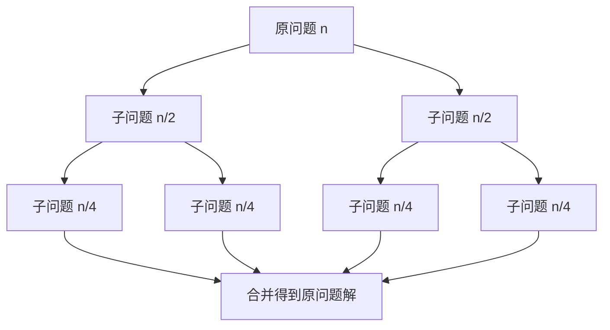

# 算法思想 - 分治算法 

> 分治（Divide and Conquer）把一个规模为 $n$ 的问题分解为若干个规模较小、**结构与原问题相同且相互独立**的子问题，分别求解后再合并，从而得到原问题的解。它是归并排序、快速排序、快速幂、FFT、MapReduce 等一大批经典算法与工程框架的共同骨架。

## 1. 三个步骤

分治的每一次递归都包含三个阶段：

1. **分解（Divide）**：把原问题划分为若干规模更小、形式相同的子问题；
2. **解决（Conquer）**：若子问题规模足够小则直接求解（递归出口），否则递归地求解各子问题；
3. **合并（Combine）**：把各子问题的解合并成原问题的解。



三个步骤中，**「合并」往往是决定性问题**：如果合并代价高，分治就未必划算。这也解释了为什么分治能成立的子问题必须**相互独立**——子问题若彼此重叠，反复求解同一子问题会带来大量重复计算，那就该改用动态规划。

## 2. 递归式与主定理

分治算法的运行时间天然写成**递归式（recurrence）**。若每次把规模 $n$ 分解为 $a$ 个规模 $n/b$ 的子问题，分解与合并的额外代价为 $f(n)$，则：

$$T(n) = a\,T\!\left(\frac{n}{b}\right) + f(n)$$

**主定理（Master Theorem）**直接给出三类解（令临界指数 $c = \log_b a$）：

| 情形 | 条件 | 结论 |
| --- | --- | --- |
| 1 | $f(n) = O(n^{c-\varepsilon})$，$\varepsilon>0$ | $T(n) = \Theta(n^{c})$ |
| 2 | $f(n) = \Theta(n^{c})$ | $T(n) = \Theta(n^{c}\log n)$ |
| 3 | $f(n) = \Omega(n^{c+\varepsilon})$ 且满足正则条件 $a\,f(n/b) \le k\,f(n)$ | $T(n) = \Theta(f(n))$ |

直观理解：**比较「子问题总规模」与「合并代价」谁更大**——

- 子问题占主导（叶子多、往上每层代价急剧变小），结果由叶子层决定（情形 1）；
- 两者同量级（每层代价相同），层数又恰是 $\log_b n$，于是多出一个 $\log n$ 因子（情形 2）；
- 合并占主导（顶层最贵、往下迅速便宜），结果由顶层决定（情形 3）。

以 $T(n)=2T(n/2)+n$ 代入：$c=\log_2 2=1$，$f(n)=n=\Theta(n^1)$ 属情形 2，故 $T(n)=\Theta(n\log n)$。

## 3. 递归树法

主定理不好直接套用时，**递归树（recursion tree）**是最通用的分析手段：把递归式逐层展开成一棵树，每层统计代价，再对所有层的代价求和。

以归并排序 $T(n)=2T(n/2)+\Theta(n)$ 为例：

- 第 0 层：$1$ 个问题，代价 $n$；
- 第 1 层：$2$ 个问题，各 $n/2$，合计代价 $n$；
- 第 $k$ 层：$2^k$ 个问题，各 $n/2^k$，合计代价仍为 $n$；
- 递归到叶子时问题规模为 1，共有 $\log_2 n + 1$ 层。

每层代价都是 $n$，共 $\log_2 n$ 层，故总代价 $\Theta(n\log n)$。

再看二分查找 $T(n)=T(n/2)+O(1)$：递归树是一条单链，每层代价 $O(1)$，深度 $\log_2 n$，总代价 $\Theta(\log n)$。这类「只有一个分支继续递归」的情形实际上是**减治（decrease and conquer）**——每层只把问题缩小而不产生多个子问题。

## 4. 经典例子

**归并排序**：均匀二分，递归排序左右半，再线性的 `merge` 合并两个有序段。$T(n)=2T(n/2)+\Theta(n)$，结果 $\Theta(n\log n)$，且稳定、最坏也是 $n\log n$。

```java
void mergeSort(int[] a, int lo, int hi, int[] buf) {
    if (lo >= hi) return;                 // 递归出口：区间只有一个元素
    int mid = lo + (hi - lo) / 2;         // 分解
    mergeSort(a, lo, mid, buf);
    mergeSort(a, mid + 1, hi, buf);
    // 合并：把两个有序段合并到 buf，再拷回 a
    int i = lo, j = mid + 1, k = lo;
    while (i <= mid && j <= hi) buf[k++] = a[i] <= a[j] ? a[i++] : a[j++];
    while (i <= mid) buf[k++] = a[i++];
    while (j <= hi) buf[k++] = a[j++];
    System.arraycopy(buf, lo, a, lo, hi - lo + 1);
}
```

**快速排序**：以枢轴划分，再递归左右。均摊 $T(n)=2T(n/2)+\Theta(n)=\Theta(n\log n)$，最坏（已排好且枢轴取端点）退化为 $T(n)=T(n-1)+\Theta(n)=\Theta(n^2)$。它与归并的差别在于「分解」阶段就完成了大量工作。

**快速选择（Quickselect）**：求第 $k$ 小的元素只需递归「包含第 $k$ 小」的那一侧，$T(n)=T(n/2)+O(n)$，均摊 $\Theta(n)$——这是「分治只递归一个分支」的巧妙应用。

**最大子数组**：把数组对半分，最大子数组要么全在左半、要么全在右半、要么跨越中点。跨越中点的一段可在 $O(n)$ 内由「左半后缀最大 + 右半前缀最大」得到。$T(n)=2T(n/2)+\Theta(n)$，得 $\Theta(n\log n)$（线性时间的 Kadane 算法是更优的专门解法）。

**快速幂**：计算 $x^n$ 时把 $n$ 二分，$x^n = (x^{n/2})^2$，$T(n)=T(n/2)+O(1)=\Theta(\log n)$——把朴素 $O(n)$ 次乘法降为对数级。

**Strassen 矩阵乘法**：把 $n\times n$ 矩阵分块，用 7 次子矩阵乘法（而非朴素的 8 次）换取更多加法，$T(n)=7T(n/2)+\Theta(n^2)$，由主定理情形 1 得 $\Theta(n^{\log_2 7})\approx\Theta(n^{2.81})$。

**Karatsuba 大整数乘法**：把大整数二分，用 3 次子乘法替代 4 次（利用 $(a+b)(c+d)=ac+bd+(a-b)(d-c)$ 形式的恒等式减少一次乘法），$T(n)=3T(n/2)+O(n)=\Theta(n^{\log_2 3})\approx\Theta(n^{1.585})$。

**最近点对**：按 $x$ 分治，合并时只需检查围绕中线、宽度为「当前最小距离」的带状区域，带内每个点最多与常数个点比较，总复杂度 $\Theta(n\log n)$。

**快速傅里叶变换（FFT）**：分治的经典，把 $O(n^2)$ 的离散傅里叶变换降到 $O(n\log n)$，是信号处理与多项式乘法的基石。

## 5. 一个分治代码示例：给表达式加括号

LeetCode 241「为运算表达式设计优先级」是分治的典型题：给定形如 `2-1-1` 的表达式，求所有可能加括号方式得到的值。

思路：对表达式中的每个运算符，把它作为**最外层运算**，左右两段表达式分别递归求解，再把两侧的可能结果两两组合。

```java
public List<Integer> diffWaysToCompute(String input) {
    List<Integer> ways = new ArrayList<>();
    for (int i = 0; i < input.length(); i++) {
        char c = input.charAt(i);
        if (c == '+' || c == '-' || c == '*') {      // 枚举最外层运算符
            List<Integer> left = diffWaysToCompute(input.substring(0, i));
            List<Integer> right = diffWaysToCompute(input.substring(i + 1));
            for (int l : left) {
                for (int r : right) {
                    switch (c) {
                        case '+': ways.add(l + r); break;
                        case '-': ways.add(l - r); break;
                        case '*': ways.add(l * r); break;
                    }
                }
            }
        }
    }
    if (ways.isEmpty()) {                 // 递归出口：input 已是纯数字
        ways.add(Integer.parseInt(input));
    }
    return ways;
}
```

对方法加上记忆化（按子串缓存结果），就能把重复子问题的开销消掉，这一改造也正是「分治」走向「动态规划」的桥。

## 6. 与动态规划的区别

分治与动态规划都靠「把问题拆小」，但适用条件截然不同：

| 维度 | 分治 | 动态规划 |
| --- | --- | --- |
| 子问题关系 | **相互独立**，无重叠 | **相互重叠**，同一子问题被多次求解 |
| 是否需要最优子结构 | 不强调 | 必须具备最优子结构 |
| 重复计算 | 天然不存在 | 需靠记忆化 / 自底向上表格消除 |
| 求解方向 | 自顶向下递归，合并得到解 | 可自顶向下记忆化，也可自底向上填表 |
| 典型例子 | 归并排序、快速幂、最近点对、FFT | 背包、最短路径、编辑距离、最长公共子序列 |

判别口诀：**子问题不重叠 → 分治；子问题重叠且要求最优 → 动态规划**。一个印证是：把分治解法加上记忆化（合并重复子问题）后，若问题还具备最优子结构，就退化成了动态规划——例如「不同路径数」问题从朴素递归到记忆化再到递推表，正是这条路径。

## 7. 实践要点

- **递归出口要正确**：归并排序的出口是区间长度 ≤ 1，表达式加括号的出口是子串为纯数字，出口写错会导致无限递归或结果缺失。
- **警惕递归深度**：分治的递归深度是 $O(\log n)$（分治）到 $O(n)$（退化的快排 / 快速选择最坏）不等，数据量大时可能栈溢出，必要时改写成迭代或显式栈。
- **合并阶段的复杂度决定成败**：归并排序之所以是 $n\log n$，关键是 `merge` 只有线性代价；若合并写成 $O(n\log n)$，整体就会退化。
- **用「减治」简化**：二分查找、快速幂、求幂取模等只递归一个分支的问题，属减治，复杂度常降到对数级。
- **分治与并行天然契合**：各子问题相互独立，可并行求解——MapReduce 的 Split→Map→Shuffle→Reduce 正是分治在集群上的工业化实现，参见 [大数据处理 - Map & Reduce](../alg-domain/alg-domain-bigdata-map-reduce.md)。

## 8. 边界与常见坑

- **递归出口必须能终止**：出口判断（区间长度、子串是否为数字）写错会导致栈溢出或丢解。
- **分解要「均匀」**：二分查找、归并排序之所以高效，是因为子问题规模接近；快速排序若枢轴选取不当会退化为 $O(n^2)$，用随机枢轴或「三数取中」可缓解。
- **合并代价要可控**：合并若高于子问题规模，主定理会落入情形 3，复杂度由合并主导；此时应先优化合并阶段。
- **慎用深递归**：递归深度接近 $n$ 时（如退化的快排 / 快速选择）要警惕栈溢出，必要时改迭代。
- **不必强行分治**：若问题规模不大、或合并代价过高，直接求解反而更快——分治是手段而非目的。

## 9. 小结

- 分治三步：**分解、解决、合并**；子问题必须形式相同且相互独立。
- 复杂度用递归式 $T(n)=a\,T(n/b)+f(n)$ 描述，主定理分三类给解，递归树是通用的展开求和手段。
- 典型应用：归并排序、快速选择、快速幂、Strassen、Karatsuba、最近点对、FFT。
- 与动态规划的分水岭在于**子问题是否重叠**：不重叠用分治，重叠且求最优用动态规划。
- 只递归一个分支的「减治」（二分、快速幂）是分治的特例，复杂度常降到对数级；分治的独立性还使其天然适合并行。

相关阅读：[算法思想 - 动态规划](./alg-core-dynamic.md)、[算法思想 - 贪心算法](./alg-core-greedy.md)、[算法思想 - 回溯算法](./alg-core-backtracking.md)。
