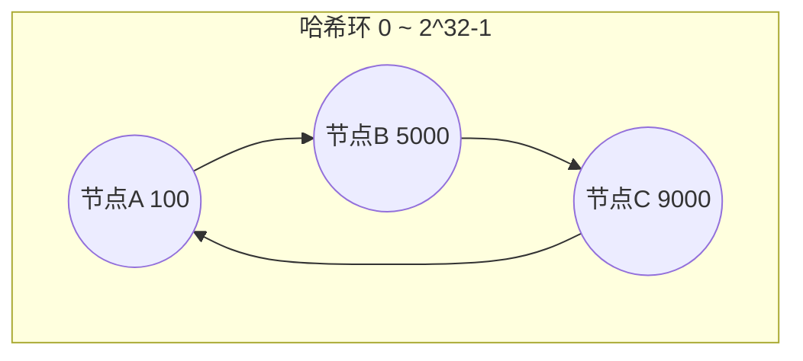

# 大数据处理 - 双层桶划分 

> 分桶（bucketing）是大数据处理里「分而治之」的经典落地：当元素取值范围极大、无法用直接寻址表（数组下标）计数时，先把数据按某种维度**划分到有限个桶**中，逐步缩小范围，最后在一个可接受的规模里完成统计。

## 1. 分桶的思想与适用范围

核心还是**分治**，重在「分」的技巧。它要解决的是这样一类矛盾：数据量或取值空间太大，装不进内存或无法直接建表。

- **适用范围**：求第 $k$ 大、求中位数、找不重复（或重复）的数字、海量数据去重；
- **基本原理**：元素范围太大不能直接寻址，于是**多次划分、逐步缩范围**，让每一步都在「可放进内存」的尺度上做统计。

「双层桶划分」指的就是这种**两级缩范围**的套路：第一级桶把数据切成大块、定位目标落在大块中的哪一块；第二级桶在该块内部再细分，直到范围小到能直接处理。分桶的效果取决于两点：

- **桶的数量**：太少则单桶仍放不进内存，太多则管理开销大；一般取到一个「单桶平均能放进内存」的档位（常见 $2^{16}=65536$）；
- **划分依据**：要保证目标被唯一地定位，且数据在各桶间尽量均匀（否则出现「倾斜桶」，单桶仍是瓶颈）。

## 2. 哈希分桶

最基础的分桶方式：把键 $k$ 通过哈希函数映射到 $N$ 个桶之一。

$$\text{bucket} = \text{hash}(k) \bmod N$$

- **用途**：分布式计算的**分区（Partition）**——MapReduce 里决定某个 key 交给哪个 Reduce，就是 `hash(key) mod R`；数据库**分库分表**、缓存**分片**同理，目的是把负载均匀打散、让各节点独立处理；
- **优点**：实现简单、负载（在理想哈希下）均匀；
- **缺点**：**桶数 $N$ 变更时几乎全量重分布**。因为 `hash(k) mod N` 会随 $N$ 改变而改变，扩容时绝大多数 key 都要迁移，代价巨大；
- **哈希函数选择**：生产环境常用 MurmurHash、FNV、xxHash（快且散列均匀），**不要用 Java 的 `hashCode` 直接取模**（分布不够均匀，整数键尤其明显），必要时再做一次扰动。

还有一个工程细节：若某个 key 的值特别多，即使桶数均匀，**热点 key 仍会造成数据倾斜**，处理它的那个桶成为长尾——这正是 MapReduce 中数据倾斜的成因，常用「加随机前缀打散」缓解：把热点 key 拆成 `key-0`、`key-1`……分散到多个桶，最终再合并。

## 3. 一致性哈希

哈希分桶的痛点在于「节点数变化 → 全量重分布」。**一致性哈希（Consistent Hashing）**通过把节点和数据都放到同一个**哈希环**上来解决：



- 把 `hash(节点标识)` 映射到环上的一个位置，每个节点负责**环上它到前一个节点之间的弧段**；
- 数据 `hash(key)` 落到环上某位置后，**顺时针找到的第一个节点**就是它的归属；
- 当某节点加入或退出时，**只有它相邻弧段上的数据需要迁移**，平均只有 $1/N$ 的数据受影响，而非全量重分布。

原始一致性哈希的缺点是**分布不均**：节点少时弧段大小悬殊（哈希落点本就随机）。工程上用**虚拟节点（virtual node）**改进——每个物理节点在环上映射成很多个虚拟节点（如每个物理节点对应 100 个虚拟节点），数据先落到虚拟节点再归到物理节点，负载就趋于均衡，且节点下线时其负载也被打散到多个节点。

| 维度 | 哈希取模分桶 | 一致性哈希 |
| --- | --- | --- |
| 映射方式 | `hash(k) mod N` | 落环后顺时针找节点 |
| 扩容迁移量 | 几乎全量（$\approx$ 全部） | 约 $1/N$ |
| 负载均衡 | 依赖哈希函数 | 需虚拟节点辅助 |
| 典型场景 | 静态分片、MapReduce 分区 | 分布式缓存 / 存储动态扩缩容 |

当需要在算法层面避免节点增减引起的大规模迁移时，一致性哈希是首选。

## 4. 位图（Bitmap）

位图用**一个 bit 表示一个数是否存在**，是「数值范围有限、且常常需要去重 / 集合运算」时的利器。

- **空间**：表示 $[0, 2^{32})$ 的整数集合，只需 $2^{32}$ 个 bit，即 512 MB；换成 32 位数组存则要 16 GB，差了两个数量级。
- **操作**：置位 `set(i)`、查询 `test(i)` 都是 $O(1)$；集合的**交、并、差**直接对位做 AND / OR / NOT，天然高效。
- **扩展**：一个数可能需要区分「没出现 / 出现一次 / 出现多次」，就为每个数分配 **2 个 bit**，用状态编码（如 00 未出现、01 一次、10 多次）实现「不重复计数」。

```java
// 2-bit 位图：判断一个数出现 0 次 / 1 次 / 多次
// 每个数占 2 bit，值为 0/1/2（2 表示「多次」）
void add(int[] bits, int x) {
    int idx = x >> 4;          // 每个 int（32 bit）可表示 16 个数的 2-bit 状态
    int shift = (x & 15) << 1; // 在 int 内的位偏移
    int state = (bits[idx] >>> shift) & 3;
    if (state < 2) {
        bits[idx] &= ~(3 << shift);        // 清掉旧状态
        bits[idx] |= (state + 1) << shift; // 置为新状态
    }
}
```

位图的问题在于**稀疏**：若数据只落在很大范围里的少数点上，全量位图会浪费大量空间，这时需先配合分桶把范围压小，再对小范围用位图——这就是双层桶划分里两个工具的配合。与**布隆过滤器**的区别是：位图记录的是**精确**的存在性（不误判），布隆过滤器只给**概率性**回答（可能误判「存在」，但不漏「不存在」），后者适合在只做「过滤掉确定不存在的」时节省空间。

## 5. 经典问题

### 5.1 2.5 亿个整数中找出不重复的整数个数

内存装不下这 2.5 亿个整数，但整数范围是 $[0, 2^{32})$。思路类似鸽巢原理：

1. 把整数范围按高位划成 $2^8=256$ 个**区域**（每个区域用一个文件或计数器表示）；
2. 第一遍扫描，把每个整数按其高位「分离」到对应区域，并统计各区域的元素数量；
3. 对每个区域分别处理：区域内的数据范围已缩小，此时用**位图**（或 2-bit 位图区分「一次 / 多次」）即可直接求不重复个数。

关键在于**用足够的磁盘空间换取「可处理的内存规模」**：只要能分到内存放得下的小块，问题就迎刃而解。

### 5.2 5 亿个 int 求中位数

**思路一：双层桶划分定位中位数。**

1. 把 int 的取值范围（$2^{32}$）划分成 $2^{16}=65536$ 个区间，第一遍扫描统计落在各区间内的元素个数；
2. 根据各区间的计数，定位中位数落在哪个区间，以及它是该区间内的第几个数；
3. 第二遍扫描只处理落在目标区间内的数，此时数据量已可控，可用直接寻址表精确求解。

若是 64 位整数，可以重复这套划分 2～3 次，每次把范围缩 $2^{16}$ 倍，逐级逼近到能直接处理的程度。

**思路二：按高低位两遍统计，类似基数排序。**

1. 开一个长度为 65536 的计数数组，第一遍统计每个 int **高 16 位**的分布（等价于把数除以 65536 后取整，取值范围正好不超过 65536 种；若有负数，整体加偏移后计数）；
2. 遍历计数数组做前缀和，即可判断中位数落在哪个高位区间（记为 $k$），并知道在高位为 $k$ 的数中还需要找第几个；
3. 第二遍只统计高位等于 $k$ 的数，记录它们的**低 16 位**分布，再在高位为 $k$ 的这批数内定位；
4. 把高位与低位拼起来，即得中位数。

两种思路都需要**两遍扫描**（数据在硬盘上便读取两次），本质都是「先分桶定位范围，再在范围内精确求解」。

### 5.3 海量数据求 TopK

给定海量数据、内存有限，求最大的 $K$ 个：先做一次**哈希分桶**把数据切成若干份，逐份读入内存用**小顶堆**维护 TopK，最后把各份的 TopK 归并再取全局 TopK。分桶的作用是让每份都能放进内存，堆的作用是在单份内只保留 $K$ 个候选。

## 6. 小结

- 分桶是分治思想在「取值范围过大、无法直接寻址」场景下的具体做法：多次划分、逐步缩范围。
- **哈希分桶**简单均匀，但桶数变化会引起全量重分布，且看不住热点 key。
- **一致性哈希**用哈希环 + 虚拟节点，让节点增减时只迁移约 $1/N$ 的数据，适合分布式缓存 / 存储。
- **位图**用 1 个 bit 表示一个数，空间极省且天然支持集合运算，是去重与集合统计的利器，稀疏时需配合分桶。
- 「中位数、第 k 大、去重、TopK」这类题目的通用套路是：**先分桶定位目标区间，再在可控规模内精确求解**。

相关阅读：[大数处理 - 分治 & 哈希](./alg-domain-bigdata-devide-and-hash.md)、[大数据处理 - 布隆过滤器](./alg-domain-bigdata-bloom-filter.md)、[大数据处理 - 外排序](./alg-domain-bigdata-outsort.md)、[大数据处理 - 数据库索引(Trie/B+/倒排)](./alg-domain-bigdata-db-index.md)。
