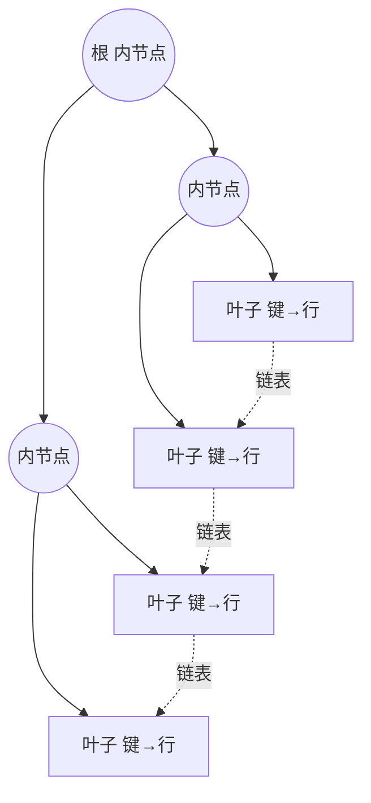

# 大数据处理 - Trie树/数据库/倒排索引 

> 大数据处理里，「索引」是一条主线：数据量一大，顺序扫描就不可行，必须用某种额外结构把「查找」从 $O(n)$ 压到对数级甚至近似 $O(1)$。本文梳理三种最常用的索引结构——内存里的 Trie 树、磁盘上的 B+ 树、以及搜索引擎的倒排索引。

## 1. Trie 树：把字符串的公共前缀合并起来

Trie 树（前缀树 / 字典树）把一组字符串按字符逐层展开：根节点为空，从根到某节点的一条路径对应一个前缀，节点上标记「从根到此是否构成一个完整单词」。它的关键优势是**查询时间只与待查字符串的长度 $L$ 相关，为 $O(L)$，与字典中保存了多少个词无关**。

```java
class TrieNode {
    TrieNode[] next = new TrieNode[26]; // 小写字母表；也可用 HashMap 省空间
    boolean isWord;                     // 从根到此是否为一个完整单词
    int count;                          // 以此结尾的单词出现次数（词频统计用）
}

void insert(TrieNode root, String word) {
    TrieNode cur = root;
    for (char c : word.toCharArray()) {
        int i = c - 'a';
        if (cur.next[i] == null) cur.next[i] = new TrieNode();
        cur = cur.next[i];
    }
    cur.isWord = true;
    cur.count++;
}
```

- **适用范围**：数据量大、重复多，但数据「种类」（字符集 / 前缀集合）小到能放进内存；
- **基本原理**：节点用数组或哈希表表示孩子；查询沿字符逐层下走；
- **空间代价**：节点数组把所有分支都铺满，稀疏时浪费大，故弱字符集或稀疏场景改用哈希表（或压缩实现）；
- **扩展**：压缩实现（把单链路径压成一条边），即「压缩 Trie / Radix 树」，进一步降低空间占用。

典型大数据题：

- **寻找热门查询**：一千万条查询串重复度很高，去重后不超过三百万条、每条不超过 255 字节。用 Trie 统计每条出现的次数，再求频度最高的若干条。
- **多文件 query 按频度排序**：10 个文件各 1G，每行一条 query 且可能重复，先各自用 Trie / 哈希统计频度，再合并排序。
- **一千万字符串去重**：用 Trie（或哈希）标记是否出现过，只保留首次出现的字符串。
- **统计词频 Top 10**：用 Trie 统计每个词出现次数，时间复杂度 $O(n \cdot L)$（$L$ 为单词平均长度），再取出现最频繁的前 10 个。

Trie 的构造是「边读入边建树」，把本需反复比较字符串的操作，转化为沿固定字符集下探，这正是「用空间换时间」在大数据场景的体现。更多实现细节可参见 [树 - 前缀树(Trie)](../alg-basic/alg-basic-tree-trie.md)。

## 2. B+ 树：磁盘上的关系型索引

数据库的索引要处理**大数据量的增删改查**，且数据主要存放在磁盘上。磁盘 I/O 以「页」（常见 4KB 或 16KB）为单位，一次随机 I/O 相对内存访问慢好几个数量级，因此索引结构的首要目标不是减少比较次数，而是**减少磁盘 I/O 次数**。

B+ 树是为磁盘而生的多路平衡查找树，核心特征：

- **只有叶子节点存数据（或数据的引用 / 主键），内节点只存键值**用于导航；
- 每个内节点有多个孩子（**高扇出**），一个节点的容量正好匹配一个磁盘页；
- **所有叶子节点用指针串成一个有序链表**，因此范围查询和全表顺序扫描只需顺着链表走。



**为什么它比二叉查找树更适合磁盘**：假设一个页能放 500 个键，则扇出为 500，三层 B+ 树就能索引 $500^3 \approx 1.25$ 亿条记录，查询最多 3 次磁盘 I/O；而二叉树要覆盖同等数据量，树高约 27 层，意味着最坏 27 次 I/O。**用「多路」换「层数」**是 B+ 树的设计精髓。

**B 树与 B+ 树的区别**：

| 维度 | B 树 | B+ 树 |
| --- | --- | --- |
| 数据存放 | 每个节点都可能存数据 | **只有叶子节点存数据** |
| 叶子间关系 | 无链表 | 叶子串成有序链表 |
| 范围查询 | 需要中序遍历，跨层 | 定位起点后顺着链表扫，高效 |
| 单点查询 I/O | 命中即止，可能更浅 | 必须走到叶子，但稳定 |

**插入与分裂**：B+ 树为保证平衡，节点写满时把节点一分为二、把中间键上提到父节点；父节点若也满则继续上提，直至根分裂、树长高一层。删除则在节点过稀时进行合并或再分配。这一过程保证了「所有叶子在同一层」，从而任意查询 I/O 次数一致。

工程落地：MySQL 的 InnoDB 用 B+ 树组织索引——**聚簇索引**的叶子节点直接存放整行数据（按主键排序），**二级索引**的叶子节点存放的是主键值，因此「二级索引 + 回表」才能取到完整行（这也是查询尽量走**覆盖索引**、避免回表的原因）。B+ 树是「读多写少」的一般 OLTP 场景的默认选择。

## 3. LSM 树：为写优化的存储结构

B+ 树每次写都可能触发随机 I/O 与页分裂，**写入成本高**。而对写密集（日志、时序、消息）场景，人们把「随机写」改成「顺序写」，这就是 LSM 树（Log-Structured Merge Tree，日志结构合并树）的核心思想：

1. **写内存**：新数据先写入内存中的有序结构（memtable，常是一棵平衡树），同时追加一条 WAL 日志保证持久性；
2. **落盘为有序文件**：memtable 写满后冻结、刷写成不可变的、**内部有序**的 SSTable（Sorted String Table）文件；
3. **后台合并**：后台把多个 SSTable 做多路归并（compaction），合并成更大的有序文件，同时清理被覆盖或删除的旧版本；
4. **读路径**：先查 memtable，未命中再按「由新到旧」依次查 SSTable；用**布隆过滤器**快速判断某个 key 是否在某个 SSTable 中，避免无谓的磁盘探测。

LSM 树的取舍鲜明：**写入几乎全是顺序写、吞吐极高**，代价是**读放大**（一次读要跨多层文件）与**写放大**（compaction 反复重写数据），以及需要额外的 compaction 调度。常见的 compaction 策略分两类——**分层（leveled）**把数据按层组织、每层内部有序，读放大低但写放大较高；**分层（tiered / size-tiered）**把小文件聚成大文件再合并，写放大低但读放大较高，工程上按读写比例取舍。它被 LevelDB、RocksDB、HBase、Cassandra、ClickHouse（MergeTree 家族）等广泛采用。

| 维度 | B+ 树 | LSM 树 |
| --- | --- | --- |
| 写入 | 随机写，可能页分裂 | 顺序写，追加 + 后台合并 |
| 读取 | 稳定，$O(\log n)$ 次 I/O | 可能跨多层，读放大 |
| 空间放大 | 低 | compaction 前较高 |
| 适用场景 | 读多写少、范围查询为主的 OLTP | 写密集、高吞吐摄入（时序 / 日志 / KV） |

## 4. 倒排索引：把「文档→词」翻转为「词→文档」

**正向索引**以文档为中心：每个文档指向「它包含的一系列词」的列表，适合「给定文档查它的词」。而全文检索要回答的是相反的问题——「包含某个词的是哪些文档」，这就需要**倒排索引（Inverted Index）**：以词为中心，记录每个词出现在哪些文档、什么位置。

以英文文本为例：

```bash
T0 = "it is what it is"
T1 = "what is it"
T2 = "it is a banana"
# 倒排索引（词 -> 出现该词的文档集合）
"a":      {2}
"banana": {2}
"is":     {0, 1, 2}
"it":     {0, 1, 2}
"what":   {0, 1}
```

检索 `"what" AND "is" AND "it"` 时，就是取三个词对应文档集合的**交集**；`OR` 则取并集。可见倒排索引把「文档指向词」的关系**反转**成「词指向文档」，这正是它得名的由来。

**构建流程**：分词（tokenize）→ 归一化（大小写、词干、停用词）→ 为每个词维护「词典（term dictionary）+ 倒排列表（posting list）」。posting list 里通常还要记录**词频**与**位置**，以支持短语查询和相关度打分。

倒排索引的效率关键在 posting list 的表示与运算：

- **压缩**：文档号在列表中有序，可用「差值编码（delta）+ 变长字节（vbyte）」把大整数序列压成很小的字节流；
- **求交加速**：为长列表加**跳表（skip list）**，跳着比较、快速定位可匹配区间，使布尔求交远快于逐元素扫描；
- **短语匹配**：借助 posting list 中的位置信息，判断多个词是否在两文档中相邻；
- **词典结构**：词典常用**有限状态转换器（FST）**或前缀树组织，既省空间又支持前缀 / 模糊查询。

这就是 Elasticsearch / Lucene 的底层原理，也是「适用范围：搜索引擎、关键字查询」的由来。

## 5. 小结

- 索引的本质是**用额外结构把查找从线性降到对数级或近似常数**，代价是额外的空间与写入开销。
- **Trie 树**适合「数据量大、重复多、字符集小、能放入内存」的字符串场景，查询 $O(L)$，与词表规模无关。
- **B+ 树**面向磁盘，高扇出 + 全叶子链表，把磁盘 I/O 次数压到很低，是关系型数据库索引的默认选择。
- **LSM 树**把随机写变顺序写，写吞吐高但有读放大与写放大，适合写密集系统。
- **倒排索引**反转「文档—词」关系，用 posting list 支撑布尔、短语检索，是搜索引擎的基石。

相关阅读：[大数据处理 - 分治 & 哈希](./alg-domain-bigdata-devide-and-hash.md)、[大数据处理 - 布隆过滤器](./alg-domain-bigdata-bloom-filter.md)、[大数据处理 - 外排序](./alg-domain-bigdata-outsort.md)、[大数据处理 - 双层桶划分](./alg-domain-bigdata-bucket.md)。
