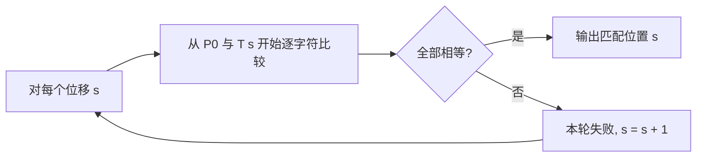
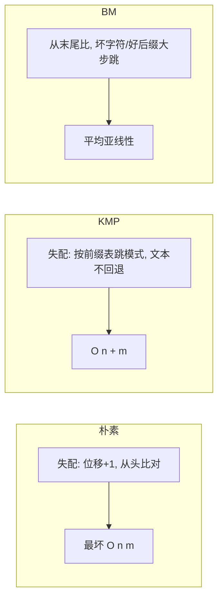

# 字符串匹配 - 模式预处理：朴素算法（Naive)(暴力破解) 

> 朴素字符串匹配算法（Naive String Matching），又称**暴力匹配算法（Brute Force Algorithm）**，是字符串匹配中最简单、最直观的算法：不做任何预处理，把模式串沿着文本逐位滑动、逐字符比较。它也是理解 KMP、BM 等更优算法的起点。

## 1. 算法思路

约定：文本（主串）$T$ 长度为 $n$，模式（子串）$P$ 长度为 $m$（$m \le n$）。匹配过程为：

1. 从文本的每一个可能的起始位置 $s$（$0 \le s \le n-m$）开始尝试；
2. 在该位置把模式的 $m$ 个字符与文本的对应字符逐个比较；
3. 若全部相等，则找到一个匹配（位移 $s$）；
4. 一旦出现不相等，**文本指针回退到本轮起点的下一位、模式指针归零**，从下一个位移重新开始。

可以把文本上的每一个位移想象成一扇「滑动窗口」，朴素算法就是把窗口**每次只向右滑动 1 位**，窗口内逐字符校验。



算法特点可以概括为：

- **没有预处理阶段**，预处理时间恒为 $0$；
- **滑动窗口总是后移 1 位**，不会跳过任何可能的对齐位置；
- 对模式字符的比较顺序不作限定，可以从前到后，也可以从后到前；
- 匹配阶段需要 $O((n-m+1)\times m)$ 的时间，最坏约 $O(nm)$。

## 2. 指针变化：低效的根源

把「文本指针」记作 $i$、模式指针记作 $j$。朴素算法的典型控制流等价于：

```text
i = s        // 本轮的文本起点
j = 0
while (j < m && T[i] == P[j]) { i++; j++; }
if (j == m) 命中位移 s
else { s = s + 1; }     // 关键：下一轮从头开始，之前比较过的位置被重比
```

失配后**只把位移 $s$ 加一**，意味着**之前已经确认相等的那些字符，下一轮会被反复、重复地比较**。以 $T = aaab$、$P = aab$ 为例：

| 位移 s | 逐字符比较 | 结果 |
| --- | --- | --- |
| 0 | `a`=`a`、`a`=`a`、`a`≠`b` | 第 3 位失配，$s \to 1$ |
| 1 | `a`=`a`、`a`=`a`、`b`=`b` | 全部匹配，命中位移 1 |

注意 $s=0$ 与 $s=1$ 两轮都在比较文本中的同一批字符（文本下标 1、2 被重复比较）——这些「已知相等」的信息被白白丢弃，正是 KMP 要弥补的地方。

## 3. 伪代码与实现

经典的 NAIVE-STRING-MATCHER 伪代码：

```text
NAIVE-STRING-MATCHER(T, P)
    n ← length[T]
    m ← length[P]
    for s ← 0 to n - m          // 枚举所有可能的对齐位置
        do if P[1 .. m] = T[s+1 .. s+m]
            then print "Pattern occurs with shift" s
```

用 Java 写出来就是两层循环：

```java
/**
 * 朴素字符串匹配：返回模式 P 在文本 T 中第一次出现的下标，找不到返回 -1
 */
public static int naiveMatch(String t, String p) {
    int n = t.length();
    int m = p.length();
    if (m == 0) return 0;             // 空模式约定为匹配在 0 处
    if (m > n) return -1;

    for (int s = 0; s <= n - m; s++) {      // 枚举起始对齐位置
        int j = 0;
        while (j < m && t.charAt(s + j) == p.charAt(j)) {   // 逐字符比较
            j++;
        }
        if (j == m) {                        // 模式全部匹配
            return s;
        }
        // 不匹配：s 自增，下一轮 j 重新从 0 开始（文本指针回退）
    }
    return -1;
}
```

若要找出**所有**出现位置，去掉 `return`、继续循环即可：

```java
public static List<Integer> naiveMatchAll(String t, String p) {
    List<Integer> res = new ArrayList<>();
    int n = t.length(), m = p.length();
    if (m == 0 || m > n) return res;
    for (int s = 0; s <= n - m; s++) {
        int j = 0;
        while (j < m && t.charAt(s + j) == p.charAt(j)) j++;
        if (j == m) res.add(s);          // 记录命中，继续找下一个
    }
    return res;
}
```

## 4. 算法图例

以模式 $P = aab$、文本 $T = acaabc$ 为例，把模式沿文本从左到右滑动、逐个比较：

```text
位移 s=0:  T: a c a a b c
           P: a a b         第二位失配(c ≠ a)
位移 s=1:  T: a c a a b c
           P:   a a b       第一位失配(c ≠ a)
位移 s=2:  T: a c a a b c
           P:     a a b     全部匹配，命中
```

图中的流程与「滑动窗口后移一位」完全一致：朴素算法**完全依赖逐位试探**，没有任何「从已匹配信息中跳步」的能力。

## 5. 复杂度分析

字符比较的总次数取决于文本与模式的具体内容：

- **最好情况** $O(n)$：每个位移的第一位就不匹配（例如模式首字符很少出现在文本里），则总共约 $n-m+1$ 次比较；若模式恰好在起始位置就命中，比较 $m$ 次。
- **最坏情况** $O(nm)$：每次匹配都要比较到模式的最后一个字符才失配。典型构造为 $T = aaaa\cdots a$（$n$ 个 `a`）、$P = aaaab$（前 $m-1$ 个 `a`），每个位移都要比较 $m$ 次，共约 $(n-m+1)\times m$ 次。当 $m \approx n/2$ 时，约为 $O(n^2)$。
- **平均情况** $O(n)$：在字符集大小为 $\sigma$ 的随机文本上，失配通常发生在比较的前几个字符，平均每轮比较次数是一个与 $n$ 无关的常数（约 $\sigma/(\sigma-1)$ 量级），因此总比较次数约为 $O(n)$。这也解释了为什么朴素算法在实践中往往远好于最坏情况。

从时间构成看，朴素算法**把所有成本都放在匹配阶段**：

| 阶段 | 代价 |
| --- | --- |
| 预处理 | $0$ |
| 匹配（最好） | $O(n)$ |
| 匹配（平均） | $O(n)$ |
| 匹配（最坏） | $O((n-m+1)\times m) \approx O(nm)$ |
| 空间 | $O(1)$ |

## 6. 与 KMP、BM 的对比

朴素算法的根本缺陷是**没有利用「已经匹配成功的部分」这一信息**。更优的算法都从这里入手：

| 算法 | 预处理 | 匹配复杂度 | 核心思想 | 适合场景 |
| --- | --- | --- | --- | --- |
| 朴素 BF | 无 | 最坏 $O(nm)$ | 逐位移暴力比较，失配后位移 +1 | 短模式、简单场景 |
| KMP | $O(m)$（前缀函数 π） | $O(n+m)$ | 失配时用 π 表跳转，**文本指针不回退** | 任意字符集、模式固定文本长 |
| BM | $O(m+\sigma)$（坏字符 + 好后缀） | 最好 $O(n/m)$，最坏 $O(nm)$ | 从模式**尾部**比较，失配时按两张表大步跳跃 | 大字符集（如英文文本）、模式长 |
| Sunday | $O(m+\sigma)$ | 平均快于 BM | 关注下一个待比较字符做跳跃 | 实际工程中表现优异 |
| Rabin-Karp | $O(m)$（滚动哈希） | 平均 $O(n+m)$ | 先比哈希值，哈希相等再逐字符校验 | 多模式 / 二维匹配 |

对比要点：

- **KMP** 通过对模式预处理得到前缀函数，失配时**只移动模式、不回退文本指针**，把最坏复杂度降到线性的 $O(n+m)$；
- **BM** 从模式末尾向前比较，利用坏字符规则、好后缀规则实现**大步跳跃**，字符集较大时常常「跳得比模式还快」，实践中常快于 KMP；
- **Rabin-Karp** 用滚动哈希把「窗口比较」降到均摊 $O(1)$，代价是哈希碰撞时需回退到逐字符校验，平均值 $O(n+m)$；
- **朴素算法**虽然最坏 $O(nm)$，但在**模式很短**或**字符集大、失配频繁**时，由于没有预处理与额外簿记开销、实现简单、常数极小，常常是首选——JDK 的 `String.indexOf` 在短模式场景下就采用了类似的朴素实现。



## 7. 工程与面试中的常见变形

朴素匹配在面试与工程中常以「变形题」出现，几乎都可以在其骨架上小改：

- **统计出现次数 / 返回全部位置**：把命中后的 `return` 改为记录并继续；
- **判断子序列 / 前缀后缀**：进一步放宽为「字符可不连续」，退化为双指针扫描，$O(n+m)$；
- **二维网格搜索**：把「一维文本」换成二维矩阵逐行滑动，思路完全一致；
- **被 `String.indexOf` 兜底**：语言内置实现通常对短模式走朴素、长模式走更优算法，理解朴素算法有助于判断内置 API 的性能边界；
- **多模式匹配**：若要在文本中同时找出多个模式（如敏感词过滤），AC 自动机（Aho-Corasick）以 Trie + 失配指针把「模式集合」预处理后单遍扫描，朴素算法则要对每个模式各扫一遍；
- **边界条件要显式处理**：空模式、模式长度大于文本（`m > n`）等情形都应提前返回，避免下标越界；
- **双指针变体**：不少字符串 / 数组题目（如有序数组求两数之和、合并两个有序数组）本质就是朴素对齐思想的双指针变体，思路与本文一脉相承。

实践中需要警惕的一点是**最坏情况**：若模式首字符与文本高度重合（例如用 `aaaa...` 去匹配 `aaaa...b`），朴素算法会退化到 $O(nm)$，此时应改用 KMP 之类的线性算法。

## 8. 小结

- 朴素（BF）匹配不做预处理，把模式沿文本逐位滑动、逐字符比较，失配后位移 +1。
- 思路最简单：预处理 $0$，匹配最坏 $O(nm)$、平均接近 $O(n)$，空间 $O(1)$。
- 缺陷在于**没有利用已匹配的信息**，也无法让文本指针跳过已比较过的位置。
- KMP 用前缀函数实现 $O(n+m)$ 且文本指针不回退；BM（及 Sunday）用坏字符 / 好后缀规则做大步跳跃；Rabin-Karp 用滚动哈希。
- 短模式或字符集大时，朴素算法的低常数优势往往压过更复杂算法，因此并未被淘汰。

相关阅读：[字符串匹配 - 算法概览](./alg-domain-char-match.md)、[字符串匹配 - KMP 算法](./alg-domain-char-match-kmp.md)、[字符串匹配 - BM 算法](./alg-domain-char-match-bm.md)、[字符串匹配 - Sunday 算法](./alg-domain-char-match-st.md)。
