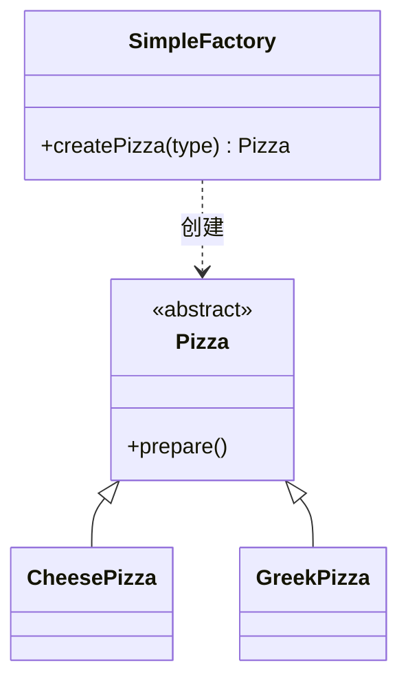
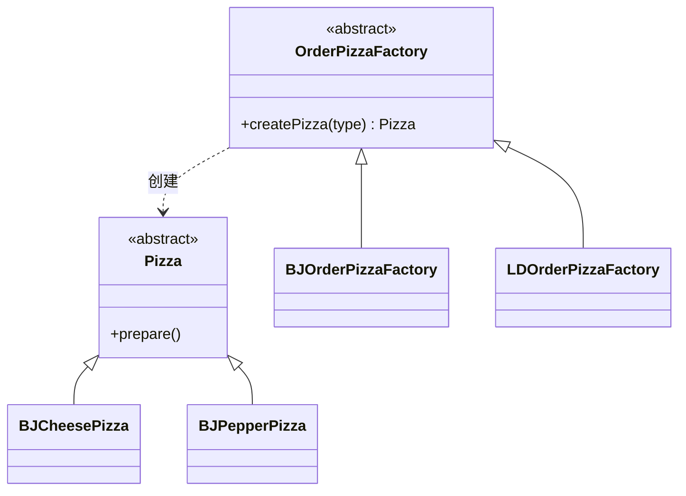

## 工厂模式概述

在面向对象开发中，`new` 是最常见的对象获取方式，但直接 `new` 会把调用方与具体实现类硬绑定：一旦产品种类扩展，或构造过程变复杂（需要组合多个对象、读取配置、做初始化），散落各处的 `new` 就会变成维护负担。工厂模式要解决的正是这个问题——**把对象的创建与使用分离**，让调用方依赖抽象而不是具体类。

工厂模式在工程实践中常被细分为三类：

- **简单工厂（Simple Factory）**：一个工厂类根据参数生产同一等级中的任意产品。
- **工厂方法（Factory Method）**：定义创建对象的抽象方法，由子类决定实例化哪个类，把实例化推迟到子类。
- **抽象工厂（Abstract Factory）**：提供一个创建「产品族」的接口，一个工厂可生产多个产品等级的对象。

GoF《设计模式》把简单工厂看作工厂方法的一种特例，只保留工厂方法与抽象工厂两类；但三分法更贴近日常叫法，本文沿用三分法。

三者的选择边界可以先看这张表：

| 模式 | 生产范围 | 新增产品的代价 | 主要代价 |
| --- | --- | --- | --- |
| 简单工厂 | 同一等级中的任意产品 | 修改工厂内部 `if-else` | 工厂职责集中，易臃肿 |
| 工厂方法 | 同一等级中的固定产品 | 新增一个工厂子类 | 类的数量增多 |
| 抽象工厂 | 产品族中的多个等级产品 | 新增「产品族」不改代码；新增「产品等级」需改所有工厂 | 抽象度最高，理解成本大 |

需要强调的是，工厂模式的实现都很简单，真正的难点是**判断何时该用**：仅当对象创建逻辑复杂，或需要把创建过程集中管控时，引入工厂才有收益；否则多写一层工厂只会增加复杂度。

工厂模式背后对应两条核心设计原则。**依赖倒置原则**（Dependency Inversion Principle）要求高层模块依赖抽象而不是具体实现；**开闭原则**（Open-Closed Principle）要求对扩展开放、对修改关闭。直接 `new` 具体类会让调用方与实现硬绑定，一旦产品需要替换或扩展，改动就会扩散；工厂模式通过引入一层抽象，把这种依赖关系反转过来，让变化隔离在工厂内部。此外，调用方依赖工厂返回的抽象产品，也提升了**可测试性**——测试时可以方便地替换为桩对象或 Mock 对象，而不必构造真实的重依赖实例。

理解工厂模式还要抓住一个前提：它是为「创建对象这件事本身有复杂度」而生的。如果创建对象只是简单的一次 `new`，工厂带来的抽象就是纯粹的额外负担。

## 简单工厂（Simple Factory）

简单工厂用一个工厂类封装「创建哪种产品」的判断逻辑。创建方法通常声明为 `static`，因此它也被称为**静态工厂方法模式**。

它包含三个角色：

- **简单工厂（SimpleFactory）**：核心类，封装所有产品的创建逻辑。
- **抽象产品（Product）**：所有产品的父类或接口，描述公共行为。
- **具体产品（ConcreteProduct）**：工厂真正创建的实例。

结构如下：



以披萨店为例，先定义抽象产品：

```java
public abstract class Pizza {
    protected String name;

    // 不同披萨原料不同，做成抽象方法由子类实现
    public abstract void prepare();

    public void bake() { System.out.println(name + " 烘焙"); }
    public void cut()  { System.out.println(name + " 切割"); }
    public void box()  { System.out.println(name + " 打包"); }
    // 省略 name 的 getter/setter
}
```

具体产品：

```java
class CheesePizza extends Pizza {
    @Override
    public void prepare() {
        setName("奶酪披萨");
        System.out.println("准备奶酪披萨原料");
    }
}

class GreekPizza extends Pizza {
    @Override
    public void prepare() {
        setName("希腊披萨");
        System.out.println("准备希腊披萨原料");
    }
}
```

工厂类与调用方：

```java
public class SimpleFactory {
    // 根据类型创建对应披萨；新增品种需修改此处
    public static Pizza createPizza(String type) {
        if ("cheese".equals(type)) {
            return new CheesePizza();
        } else if ("greek".equals(type)) {
            return new GreekPizza();
        }
        return null;
    }
}

public class OrderPizza {
    public static void main(String[] args) {
        Pizza pizza = SimpleFactory.createPizza("cheese");
        pizza.prepare();
        pizza.bake();
    }
}
```

> 优点

- 调用方无需知道具体产品类名，只需传入参数。
- 把创建逻辑集中到一处；配合配置文件，甚至能在不改调用方的前提下替换产品。

> 缺点

- 工厂类职责过重，所有产品的创建逻辑堆在一起，产品一多就臃肿，违背高内聚。
- 新增产品必须修改工厂内部逻辑，**违反开闭原则（Open-Closed Principle, OCP）**。
- 使用 `static` 方法时，工厂无法形成基于继承的等级结构。

简单工厂虽违反 OCP，但改动代价很小，在创建逻辑不复杂、产品种类有限的场景中依然被广泛使用。

它特别适合产品种类少、创建逻辑简单、且不会频繁新增产品的场景，例如根据配置项或环境变量快速切换实现。它的价值在于把 `new` 从业务代码里抽走、集中到一处，而不是追求扩展性；一旦产品种类会频繁增加，就该考虑升级为工厂方法。反过来，如果一个工厂里的 `if-else` 分支已经长到需要经常修改，说明它已经在承担超出简单工厂能力的变化，此时拆分才是有意义的。

## 工厂方法（Factory Method）

工厂方法把「创建哪个产品」这个决策下放给子类：抽象工厂只声明创建产品的抽象方法，具体工厂各自实现，从而满足开闭原则。

它包含四个角色：**抽象工厂**、**具体工厂**、**抽象产品**、**具体产品**。结构如下：



抽象工厂与具体工厂：

```java
public abstract class OrderPizzaFactory {
    // 抽象方法，由各子工厂决定创建哪种披萨
    public abstract Pizza createPizza(String type);
}

public class BJOrderPizzaFactory extends OrderPizzaFactory {
    @Override
    public Pizza createPizza(String type) {
        if ("cheese".equals(type)) {
            return new BJCheesePizza();
        } else if ("pepper".equals(type)) {
            return new BJPepperPizza();
        }
        return null;
    }
}
```

此时新增「伦敦口味」只需再写一个 `LDOrderPizzaFactory`，不必触碰已有代码，满足 OCP；代价是每新增一种产品类型就要多一个工厂子类。

### 简单工厂还是工厂方法？

是否把创建逻辑剥离出去，取决于该逻辑的复杂度：

- 若创建逻辑只是简单 `new` 一下，用一个简单工厂足够，没必要拆成多个工厂类。
- 若创建逻辑复杂（要组合其他对象、做初始化），或**对象不可复用、每次都要返回新实例**，用工厂方法把逻辑分散到多个工厂类，避免单个工厂膨胀，也避免恼人的 `if-else`。

| 维度 | 更优选择 |
| --- | --- |
| 结构复杂度、代码复杂度 | 简单工厂 |
| 管理复杂度、可扩展性 | 工厂方法 |
| 遵循开闭原则 | 工厂方法 |

## 抽象工厂（Abstract Factory）

抽象工厂面向**产品族**：一个工厂可以创建一组相关或相互依赖的产品等级。它与工厂方法的关系是——工厂方法只生产一个等级的产品，抽象工厂生产多个等级。

两个关键术语：

- **产品等级结构**：同一类产品的继承体系，如「手机」是一个产品等级。
- **产品族**：同一品牌下的一组相关产品，如「小米手机 + 小米路由器」。

以「手机 + 路由器」套件为例，先定义两个产品接口与各自实现：

```java
public interface IPhoneProduct {
    void start();
    void call();
}

public interface IRouterProduct {
    void start();
    void link();
}

public class XiaoMiPhone implements IPhoneProduct {
    @Override public void start() { System.out.println("打开小米手机"); }
    @Override public void call()  { System.out.println("小米手机打电话"); }
}

public class XiaoMiRouter implements IRouterProduct {
    @Override public void start() { System.out.println("打开小米路由器"); }
    @Override public void link()  { System.out.println("连接小米路由器"); }
}
```

抽象工厂与具体工厂：

```java
public interface IProductFactory {
    IPhoneProduct phoneProduct();
    IRouterProduct routerProduct();
}

public class XiaoMiFactory implements IProductFactory {
    @Override public IPhoneProduct phoneProduct()   { return new XiaoMiPhone(); }
    @Override public IRouterProduct routerProduct() { return new XiaoMiRouter(); }
}
```

调用方只面向抽象工厂，就能保证拿到的手机与路由器来自**同一品牌**：

```java
public class Client {
    public static void main(String[] args) {
        IProductFactory factory = new XiaoMiFactory();
        IPhoneProduct phone = factory.phoneProduct();
        IRouterProduct router = factory.routerProduct();
        phone.start();
        router.start();
    }
}
```

> 优点

- 在类内部统一管理同一产品族中相关联的多个产品。
- 保证客户端始终使用同一产品族的产品组合。
- 新增一个**产品族**无需修改原代码，满足 OCP。

> 缺点

- 当产品族中需要新增一个**产品等级**时，所有具体工厂都要修改。

判断是否值得用抽象工厂，可以问两个问题：系统里是否存在多个相互关联、必须成套使用的产品等级？未来新增的更可能是「产品族」还是「产品等级」？只有「成套使用」的约束真实存在时，抽象工厂多出来的抽象成本才划算。

## 三种工厂模式对比

| 对比项 | 简单工厂 | 工厂方法 | 抽象工厂 |
| --- | --- | --- | --- |
| 抽象层数 | 一层（工厂） | 两层（抽象/具体工厂） | 三层（抽象工厂 + 多产品等级） |
| 生产对象 | 同一等级任意产品 | 同一等级固定产品 | 多个等级的产品族 |
| 新增产品 | 改工厂逻辑 | 加工厂子类 | 新增产品族免改；新增产品等级需改所有工厂 |
| 遵循 OCP | 否 | 是 | 部分是 |

## 工厂模式在 JDK 中的应用

JDK 的 `java.util.Calendar#getInstance()` 就是简单工厂：调用方传入时区与区域，由静态方法内部决定返回 `GregorianCalendar`、`BuddhistCalendar` 还是 `JapaneseImperialCalendar`，调用方无需关心具体实现。

```java
Calendar cal = Calendar.getInstance(); // 由工厂方法决定具体实现
System.out.println(cal.get(Calendar.YEAR));
```

此外，`Boolean.valueOf(boolean)`、`Integer.valueOf(int)` 等静态 `valueOf` 方法，以及 `Executors` 中创建不同类型线程池的静态方法，都属于工厂模式的应用。

## 工厂模式与依赖注入容器

依赖注入（Dependency Injection, DI）容器，如 Spring 的 `ApplicationContext`，底层同样是工厂思想：它在应用启动时按配置把对象创建好并缓存，需要时直接取用，正因为持有一堆对象，才被称为「容器」。可以说，DI 容器是一个「超级工厂」。

二者的区别在于范围与职责。单个工厂类通常只负责某一组相关对象的创建；而 DI 容器负责整个应用所有对象的创建、装配与生命周期管理——包括单例还是多例、是否懒加载、初始化与销毁回调如何执行等。因此工厂模式可以看作 DI 容器最基础的设计思路，理解了工厂，也就更容易理解容器为什么能「自动」把相互依赖的对象装配起来。

## 实践要点与常见坑

- **不要为了用模式而用模式**：创建逻辑简单时，直接 `new` 往往更清晰。
- **命名体现意图**：工厂方法名用 `createXxx`、`of`、`valueOf` 等，让读者一眼看出这是工厂。
- **抽象工厂容易被过度设计**：仅当确实存在多个相互关联的产品等级时才使用；否则用工厂方法即可。
- **把工厂和产品放在同一变化维度**：当产品与创建逻辑分属不同模块时，工厂应归属产品所在模块，避免产生反向依赖。
- **让命名一眼看出是工厂**：`XxxFactory`、`createXxx`、`of`、`valueOf` 等命名能让读者快速识别创建入口。

## 小结

- 工厂模式的核心是**把对象创建与使用分离**，让调用方依赖抽象。
- 简单工厂最简单，但违反开闭原则；工厂方法通过子类化解，满足 OCP；抽象工厂面向产品族，抽象度最高。
- 选择依据是产品属于「同一等级」还是「多等级产品族」，以及是否要求新增产品时免改代码。
- 简单工厂与工厂方法的取舍，本质是「代码复杂度」与「扩展性」之间的权衡。
