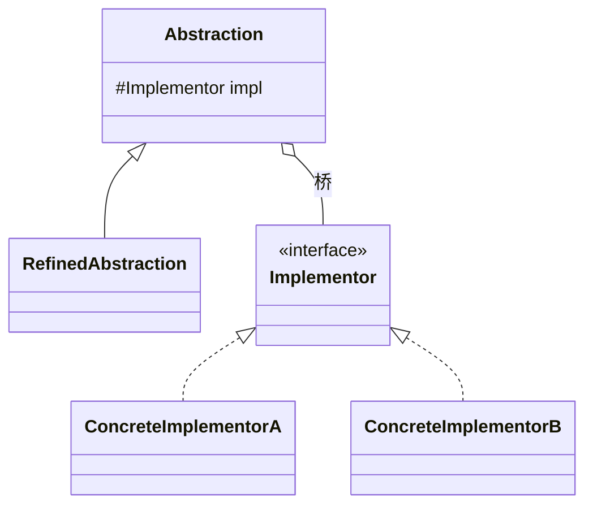

# 桥接（Bridge）

> 一句话意图：把**抽象部分**与其**实现部分**分离，使二者可以独立地变化，用组合代替继承层级的爆炸。

## 适用场景

- 一个类存在**两个（或多个）维度的变化**，用继承会产生 m×n 个子类。
- 想避免抽象与实现被编译期绑定，希望在运行时切换实现。
- 典型二维：图形 × 系统、消息类型 × 发送渠道、语句类型 × 数据库方言。

## 结构与角色

| 角色 | 职责 |
|------|------|
| `Abstraction` | 抽象层，持有 `Implementor` 引用，提供高层操作 |
| `RefinedAbstraction` | 扩展抽象，调用实现层完成业务 |
| `Implementor` | 实现层接口，定义底层行为 |
| `ConcreteImplementor` | 实现层的具体实现 |



## Java 示例（消息类型 × 发送渠道）

```java
// 实现层：发送渠道
interface MessageSender {
    void send(String content);
}
class SmsSender implements MessageSender {
    @Override public void send(String c) { System.out.println("短信发送: " + c); }
}
class EmailSender implements MessageSender {
    @Override public void send(String c) { System.out.println("邮件发送: " + c); }
}

// 抽象层：消息类型，持有发送渠道（桥）
abstract class Message {
    protected final MessageSender sender;      // 组合，而非继承
    protected Message(MessageSender sender) { this.sender = sender; }
    public abstract void send(String content);
}

class NormalMessage extends Message {
    public NormalMessage(MessageSender sender) { super(sender); }
    @Override public void send(String c) { sender.send("【普通】" + c); }
}
class UrgentMessage extends Message {
    public UrgentMessage(MessageSender sender) { super(sender); }
    @Override public void send(String c) { sender.send("【加急】" + c); }
}

public class Client {
    public static void main(String[] args) {
        // 两个维度自由组合：2 种消息 × 2 种渠道 = 4 种用法，无需 4 个子类
        Message m = new UrgentMessage(new EmailSender());
        m.send("服务器宕机");
    }
}
```

## 优缺点

| 优点 | 缺点 |
|------|------|
| 抽象与实现独立演化，避免类爆炸 | 增加系统抽象层次，理解成本上升 |
| 运行时切换实现，灵活 | 需求识别不准时，桥接可能被过度设计 |
| 符合开闭与合成复用原则 | 只在确实存在多维度变化时才划算 |

## 与相似模式的区别

- **vs 继承**：继承是编译期静态绑定、维度相乘；桥接用组合在运行期动态组合，维度相加。
- **vs 适配器**：桥接是**设计之初**的分离；适配器是**事后**对不兼容接口的补救。
- **vs 策略**：策略强调**算法可替换**（同一接口多种算法）；桥接强调**抽象与实现两个维度各自独立扩展**。

## 实践要点与坑

- 只有当确实存在**两个及以上独立变化维度**时才用桥接，否则是过度设计。
- 「抽象」与「实现」是相对概念：上层业务逻辑 vs 底层平台/驱动，各按一个维度抽。
- 桥接常与抽象工厂配合：由工厂决定注入哪种实现层，构造出状态一致的抽象对象。
- 若两个维度未来会合并成业务概念，别急着桥接，先观察是否真会独立演化。

## 一句话记忆

**两个维度各自会变，就用「组合桥」把它们连起来，别让子类数量相乘。**

---

详解见 [结构型桥接模式](../design/bridge.md)。
