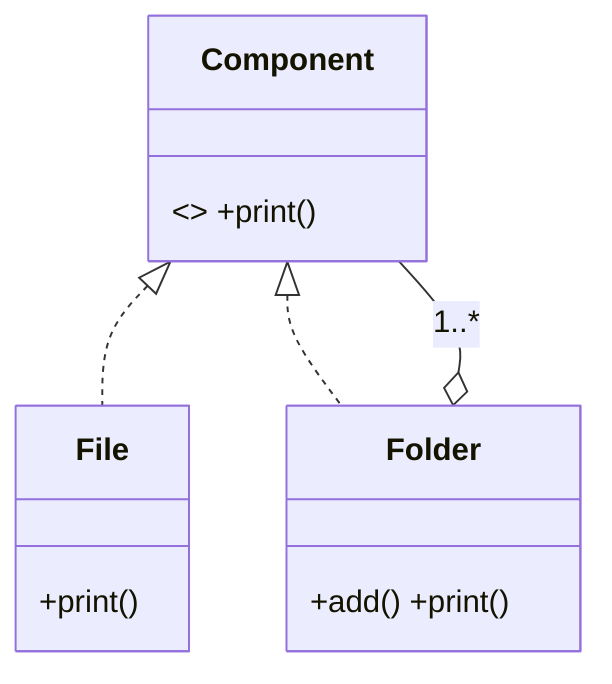

# 组合（Composite）

> 一句话意图：把对象组合成**树形结构**，让客户端对「单个对象」和「组合对象」的使用方式保持一致。

## 适用场景

- 数据天然是树：文件/文件夹、菜单/子菜单、组织架构、UI 容器与控件。
- 希望客户端递归处理、无需区分「叶子」还是「分支」。
- 需要在整棵树上做统一操作（统计大小、批量渲染、计算权限）。

## 结构与角色

| 角色 | 职责 |
|------|------|
| `Component` | 叶子和容器的公共接口 |
| `Leaf` | 叶子节点，无子节点，实现基本操作 |
| `Composite` | 容器节点，持有子节点集合，转发并聚合操作 |

两种 API 设计：**透明式**（`Component` 里声明 `add/remove`，容器实现、叶子空实现或抛异常）与**安全式**（只有 `Composite` 有 `add/remove`）。前者客户端一致但不够安全，后者安全但需类型判断。



## Java 示例（文件与文件夹）

```java
import java.util.ArrayList;
import java.util.List;

// 统一接口
interface Node {
    void print(String prefix);
}

// 叶子：文件
class FileNode implements Node {
    private final String name;
    private final long size;

    FileNode(String name, long size) { this.name = name; this.size = size; }

    @Override public void print(String prefix) {
        System.out.println(prefix + "文件 " + name + " (" + size + "B)");
    }
}

// 容器：文件夹，可含文件或子文件夹
class FolderNode implements Node {
    private final String name;
    private final List<Node> children = new ArrayList<>();

    FolderNode(String name) { this.name = name; }

    // 安全式：add 只在容器上提供
    public void add(Node node) { children.add(node); }

    @Override public void print(String prefix) {
        System.out.println(prefix + "目录 " + name);
        for (Node child : children) {
            child.print(prefix + "  ");   // 递归，客户端无感
        }
    }
}

public class Demo {
    public static void main(String[] args) {
        FolderNode root = new FolderNode("src");
        root.add(new FileNode("Main.java", 1200));
        FolderNode util = new FolderNode("util");
        util.add(new FileNode("StringUtils.java", 800));
        root.add(util);

        root.print("");   // 统一处理整棵树
    }
}
```

## 优缺点

| 优点 | 缺点 |
|------|------|
| 客户端一致地处理叶子与容器 | 透明式 API 让叶子继承无意义方法，不够安全 |
| 天然支持递归与树形操作 | 容器过深时递归有栈溢出风险 |
| 易于新增节点类型 | 「父引用」设计不当会让结构变复杂 |

## 与相似模式的区别

- **vs 装饰器**：装饰器**只有一条**链，逐层包裹单一对象；组合是**树**，容器持有**多个**子节点。
- **vs 代理**：代理对同一接口做访问控制；组合关注**部分-整体**层次。
- **vs 外观**：外观简化对**平级子系统**的调用；组合是对**树形结构**的统一递归处理。

## 实践要点与坑

- 递归遍历深度大时要防栈溢出，可改迭代 + 显式栈。
- 容器节点增删子节点后注意失效缓存（如统计的节点总数/大小）。
- 若需要「子节点反向找到父节点」，在 `add` 时维护 `parent` 引用，但要避免强引用环导致无法回收。
- 明确用**透明式**还是**安全式** API：透明式客户端调用一致但叶子要处理无意义的 `add`；安全式更严谨但需类型判断。

## 一句话记忆

**树形数据就用组合：叶子与容器同一接口，递归遍历一视同仁。**

---

详解见 [结构型组合模式](../design/composite.md)。
