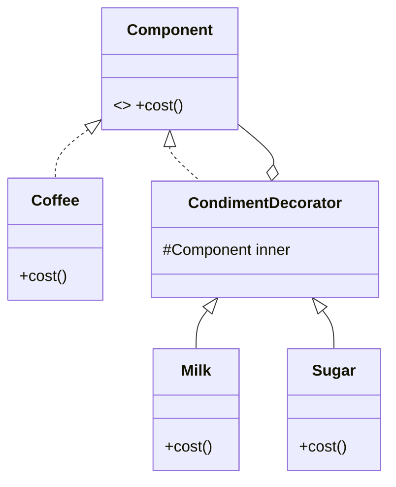

# 装饰器（Decorator）

> 一句话意图：在不改变对象接口的前提下，**动态地**给对象叠加职责，用组合替代继承来扩展功能。

## 适用场景

- 功能可以自由排列组合，用继承会产生大量子类（如「加奶 + 加糖」的所有组合）。
- 想在运行时按需增删能力，而不想改动原始类。
- 需要透明地为对象增强：客户端看到的接口不变。

## 结构与角色

| 角色 | 职责 |
|------|------|
| `Component` | 抽象接口，被装饰者与装饰者共同实现 |
| `ConcreteComponent` | 基础组件，被装饰的对象 |
| `Decorator` | 持有 `Component` 引用，实现同一接口 |
| `ConcreteDecorator` | 在转发前后附加额外行为 |



## Java 示例（咖啡加料）

```java
// 抽象组件
interface Coffee {
    double cost();
    String desc();
}

// 基础组件
class Espresso implements Coffee {
    @Override public double cost() { return 20.0; }
    @Override public String desc() { return "浓缩"; }
}

// 抽象装饰者：持有一个 Coffee
abstract class Condiment implements Coffee {
    protected final Coffee inner;              // 被包裹的组件
    protected Condiment(Coffee inner) { this.inner = inner; }
}

class Milk extends Condiment {
    public Milk(Coffee inner) { super(inner); }
    @Override public double cost() { return inner.cost() + 3.0; }  // 转发 + 增强
    @Override public String desc() { return inner.desc() + "+牛奶"; }
}

class Sugar extends Condiment {
    public Sugar(Coffee inner) { super(inner); }
    @Override public double cost() { return inner.cost() + 1.5; }
    @Override public String desc() { return inner.desc() + "+糖"; }
}

public class Demo {
    public static void main(String[] args) {
        // 自由叠加，顺序任意
        Coffee c = new Sugar(new Milk(new Espresso()));
        System.out.println(c.desc() + " = " + c.cost()); // 浓缩+牛奶+糖 = 24.5
    }
}
```

JDK IO 是标杆：`new BufferedReader(new InputStreamReader(new FileInputStream(f)))` 层层包装，每层只加一项能力。

## 优缺点

| 优点 | 缺点 |
|------|------|
| 动态扩展，组合灵活、无类爆炸 | 叠加过多层会生成大量小对象，调试跟踪变难 |
| 遵循开闭原则，不改原类 | 多层装饰后实例类型复杂，可能影响判断 |
| 每一层职责单一 | 装饰顺序有时会影响结果 |

## 与相似模式的区别

- **vs 继承**：继承是编译期静态、单维度扩展；装饰器是运行期动态、可任意组合。
- **vs 代理**：结构相似，但**意图不同**——装饰器**增强功能**，代理**控制访问**（且代理常自己创建目标，装饰器由外部传入目标）。
- **vs 适配器**：适配器**改接口**；装饰器**保持接口不变**、只加职责。

## 实践要点与坑

- 装饰器与被装饰者必须**同一接口**，客户端才能透明使用。
- 装饰层数不宜过多，否则对象数与小方法调用开销上升、堆栈难读。
- 明确装饰顺序的影响：有的增强有前后依赖，顺序不同结果可能不同。
- 若只是偶尔、固定地加一种能力，直接写专类或继承更简单，不必上装饰器。

## 一句话记忆

**接口不变、能力可叠：层层包裹，`new A(new B(new C()))`，比继承更灵活。**

---

详解见 [结构型装饰者模式](../design/decorator.md)。
