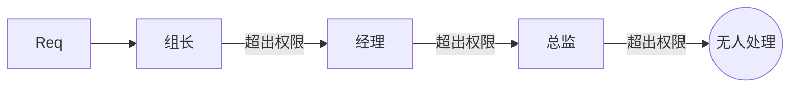

# 责任链（Chain of Responsibility）

> 一句话意图：把多个处理者连成一条链，让请求沿链传递，直到被某个处理者处理，从而给请求的发送者和接收者解耦。

## 适用场景

- 多个对象都可能处理同一请求，但由谁处理在运行时才定（如按金额分级审批）。
- 需要按顺序执行一连串处理步骤，且步骤可增删：过滤器、拦截器、校验流水线。
- 典型实现：Servlet `Filter`、Spring `HandlerInterceptor`、Netty `ChannelPipeline`、网关职责链。

## 结构与角色

| 角色 | 职责 |
|------|------|
| `Handler` | 抽象处理者，持有下一个处理者引用、声明 `handle()` |
| `ConcreteHandler` | 能处理则处理，否则转给下一个 |
| `Client` | 组装链并发出请求 |



## Java 示例（分级审批）

```java
// 抽象处理者
abstract class Approver {
    protected Approver next;                 // 下一个处理者

    public Approver setNext(Approver next) { // 链式组装，返回下一个便于串联
        this.next = next;
        return next;
    }

    public abstract void approve(int amount);
}

class TeamLeader extends Approver {
    @Override public void approve(int amount) {
        if (amount <= 1000) {
            System.out.println("组长审批通过 " + amount);
        } else if (next != null) {
            next.approve(amount);            // 无权处理，传递
        }
    }
}

class Manager extends Approver {
    @Override public void approve(int amount) {
        if (amount <= 5000) {
            System.out.println("经理审批通过 " + amount);
        } else if (next != null) {
            next.approve(amount);
        }
    }
}

class Director extends Approver {
    @Override public void approve(int amount) {
        System.out.println("总监审批通过 " + amount);  // 最高权限，兜底
    }
}

public class Client {
    public static void main(String[] args) {
        Approver leader = new TeamLeader();
        leader.setNext(new Manager()).setNext(new Director());
        leader.approve(300);    // 组长处理
        leader.approve(8000);   // 一路传递到总监
    }
}
```

## 优缺点

| 优点 | 缺点 |
|------|------|
| 发送者与接收者解耦，链可动态组装 | 不保证请求一定被处理（可能走到链尾仍无人管） |
| 处理者职责单一、易于增删 | 链过长时性能下降、调试追踪困难 |
| 符合开闭原则，加节点不必改旧节点 | 可能出现循环链导致的死循环 |

## 与相似模式的区别

- **vs 装饰器**：都靠「持有下一个」串联，但装饰器**每一层都执行并增强**；责任链**一旦被处理通常中断**传递。
- **vs 观察者**：观察者是**一对多广播**，通知所有订阅者；责任链是**一对一传递**，沿链寻找处理者。
- **vs 状态**：状态是**对象内部**状态驱动行为切换；责任链是**多个独立对象**按链处理请求。

## 实践要点与坑

- **设好链尾兜底**：决定「无人处理」时是静默丢弃、抛异常还是记录日志，避免请求凭空消失。
- 防**循环链**：组装时校验，别让 `next` 指回自身或形成环，否则会栈溢出。
- 链越长性能越低，且断点调试要跨多个处理器；高频路径上衡量是否值得。
- 处理者内部**不要直接依赖链上具体节点**，只用抽象 `Handler`，才能自由插拔。
- 与「过滤器」的区别：过滤器通常**每个都执行**（可中断），责任链偏好**命中即止**。
- 组装方式可灵活：Client 手动 `setNext`，或由框架按注解/配置自动排序（如拦截器 order）。
- 责任链适合**流程**型处理；若是**数据变换**型的逐层加工，管道/装饰器更贴切。

## 一句话记忆

**一个请求串成一串：能办就办、办不了就往下传，链可拼装、职责单一。**

---

详解见 [行为型职责链模式](../design/responsibility.md)。
