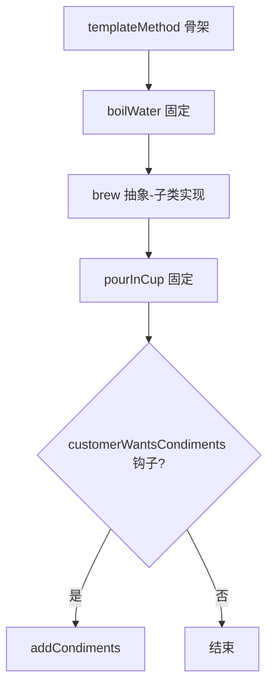

# 模板方法（Template Method）

> 一句话意图：在父类中定义算法的**骨架**，把其中若干可变步骤延迟到子类实现，骨架流程不变、局部步骤可定制。

## 适用场景

- 多个流程**步骤次序固定、个别步骤实现不同**（如各种「制作饮料」、各种导入导出）。
- 框架定义算法骨架并留出扩展点，由使用者填充细节（`*Template` 家族）。
- 想复用公共流程代码，避免子类重复写同样的步骤编排。

## 结构与角色

| 角色 | 职责 |
|------|------|
| `AbstractClass` | 定义 `templateMethod()` 骨架，声明抽象步骤与可选**钩子方法** |
| `ConcreteClass` | 实现抽象步骤，可重写钩子 |

要点：`templateMethod()` 常声明为 `final`，防止子类篡改流程；可变步骤为 `abstract`，可选步骤用**钩子方法**（有默认空实现）。



## Java 示例（冲泡饮料）

```java
abstract class Beverage {
    // 模板方法：流程固定，声明 final 防止子类改写顺序
    public final void prepare() {
        boilWater();
        brew();                 // 抽象步骤，子类实现
        pourInCup();
        if (customerWantsCondiments()) {   // 钩子控制可选步骤
            addCondiments();
        }
    }

    private void boilWater() { System.out.println("烧水"); }
    private void pourInCup() { System.out.println("倒入杯中"); }

    protected abstract void brew();            // 必须实现
    protected abstract void addCondiments();

    // 钩子方法：默认返回 true，子类可按需重写
    protected boolean customerWantsCondiments() { return true; }
}

class Coffee extends Beverage {
    @Override protected void brew() { System.out.println("冲泡咖啡粉"); }
    @Override protected void addCondiments() { System.out.println("加糖和牛奶"); }
}

class Tea extends Beverage {
    @Override protected void brew() { System.out.println("浸泡茶叶"); }
    @Override protected void addCondiments() { System.out.println("加柠檬"); }
    @Override protected boolean customerWantsCondiments() { return false; } // 不加料
}

public class Demo {
    public static void main(String[] args) {
        new Coffee().prepare();
        System.out.println("----");
        new Tea().prepare();
    }
}
```

Spring 的 `JdbcTemplate`、`RestTemplate`、`AbstractApplicationContext#refresh` 都是模板方法的实战：框架固定执行骨架，把可变部分（回调、子类实现）留给使用者。

## 优缺点

| 优点 | 缺点 |
|------|------|
| 复用骨架代码，子类只关注差异 | 继承耦合较紧，父类改动影响所有子类 |
| 控制流程一致，约束子类不破坏顺序 | 复杂骨架会让继承层次变深、难维护 |
| 钩子方法提供灵活扩展点 | 受 Java 单继承限制，扩展维度有限 |

## 与相似模式的区别

- **vs 策略**：模板方法用**继承**在编译期决定步骤；策略用**组合**在运行时整体替换算法。
- **vs 工厂方法**：工厂方法往往就是模板方法里的一个步骤——骨架调用抽象工厂方法产出对象。
- **vs 回调**：回调是「把行为作为参数传入」，模板方法靠「子类覆写」；现代框架常用回调替代继承。

## 实践要点与坑

- `templateMethod()` 声明为 `final`，锁死执行顺序，子类只能填充步骤。
- 可变步骤用 `protected abstract`，可选步骤用**钩子**给默认实现。
- 现代框架更倾向用**回调/函数式接口**替代子类继承，减少继承层次。
- 父类骨架应保持稳定；骨架频繁变动会波及所有子类。

## 一句话记忆

**父类定流程、子类填步骤：骨架 `final` 不能改，钩子按需重写。**

---

详解见 [行为型模板方法模式](../design/template-method.md)。
