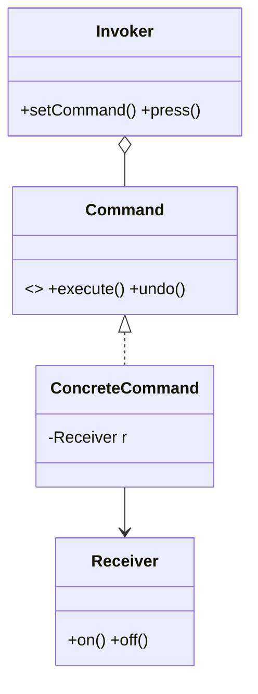

# 命令（Command）

> 一句话意图：把一次**请求**封装成一个对象，从而可以参数化调用方、排队、记录日志、支持撤销与重做。

## 适用场景

- 需要**撤销/重做**：编辑器、绘图工具的操作历史。
- 需要**排队或延迟执行**：任务队列、线程池提交的 `Runnable`。
- 需要把「发出请求」与「执行请求」解耦，例如 GUI 按钮与业务动作、遥控器与家电。

## 结构与角色

| 角色 | 职责 |
|------|------|
| `Command` | 命令接口，声明 `execute()`（常配 `undo()`） |
| `ConcreteCommand` | 绑定一个接收者，`execute()` 里调用接收者的方法 |
| `Receiver` | 真正干活的对象（如电灯） |
| `Invoker` | 持有命令对象并触发执行（如遥控器） |
| `Client` | 创建命令并绑定接收者 |



## Java 示例（遥控开关灯）

```java
// 接收者：真正执行动作的对象
class Light {
    public void on()  { System.out.println("灯已打开"); }
    public void off() { System.out.println("灯已关闭"); }
}

// 命令接口
interface Command {
    void execute();
    void undo();          // 支持撤销
}

// 具体命令：把接收者和动作绑定
class LightOnCommand implements Command {
    private final Light light;
    LightOnCommand(Light light) { this.light = light; }
    @Override public void execute() { light.on(); }
    @Override public void undo()    { light.off(); }
}

class LightOffCommand implements Command {
    private final Light light;
    LightOffCommand(Light light) { this.light = light; }
    @Override public void execute() { light.off(); }
    @Override public void undo()    { light.on(); }
}

// 调用者：不关心具体是谁在干活
class RemoteControl {
    private Command command;
    public void setCommand(Command command) { this.command = command; }
    public void press()      { command.execute(); }
    public void pressUndo()  { command.undo(); }
}

public class Demo {
    public static void main(String[] args) {
        Light light = new Light();
        RemoteControl remote = new RemoteControl();

        remote.setCommand(new LightOnCommand(light));
        remote.press();        // 灯已打开
        remote.pressUndo();    // 灯已关闭

        remote.setCommand(new LightOffCommand(light));
        remote.press();        // 灯已关闭
    }
}
```

JDK 里的 `Runnable` 命令模式味道很浓：`Thread`/线程池是 Invoker，`run()` 是 `execute()`；`java.util.concurrent` 的任务队列天然支持排队与异步。

## 优缺点

| 优点 | 缺点 |
|------|------|
| 请求对象化，支持排队、日志、撤销 | 每个命令一个类，类数量增多 |
| 调用者与接收者解耦 | 简单场景引入命令反而增加复杂度 |
| 便于组合成宏命令（命令列表） | 撤销逻辑复杂时实现成本高 |

## 与相似模式的区别

- **vs 策略**：策略把「同一件事的不同算法」换来换去；命令把「一次请求」封装成对象，强调**记录/撤销/排队**。
- **vs 责任链**：责任链是请求沿链寻找处理者；命令是请求被封装后交给指定接收者执行。
- **vs 备忘录**：命令的 `undo` 常借助备忘录保存/恢复接收者状态。

## 一句话记忆

**把「动作」变成对象：一个命令一个类，能排队、能记录、能撤销。**

---

详解见 [行为型命令模式](../design/command.md)。
