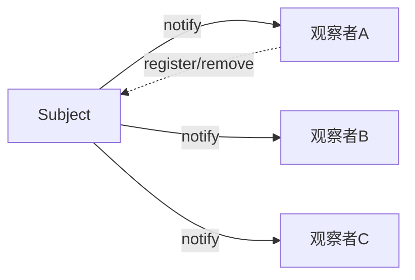

# 观察者（Observer）

> 一句话意图：定义对象间**一对多**的依赖，当被观察者状态变化时，自动通知并更新所有观察者。

## 适用场景

- 事件驱动：状态变更要触发多方反应（下单后通知库存、积分、消息）。
- 发布-订阅、消息总线、UI 数据绑定（数据变 → 视图刷新）。
- 一个对象的变化需要广播给数量不定的订阅者。

## 结构与角色

| 角色 | 职责 |
|------|------|
| `Subject`（被观察者） | 维护观察者列表，提供注册/移除/通知 |
| `Observer` | 定义更新接口 `update()` |
| `ConcreteObserver` | 收到通知后执行自己的逻辑 |



## Java 示例（订单状态通知）

```java
import java.util.ArrayList;
import java.util.List;

// 观察者接口
interface OrderObserver {
    void onOrderPaid(String orderId);
}

// 被观察者：维护订阅者列表并在状态变化时通知
class OrderSubject {
    private final List<OrderObserver> observers = new ArrayList<>();

    public void addObserver(OrderObserver o)    { observers.add(o); }
    public void removeObserver(OrderObserver o) { observers.remove(o); }

    // 业务动作触发后，广播给所有观察者
    public void paySuccess(String orderId) {
        System.out.println("订单 " + orderId + " 支付成功");
        for (OrderObserver o : observers) {
            o.onOrderPaid(orderId);
        }
    }
}

// 具体观察者
class InventoryObserver implements OrderObserver {
    @Override public void onOrderPaid(String orderId) {
        System.out.println("  → 库存扣减: " + orderId);
    }
}
class PointsObserver implements OrderObserver {
    @Override public void onOrderPaid(String orderId) {
        System.out.println("  → 增加积分: " + orderId);
    }
}

public class Demo {
    public static void main(String[] args) {
        OrderSubject subject = new OrderSubject();
        subject.addObserver(new InventoryObserver());
        subject.addObserver(new PointsObserver());
        subject.paySuccess("A1001");   // 两个观察者都被通知
    }
}
```

框架实践：Spring 的 `ApplicationEvent` + `@EventListener`、Guava `EventBus`、消息中间件都体现该模式思想。JDK 自带的 `java.util.Observable`/`Observer` 因设计缺陷，自 Java 9 起已被标记过时，新代码不建议使用，改用 `PropertyChangeSupport` 或自定义事件。

## 优缺点

| 优点 | 缺点 |
|------|------|
| 解耦被观察者与观察者，支持广播 | 观察者数量多时通知开销大 |
| 可动态增删订阅者 | 通知顺序不确定，可能引发级联更新 |
| 符合开闭原则，新增观察者不改被观察者 | 忘记注销易造成内存泄漏/悬挂引用 |

## 与相似模式的区别

- **vs 发布-订阅**：观察者模式中被观察者**直接持有**观察者列表；发布-订阅通过**事件总线/中介**间接通信，双方互不感知。
- **vs 中介者**：中介者封装**多对多**交互、减少网状依赖；观察者是**一对多**的广播通知。
- **vs 责任链**：责任链是一对一沿链传递、找到处理者即止；观察者是一对多通知所有订阅者。

## 实践要点与坑

- 通知里若执行**耗时操作**，应异步化，避免拖慢被观察者主流程。
- 观察者异常不应中断整个通知循环，逐条 try-catch 隔离。
- 及时注销不再需要的观察者，防止内存泄漏（长生命周期主题持有短生命周期观察者时尤甚）。
- 注意通知顺序与级联更新，避免观察者在回调里又触发新一轮通知造成无限循环。

## 一句话记忆

**状态一变、广播一圈：被观察者存订阅者列表，事件来了挨个 `update`。**

---

详解见 [行为型观察者模式](../design/observer.md)。
