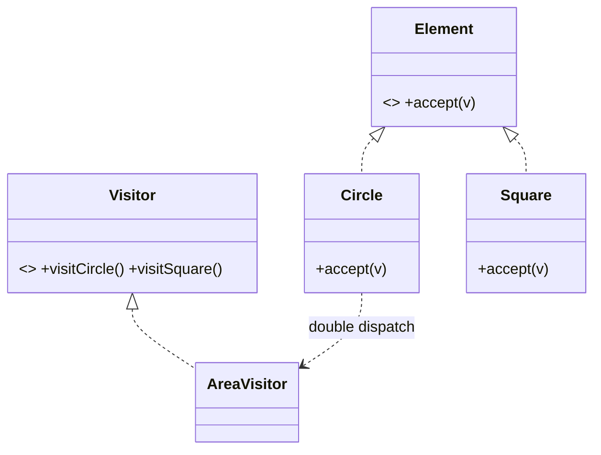

# 访问者（Visitor）

> 一句话意图：在不修改元素类的前提下，定义**作用于某对象结构**中的各元素的新操作，把「操作」与「元素结构」分离。

## 适用场景

- 对象结构**相对稳定**（元素类型固定），但**操作经常新增**（统计、导出、校验、格式化）。
- 需要对一组异构元素做多种互不相关的运算，而不想把它们塞进元素类。
- 典型：编译器 AST 遍历（语法检查、代码生成、美化打印各自是独立访问者）。

## 结构与角色

| 角色 | 职责 |
|------|------|
| `Visitor` | 为每种元素声明一个 `visit(ConcreteElement)` 方法 |
| `ConcreteVisitor` | 实现各元素的访问逻辑（一种操作） |
| `Element` | 声明 `accept(Visitor)` |
| `ConcreteElement` | 在 `accept` 中回调 `visitor.visit(this)` |
| `ObjectStructure` | 元素集合，遍历并让访问者访问 |

核心机制是**双重分派**：`element.accept(visitor)` 决定「哪个元素」，`visitor.visit(this)` 决定「哪个操作」，两重多态共同定位到具体方法。



## Java 示例（图形面积的多种统计）

```java
// 访问者：为每种元素类型提供一个访问方法
interface ShapeVisitor {
    void visit(Circle c);
    void visit(Square s);
}

// 元素：accept 把「自己」交给访问者，实现双重分派
interface Shape {
    void accept(ShapeVisitor visitor);
}

class Circle implements Shape {
    final double radius;
    Circle(double radius) { this.radius = radius; }
    @Override public void accept(ShapeVisitor visitor) { visitor.visit(this); }
}

class Square implements Shape {
    final double side;
    Square(double side) { this.side = side; }
    @Override public void accept(ShapeVisitor visitor) { visitor.visit(this); }
}

// 具体访问者：新增「算面积」操作，无需改 Shape 及其子类
class AreaVisitor implements ShapeVisitor {
    private double total;
    @Override public void visit(Circle c) { total += Math.PI * c.radius * c.radius; }
    @Override public void visit(Square s) { total += s.side * s.side; }
    public double getTotal() { return total; }
}

public class Demo {
    public static void main(String[] args) {
        Shape[] shapes = { new Circle(1.0), new Square(2.0) };
        AreaVisitor visitor = new AreaVisitor();
        for (Shape s : shapes) {
            s.accept(visitor);              // 双重分派，分发到正确的 visit
        }
        System.out.printf("总面积 = %.2f%n", visitor.getTotal());
    }
}
```

新增一种操作，只需再加一个 `ShapeVisitor` 实现；元素类原封不动。

## 优缺点

| 优点 | 缺点 |
|------|------|
| 新增操作容易，符合开闭原则 | 新增**元素类型**要改所有访问者，代价大 |
| 把相关操作集中到一个访问者，职责清晰 | 破坏封装：访问者常需读取元素内部状态 |
| 可跨异构元素统一处理 | 元素结构须稳定，否则维护困难 |

## 与相似模式的区别

- **vs 迭代器**：迭代器负责**遍历**、只访问同类元素；访问者负责**对元素做操作**，可处理异构元素。
- **vs 策略**：策略替换**单个**对象的算法；访问者遍历**整个结构**、对每种元素分别施加操作。
- **vs 组合**：组合定义树的统一接口；访问者常**配合组合**在树上遍历并施加新操作。

## 一句话记忆

**元素结构稳定、操作常变：把操作外提成访问者，`accept` + `visit` 双重分派。**

---

详解见 [行为型访问者模式](../design/visitor.md)。
