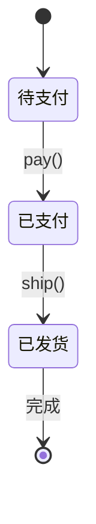

# 状态（State）

> 一句话意图：允许一个对象在**内部状态改变时改变它的行为**，看起来就像换了另一个类。

## 适用场景

- 对象行为随状态而变，且状态间有明确的转移规则（订单流转、审批流、连接生命周期）。
- 代码里塞满 `if/switch` 判断当前状态再决定做什么。
- 需要把庞大状态机拆成一个个职责单一的状态类。

## 结构与角色

| 角色 | 职责 |
|------|------|
| `State` | 状态接口，声明各事件对应的行为 |
| `ConcreteState` | 具体状态，实现本状态下的行为并负责状态转移 |
| `Context` | 持有当前状态，把请求委托给它（如 `Order`） |

与策略结构几乎一致，差别在于：**状态会驱动 Context 切换到下一个状态**，客户端通常不需要知道状态细节。



## Java 示例（订单状态流转）

```java
// 状态接口：定义各事件
interface OrderState {
    void pay(OrderContext ctx);
    void ship(OrderContext ctx);
}

// 具体状态：待支付
class PendingState implements OrderState {
    @Override public void pay(OrderContext ctx) {
        System.out.println("支付成功，状态转为已支付");
        ctx.setState(new PaidState());            // 触发状态转移
    }
    @Override public void ship(OrderContext ctx) {
        System.out.println("未支付，无法发货");
    }
}

// 具体状态：已支付
class PaidState implements OrderState {
    @Override public void pay(OrderContext ctx) {
        System.out.println("已支付，请勿重复支付");
    }
    @Override public void ship(OrderContext ctx) {
        System.out.println("发货成功，状态转为已发货");
        ctx.setState(new ShippedState());
    }
}

// 具体状态：已发货
class ShippedState implements OrderState {
    @Override public void pay(OrderContext ctx) { System.out.println("已发货，不能支付"); }
    @Override public void ship(OrderContext ctx) { System.out.println("已发货，请勿重复发货"); }
}

// 上下文：持有当前状态，委托调用
class OrderContext {
    private OrderState state = new PendingState();   // 初始状态
    public void setState(OrderState state) { this.state = state; }
    public void pay()  { state.pay(this); }
    public void ship() { state.ship(this); }
}

public class Demo {
    public static void main(String[] args) {
        OrderContext order = new OrderContext();
        order.ship();   // 未支付，无法发货
        order.pay();    // 支付成功，状态转为已支付
        order.ship();   // 发货成功，状态转为已发货
        order.pay();    // 已发货，不能支付
    }
}
```

## 优缺点

| 优点 | 缺点 |
|------|------|
| 消除庞大的状态分支，职责清晰 | 状态类数量随状态数增长 |
| 状态转移显式、集中易维护 | 状态间耦合，新增状态要理清转移关系 |
| 符合开闭原则，加状态不改旧状态 | 简单状态机用它显得过度设计 |

## 与相似模式的区别

- **vs 策略**：策略的算法由**客户端主动选择**，彼此可自由互换、无转移关系；状态由**内部状态**驱动自动切换，状态间转移规则明确。
- **vs 状态机表驱动**：表驱动（枚举 + switch）适合状态少的场景；状态模式适合状态多、转移复杂、每态行为丰富的场景。
- **vs 责任链**：责任链是**多个对象**按链处理同一请求；状态是**一个对象**在不同状态下的行为变化。

## 实践要点与坑

- 状态对象通常**无状态**，可作为枚举常量/单例复用，避免频繁 `new`。
- 状态转移要集中、可追溯；非法事件应给出明确反馈而非静默吞掉。
- 状态少、转移简单时，用枚举 + `switch` 表驱动反而更直观，别硬套模式。
- 状态模式解决的是**行为随状态变**，若只是数据字段不同，无需状态类。

## 一句话记忆

**把状态做成类：每个状态管自己的行为，转移时换下一个状态对象，告别大 switch。**

---

详解见 [行为型状态模式](../design/state.md)。
