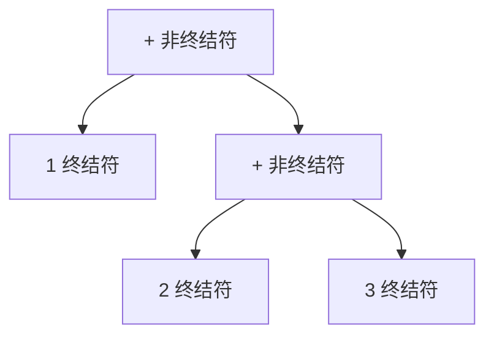

# 解释器（Interpreter）

> 一句话意图：给定一种语言，定义它的**文法表示**，并定义一个解释器来**解释**该语言中的句子。

## 适用场景

- 需要解释执行**简单文法**的表达式：加减法、布尔条件、简单查询/规则 DSL。
- 文法可映射成抽象语法树（AST），且节点类型稳定。
- 规则频繁变、又不想每次改代码，可用它实现可配置的规则表达式。

复杂语法（完整编程语言、SQL）更适合用词法/语法分析器（如 ANTLR）生成，而不是手写解释器模式。

## 结构与角色

| 角色 | 职责 |
|------|------|
| `AbstractExpression` | 声明 `interpret(Context)` |
| `TerminalExpression` | 终结符（如数字、变量），不可再分 |
| `NonterminalExpression` | 非终结符（如加法、乘法），组合子表达式 |
| `Context` | 保存解释器需要的全局信息 |

终结符对应语法中的「叶子」，非终结符对应「组合」，整体是一棵树。



## Java 示例（求值 1 + 2 + 3）

```java
// 上下文：这里用一个 Map 保存变量值，示例加减法用不到变量，保留以便扩展
import java.util.Map;

// 抽象表达式
interface Expression {
    int interpret(Map<String, Integer> context);
}

// 终结符：数字
class NumberExpression implements Expression {
    private final int value;
    NumberExpression(int value) { this.value = value; }
    @Override public int interpret(Map<String, Integer> context) { return value; }
}

// 终结符：变量
class VariableExpression implements Expression {
    private final String name;
    VariableExpression(String name) { this.name = name; }
    @Override public int interpret(Map<String, Integer> context) {
        return context.getOrDefault(name, 0);
    }
}

// 非终结符：加法
class AddExpression implements Expression {
    private final Expression left;
    private final Expression right;
    AddExpression(Expression left, Expression right) {
        this.left = left; this.right = right;
    }
    @Override public int interpret(Map<String, Integer> context) {
        return left.interpret(context) + right.interpret(context);   // 递归解释
    }
}

public class Demo {
    public static void main(String[] args) {
        // 手工构建 AST：((1 + 2) + x)
        Map<String, Integer> ctx = Map.of("x", 3);
        Expression ast = new AddExpression(
                new AddExpression(new NumberExpression(1), new NumberExpression(2)),
                new VariableExpression("x"));
        System.out.println(ast.interpret(ctx));   // 1 + 2 + 3 = 6
    }
}
```

## 优缺点

| 优点 | 缺点 |
|------|------|
| 文法规则易于扩展、组合灵活 | 复杂文法会生成大量类，难维护 |
| 每条规则对应一个类，语义清晰 | 递归解释、效率一般，不适合性能敏感场景 |
| 适合小型领域语言/规则引擎 | 文法一复杂就不如用专业解析器 |

## 与相似模式的区别

- **vs 组合**：结构都是树、都递归处理；组合是**统一处理节点**，解释器是**对树做求值/解释**，每个节点有具体语义。
- **vs 访问者**：访问者把操作外提到`Visitor`；解释器把操作放在**每个表达式节点自身**的 `interpret` 里。
- **vs 策略**：策略是选**一个**算法；解释器是把**一棵表达式树**递归解释成结果。

## 一句话记忆

**语法树即模式：终结符当叶子、非终结符当组合，`interpret` 递归求值。**

---

详解见 [行为型解释器模式](../design/interpreter.md)。
