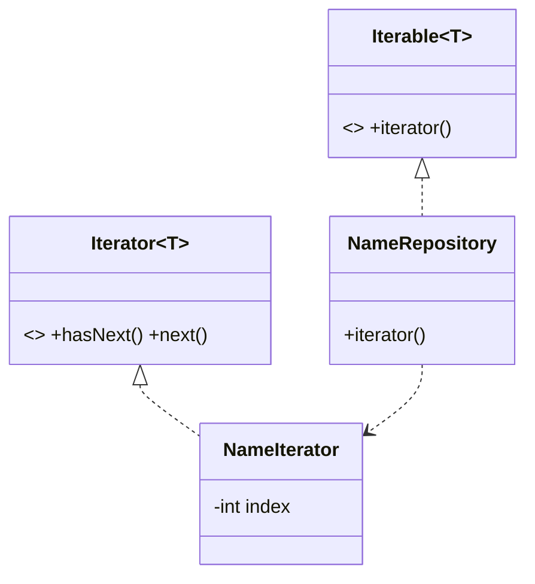

# 迭代器（Iterator）

> 一句话意图：提供一种方法**顺序访问**聚合对象中的元素，而不暴露其内部表示。

## 适用场景

- 需要遍历一个集合，又不想让调用方依赖集合的内部结构（数组/链表/树）。
- 想为同一聚合提供多种遍历方式（正序、逆序、按条件过滤）。
- 希望统一遍历入口，让不同集合拥有一致的遍历语法。

Java 已内建该模式：`java.util.Iterator` 与 `java.lang.Iterable`，`for-each` 语法糖底层就是迭代器。

## 结构与角色

| 角色 | 职责 |
|------|------|
| `Iterator` | 定义 `hasNext()` / `next()`（可选 `remove()`） |
| `ConcreteIterator` | 记录遍历位置，实现遍历算法 |
| `Aggregate` | 定义 `iterator()` 创建迭代器 |
| `ConcreteAggregate` | 返回具体的迭代器实现 |



## Java 示例

```java
import java.util.Iterator;
import java.util.NoSuchElementException;

// 聚合对象：实现 Iterable，就可用于 for-each
class NameRepository implements Iterable<String> {
    private final String[] names = {"张三", "李四", "王五"};

    @Override
    public Iterator<String> iterator() {
        return new NameIterator();
    }

    // 具体迭代器：持有遍历状态（不暴露给外部）
    private class NameIterator implements Iterator<String> {
        private int index = 0;

        @Override public boolean hasNext() { return index < names.length; }

        @Override public String next() {
            if (!hasNext()) throw new NoSuchElementException();
            return names[index++];
        }
    }
}

public class Demo {
    public static void main(String[] args) {
        NameRepository repo = new NameRepository();
        // for-each 底层调用 iterator()，编译期展开成 hasNext()/next()
        for (String name : repo) {
            System.out.println(name);
        }

        // 也可手动使用迭代器
        Iterator<String> it = repo.iterator();
        while (it.hasNext()) {
            System.out.println("手动: " + it.next());
        }
    }
}
```

JDK 的 `ArrayList`/`HashMap` 各自的 `iterator()`、集合框架的 fail-fast 机制、`Stream` 的惰性遍历都建立在迭代器之上。

## 优缺点

| 优点 | 缺点 |
|------|------|
| 遍历与聚合解耦，隐藏内部结构 | 增加类数量，简单集合显得绕 |
| 支持多种遍历方式、多个并存迭代器 | 遍历中修改集合易触发 `ConcurrentModificationException` |
| 统一遍历接口，配合 for-each 简洁 | 对某些结构，迭代器实现较繁琐 |

## 与相似模式的区别

- **vs 组合**：组合提供树形结构；迭代器负责**遍历**（可遍历组合成的树，如深度/广度优先）。
- **vs 访问者**：迭代器只管**遍历取元素**；访问者遍历后对每种元素**施加操作**。
- **vs for 循环**：直接按索引访问暴露了内部结构、耦合强；迭代器把遍历交给聚合本身，接口统一。

## 实践要点与坑

- 遍历中**不要**通过聚合自身的增删方法修改集合，否则 fail-fast 会抛 `ConcurrentModificationException`；需要删除时用迭代器的 `remove()`。
- 可为同一聚合提供多个独立迭代器，互不干扰。
- 自定义迭代器注意 `next()` 在无元素时的行为（应抛 `NoSuchElementException`）。
- 对不可变集合返回的迭代器，`remove()` 应抛出异常。

## 一句话记忆

**遍历方式归聚合自己管：`hasNext` + `next`，外部只见迭代器、不见内部结构。**

---

详解见 [行为型迭代器模式](../design/iterator.md)。
