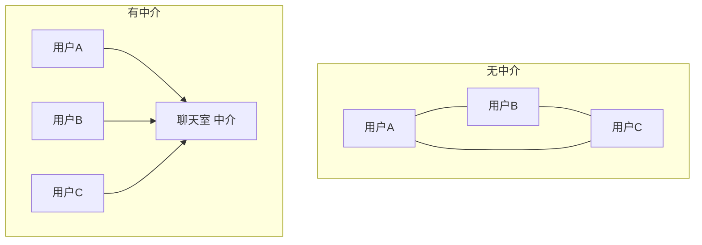

# 中介者（Mediator）

> 一句话意图：用一个**中介对象**封装一组对象之间的交互，把网状的多对多依赖变成星形的少对少依赖。

## 适用场景

- 对象之间两两交互，依赖关系形成「网状」，牵一发而动全身。
- 对话框里多个控件互相联动（选了下拉框，输入框要禁用/联动）。
- 聊天室、消息总线、CQRS 中的调度中枢，都可用中介者思路理解。

## 结构与角色

| 角色 | 职责 |
|------|------|
| `Mediator` | 定义同事对象之间通信的接口 |
| `ConcreteMediator` | 协调各同事对象，掌握它们的引用 |
| `Colleague`（同事） | 每个同事只认识中介者，不直接联系其他同事 |

没有中介者时，N 个对象两两通信有约 N²/2 条关系；引入中介者后降为 N 条。



## Java 示例（聊天室）

```java
import java.util.ArrayList;
import java.util.List;

// 中介者：聊天室
class ChatRoom {
    private final List<User> users = new ArrayList<>();

    public void register(User user) { users.add(user); }

    // 同事之间不直接说话，都经中介转达
    public void send(User from, String message) {
        for (User u : users) {
            if (u != from) {
                u.receive(from.getName() + ": " + message);
            }
        }
    }
}

// 同事：只持有中介者引用
class User {
    private final String name;
    private final ChatRoom room;

    User(String name, ChatRoom room) {
        this.name = name;
        this.room = room;
        room.register(this);           // 注册到中介者
    }

    public String getName() { return name; }

    public void send(String message) {
        room.send(this, message);      // 通过中介转发
    }

    public void receive(String message) {
        System.out.println(name + " 收到 -> " + message);
    }
}

public class Demo {
    public static void main(String[] args) {
        ChatRoom room = new ChatRoom();
        User a = new User("张三", room);
        User b = new User("李四", room);
        User c = new User("王五", room);

        a.send("大家好");               // b、c 收到
        b.send("你好张三");             // a、c 收到
    }
}
```

## 优缺点

| 优点 | 缺点 |
|------|------|
| 把网状依赖收敛为星形，降低耦合 | 中介者易膨胀成「上帝对象」，逻辑过于集中 |
| 同事对象可独立复用（只依赖中介接口） | 中介者一旦出问题，影响面大 |
| 交互逻辑集中，便于统一管理 | 交互简单时引入中介者反而增加复杂度 |

## 与相似模式的区别

- **vs 外观**：外观是**单向**的——子系统不知道外观；中介者的同事**都认识中介者**，是**双向**通信。
- **vs 观察者**：观察者是**一对多广播**，被观察者不关心观察者是谁；中介者负责**多对多协调**，可做路由与过滤。
- **vs 代理**：代理代表**单个**对象控制访问；中介者协调**一组**对象的交互。

## JDK 与框架中的实例

- `java.util.concurrent.Executor`：任务与执行线程（同事）之间由执行器中介转发。
- `java.util.Timer`：多个 `TimerTask` 通过同一个 `Timer` 调度，互不直接依赖。
- 消息中间件 / 事件总线：生产者与消费者不直接通信，由 broker 中介路由。

## 实践要点与坑

- 中介者承担交互逻辑，注意**别让它膨胀成上帝对象**，可按主题拆分多个中介。
- 同事对象只依赖 `Mediator` 抽象，不引用其他同事，才能真正解耦。
- 中介者与观察者常配合：中介内部用观察者广播、用策略做路由。
- 交互很简单、对象很少时，直接调用即可，别为中介而中介。
- 中介者对同事只暴露最小接口，减少反向耦合。

## 一句话记忆

**多对多太乱就加个中介：同事只找中介，交互逻辑集中在中间一点。**

---

详解见 [行为型中介模式](../design/mediator.md)。
