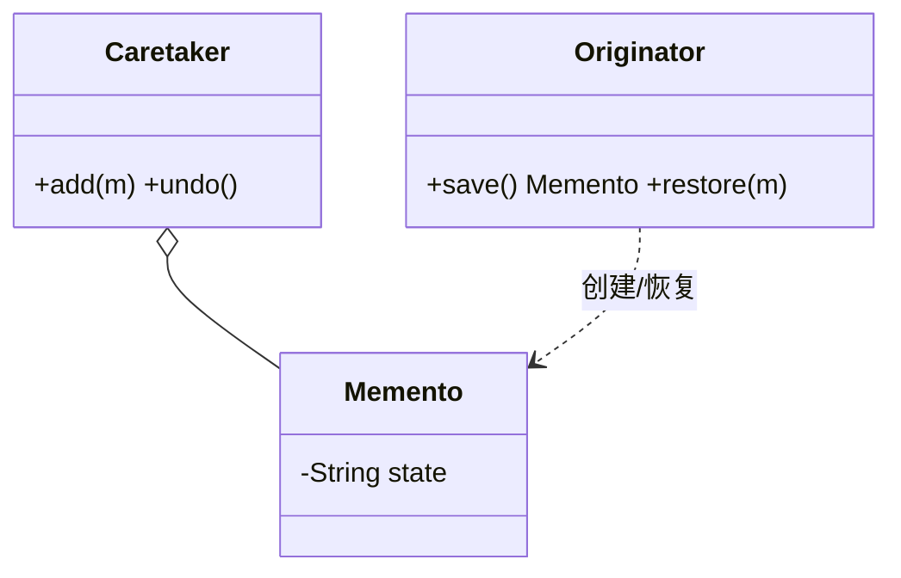

# 备忘录（Memento）

> 一句话意图：在不破坏封装的前提下，**捕获并保存**对象的内部状态，以便日后把对象**恢复到**该状态（撤销/快照）。

## 适用场景

- 需要**撤销/回滚**：编辑器的撤销、事务的回滚点、游戏的存档。
- 需要保存对象某时刻的**快照**，之后能精确恢复。
- 不能把对象内部状态暴露给外部，又要支持恢复。

## 结构与角色

| 角色 | 职责 |
|------|------|
| `Originator`（发起人） | 业务的宿主，负责**创建**备忘录与**从**备忘录**恢复** |
| `Memento`（备忘录） | 保存 Originator 的内部状态，对外只暴露必要信息 |
| `Caretaker`（管理者） | 只负责**保存/传递**备忘录，**不解读**其内容 |

关键点：只有 Originator 能读写备忘录的内部状态，Caretaker 只当代管，从而兼顾「可恢复」与「不破坏封装」。



## Java 示例（编辑器撤销）

```java
import java.util.ArrayDeque;
import java.util.Deque;

// 备忘录：保存某一时刻的内容，字段私有，仅 Originator 可读
final class Memento {
    private final String content;
    Memento(String content) { this.content = content; }
    private String getContent() { return content; }   // 仅内部可见
}

// 发起人：持有真实状态，能生成/恢复备忘录
class Editor {
    private StringBuilder content = new StringBuilder();

    public void type(String text) { content.append(text); }
    public String getContent() { return content.toString(); }

    public Memento save() { return new Memento(content.toString()); }

    public void restore(Memento memento) {
        content = new StringBuilder(memento.getContent());
    }
}

// 管理者：只保存备忘录，不碰内部状态
class History {
    private final Deque<Memento> stack = new ArrayDeque<>();

    public void push(Memento m) { stack.push(m); }

    public Memento undo() { return stack.isEmpty() ? null : stack.pop(); }
}

public class Demo {
    public static void main(String[] args) {
        Editor editor = new Editor();
        History history = new History();

        editor.type("Hello");
        history.push(editor.save());     // 存档

        editor.type(", World");
        editor.type("!");
        System.out.println("当前: " + editor.getContent());   // Hello, World!

        Memento last = history.undo();   // 撤销到上次存档
        if (last != null) {
            editor.restore(last);
        }
        System.out.println("恢复: " + editor.getContent());   // Hello
    }
}
```

## 优缺点

| 优点 | 缺点 |
|------|------|
| 恢复机制清晰，封装不被破坏 | 状态大或快照频繁时，内存占用高 |
| 撤销/回滚实现简单直接 | Caretaker 数量多时要自行管理生命周期与清理 |
| 发起人自主决定存取哪些状态 | 深拷贝大对象时性能开销明显 |

## 与相似模式的区别

- **vs 命令**：命令的 `undo` 常**借助备忘录**保存接收者状态——命令封装「动作」，备忘录封装「状态快照」。
- **vs 原型**：原型用克隆**创建新对象**；备忘录用快照**恢复旧状态**。
- **vs 序列化**：序列化是通用持久化手段，可作备忘录的**实现方式**之一，但备忘录更强调「封装内、临时性」的状态保存。

## 一句话记忆

**存档 + 读档：Originator 保存/恢复，Memento 只存状态，Caretaker 只当代管。**

---

详解见 [行为型备忘录模式](../design/memento.md)。
