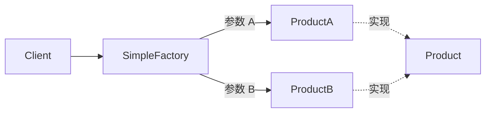

# 简单工厂（Simple Factory）

> 一句话意图：由一个工厂类根据传入参数，决定创建并返回哪一种产品类的实例，调用方不再直接 `new`。

## 适用场景

- 产品种类少、创建逻辑集中、变化不频繁。
- 想隐藏 `new` 的细节（如根据字符串/枚举选择实现）。
- 作为理解工厂家族的入门：它严格说**不属于 GoF 23 种**，而常被看作工厂方法的一种特例（工厂只有一家）。

## 结构与角色

| 角色 | 职责 |
|------|------|
| 抽象产品 `Product` | 产品的公共接口或抽象类 |
| 具体产品 `ConcreteProduct` | 具体实现，如 `Phone`、`Laptop` |
| 工厂 `SimpleFactory` | 静态方法按参数 `switch/if` 返回对应产品 |



## Java 示例

```java
// 抽象产品
interface Product {
    void use();
}

class Phone implements Product {
    @Override public void use() { System.out.println("使用手机"); }
}

class Laptop implements Product {
    @Override public void use() { System.out.println("使用笔记本"); }
}

// 简单工厂：用枚举参数选择产品，避免魔法字符串
enum ProductType { PHONE, LAPTOP }

class SimpleFactory {
    public static Product create(ProductType type) {
        switch (type) {
            case PHONE:  return new Phone();
            case LAPTOP: return new Laptop();
            default:     throw new IllegalArgumentException("未知产品类型: " + type);
        }
    }
}

public class Client {
    public static void main(String[] args) {
        Product p = SimpleFactory.create(ProductType.LAPTOP);
        p.use(); // 使用笔记本
    }
}
```

## 优缺点

| 优点 | 缺点 |
|------|------|
| 调用方与具体产品解耦，只依赖抽象 | 新增产品必须**修改工厂**，违背开闭原则 |
| 创建逻辑集中，便于统一管理 | 工厂类职责过重，产品多时代码臃肿 |
| 使用简单，适合产品少而固定的场景 | 静态方法无法被继承扩展 |

## 与相似模式的区别

- **vs 工厂方法**：简单工厂只有**一个**工厂类，靠参数分支；工厂方法把「创建」下推给**子类工厂**，新增产品是加类而非改旧代码。
- **vs 抽象工厂**：简单工厂生产**单一等级**的产品；抽象工厂生产**一族相关**产品（如手机 + 耳机 + 充电器）。

## JDK 与框架中的实例

- `Integer.valueOf(int)`：-128~127 命中缓存直接返回，否则 `new`，本质是按参数返回并复用对象。
- `Boolean.valueOf(boolean)`：返回 `TRUE`/`FALSE` 两个静态共享实例。
- `Calendar.getInstance()`：根据区域/时区返回不同实现。
- `Executors.newXxxThreadPool()` 系列：按方法名返回不同配置的线程池，分支形式不同、意图一致。
- `DateFormat.getDateInstance(int style)`：按风格/区域返回不同的格式化器。

## 实践要点与坑

- 参数用**枚举或常量**，别用魔法字符串/数字，避免非法输入落到 `default` 分支。
- 工厂只负责「造对象」，不要把业务逻辑塞进工厂方法。
- 产品种类**稳定且少**时用它最划算；一旦产品频繁新增，应升级为工厂方法，避免每次都改工厂。
- 返回类型一律声明为**抽象产品接口**，调用方只依赖抽象、不感知具体类。
- 新增产品要在工厂的 `switch` 里加分支，改的是**已存在的代码**，这正是它违背开闭原则之处。
- 工厂与产品通常放在同一模块，避免调用方反向依赖具体产品包。
- 只暴露创建方法、不暴露产品具体类型，客户端的 `import` 里不应出现具体产品类。
- 与抽象工厂配合时，简单工厂可负责造「单一维度」产品，抽象工厂负责成套产品。

## 一句话记忆

**一个工厂类、一个参数、一个 `switch`，按需返回产品；产品一多就该升级成工厂方法。**

---

详解见 [创建型工厂模式](../design/factory.md)。
