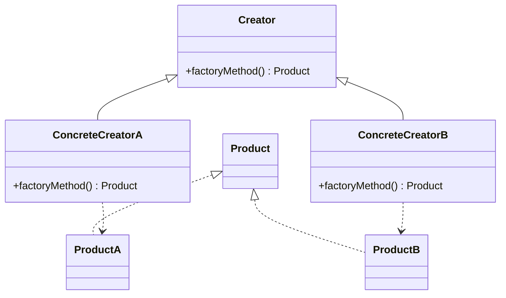

# 工厂方法（Factory Method）

> 一句话意图：定义一个创建对象的接口，让**子类**决定实例化哪一个类，把创建延迟到子类。

## 适用场景

- 类无法预知自己要创建哪种产品，把决定权交给子类。
- 需要解耦「使用产品」与「创建产品」，且产品种类会持续新增。
- 框架留出扩展点：父类调用工厂方法拿到产品，具体产品由子类提供。

## 结构与角色

| 角色 | 职责 |
|------|------|
| `Product` | 抽象产品接口 |
| `ConcreteProduct` | 具体产品 |
| `Creator` | 声明工厂方法 `factoryMethod()`，可含依赖产品的业务逻辑 |
| `ConcreteCreator` | 重写工厂方法，返回具体产品 |



## Java 示例

```java
interface Logger {
    void log(String msg);
}

class FileLogger implements Logger {
    @Override public void log(String msg) { System.out.println("[文件]" + msg); }
}

class ConsoleLogger implements Logger {
    @Override public void log(String msg) { System.out.println("[控制台]" + msg); }
}

// 工厂（Creator）：定义工厂方法
abstract class LoggerFactory {
    // 工厂方法：由子类决定造哪种 Logger
    protected abstract Logger createLogger();

    // 模板逻辑：拿到产品后如何使用，父类固定
    public void writeLog(String msg) {
        Logger logger = createLogger();
        logger.log(msg);
    }
}

class FileLoggerFactory extends LoggerFactory {
    @Override protected Logger createLogger() { return new FileLogger(); }
}

class ConsoleLoggerFactory extends LoggerFactory {
    @Override protected Logger createLogger() { return new ConsoleLogger(); }
}

public class Client {
    public static void main(String[] args) {
        LoggerFactory factory = new FileLoggerFactory();
        factory.writeLog("hello"); // [文件]hello
    }
}
```

## 优缺点

| 优点 | 缺点 |
|------|------|
| 新增产品只需**新增工厂子类**，符合开闭原则 | 每多一种产品就多一个工厂类，类数量翻倍 |
| 创建与使用解耦，符合依赖倒置 | 结构比简单工厂复杂，简单场景显得重 |
| 与模板方法天然结合，父类定流程 | 需要客户端知道用哪个具体工厂 |

## 与相似模式的区别

- **vs 简单工厂**：简单工厂靠参数分支、改一个类；工厂方法靠多态、加多个类，扩展性更好。
- **vs 抽象工厂**：工厂方法只造**一种**产品；抽象工厂的一个工厂类可以造**多种**相关产品。
- **vs 模板方法**：工厂方法常内嵌在模板方法中——父类的骨架流程里，某一步调用了抽象的 `createLogger()`。

## 实践要点与坑

- **默认产品**：若某类产品最常用，可在父类给出工厂方法默认实现（返回常用产品），子类按需重写，减少子类数量。
- **与简单工厂的取舍**：产品少而固定用简单工厂更省事；产品会持续扩展、要符合开闭原则时用工厂方法。
- 工厂方法常与**模板方法**合用：父类骨架流程里调用抽象工厂方法，子类既决定产品、又复用公共流程。
- `Collection.iterator()`、`Calendar.getInstance()` 都带工厂方法思想：调用方拿接口，具体实现由内部决定。

## 一句话记忆

**「造什么」交给子类，「怎么用」留在父类；加产品 = 加工厂类。**

---

详解见 [创建型工厂模式](../design/factory.md)。
