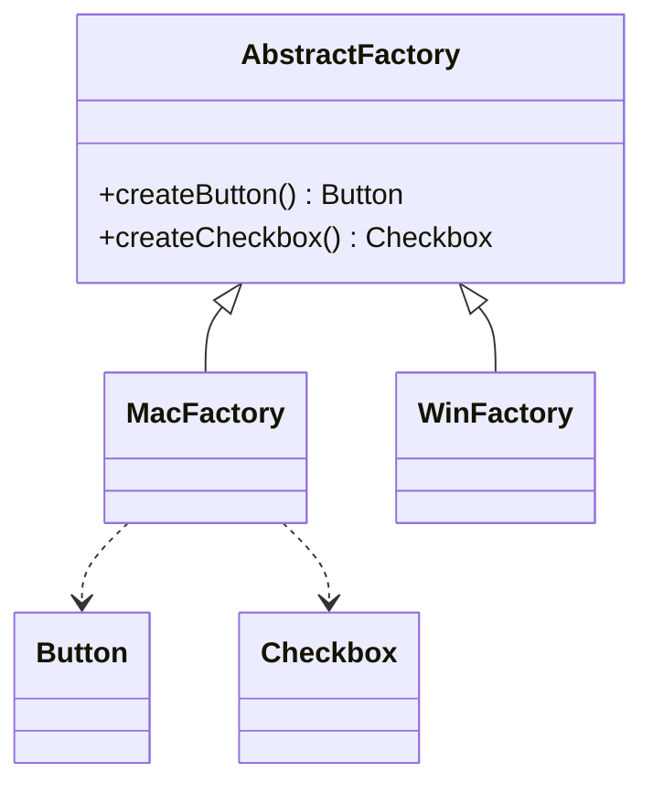

# 抽象工厂（Abstract Factory）

> 一句话意图：提供一个接口，用于创建**一族相关或相互依赖**的产品对象，而无需指定它们的具体类。

## 适用场景

- 系统需要保证一组产品**成套搭配**（同一风格、同一厂商、同一主题）。
- 需要切换「整套实现」而不改动使用方，如换数据库驱动、换 UI 主题、换本地化组件。
- 产品族内的产品之间存在约束，不能混搭。

## 结构与角色

| 角色 | 职责 |
|------|------|
| `AbstractFactory` | 声明一族产品的创建方法 |
| `ConcreteFactory` | 实现某个产品族的所有创建方法 |
| `AbstractProduct` | 每类产品的抽象接口 |
| `ConcreteProduct` | 具体产品，归属于某个族 |



## Java 示例

```java
// 产品族：按钮 + 复选框，两类产品
interface Button { void paint(); }
interface Checkbox { void check(); }

// 具体产品（Mac 风格）
class MacButton implements Button {
    @Override public void paint() { System.out.println("Mac 风格按钮"); }
}
class MacCheckbox implements Checkbox {
    @Override public void check() { System.out.println("Mac 风格复选框"); }
}

// 具体产品（Windows 风格）
class WinButton implements Button {
    @Override public void paint() { System.out.println("Win 风格按钮"); }
}
class WinCheckbox implements Checkbox {
    @Override public void check() { System.out.println("Win 风格复选框"); }
}

// 抽象工厂：负责造一族产品
interface GuiFactory {
    Button createButton();
    Checkbox createCheckbox();
}

class MacFactory implements GuiFactory {
    @Override public Button createButton() { return new MacButton(); }
    @Override public Checkbox createCheckbox() { return new MacCheckbox(); }
}

class WinFactory implements GuiFactory {
    @Override public Button createButton() { return new WinButton(); }
    @Override public Checkbox createCheckbox() { return new WinCheckbox(); }
}

// 使用方只依赖抽象工厂，切换整族只需换一个实现
public class Application {
    private final Button button;
    private final Checkbox checkbox;

    public Application(GuiFactory factory) {
        this.button = factory.createButton();     // 保证同一族
        this.checkbox = factory.createCheckbox();
    }
    public void render() { button.paint(); checkbox.check(); }

    public static void main(String[] args) {
        new Application(new MacFactory()).render();
    }
}
```

## 优缺点

| 优点 | 缺点 |
|------|------|
| 保证产品族内**成套兼容**，不会混搭 | 新增**产品种类**（如加一个 Slider）要改所有工厂 |
| 切换整套实现只需换工厂实现类 | 类的数量膨胀，抽象层次高 |
| 使用方与具体产品彻底解耦 | 只适合产品族稳定的场景 |

## 与相似模式的区别

- **vs 工厂方法**：工厂方法一个工厂方法只产一种产品；抽象工厂一个工厂类产**一族多种**产品。
- **vs 建造者**：抽象工厂关注「造哪些对象」，返回成套产品；建造者关注「一个复杂对象怎么一步步拼」。

## 一句话记忆

**抽象工厂 = 产品族的工厂工厂；加一「族」容易，加一「品种」难。**

---

详解见 [创建型工厂模式](../design/factory.md)。
