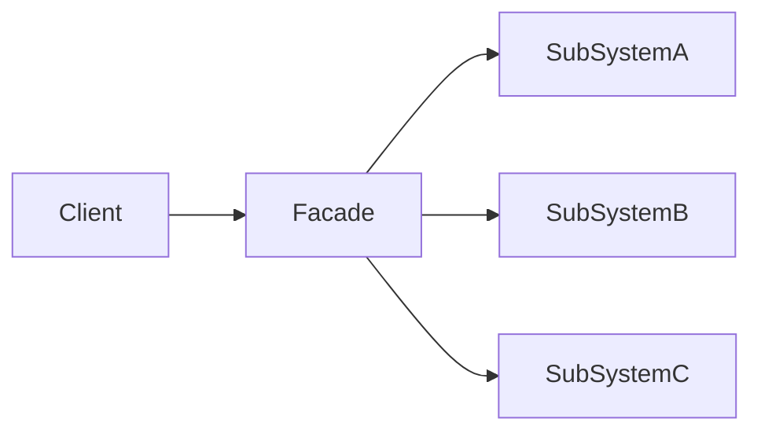

# 外观（Facade）

> 一句话意图：为一组复杂的子系统提供一个**统一的高层接口**，让调用方用最简单的方式使用系统。

## 适用场景

- 子系统类多、调用步骤繁琐，业务侧只想「一键完成」。
- 需要为分层架构提供入口：外观充当层与层之间的门面，隔离内部实现。
- 封装第三方 SDK / 遗留系统，给团队一个干净、稳定的 API。

## 结构与角色

| 角色 | 职责 |
|------|------|
| `Facade` | 了解子系统职责，把多个调用编排成一个方法 |
| `Subsystem` | 一个或多个子系统类，各司其职 |
| `Client` | 只依赖 `Facade`，不直接碰子系统 |



## Java 示例

```java
// 三个子系统：启动一台电脑要依次操作它们
class Cpu { void start() { System.out.println("CPU 启动"); } }
class Memory { void load() { System.out.println("内存加载"); } }
class Disk { void read() { System.out.println("磁盘读取"); } }

// 外观：把复杂步骤收敛成一个 start()
class ComputerFacade {
    private final Cpu cpu = new Cpu();
    private final Memory memory = new Memory();
    private final Disk disk = new Disk();

    public void start() {
        cpu.start();
        memory.load();
        disk.read();
        System.out.println("电脑启动完成");
    }
}

public class Client {
    public static void main(String[] args) {
        // 调用方只面对一个方法，不关心内部子系统顺序
        new ComputerFacade().start();
    }
}
```

## 优缺点

| 优点 | 缺点 |
|------|------|
| 降低调用方认知负担，接口简单 | 外观可能变成「上帝类」，堆积过多职责 |
| 隔离子系统，内部改动不外溢 | 过度封装会挡住子系统的高级能力 |
| 有利于分层与包依赖治理 | 不阻止客户端绕过外观直接访问子系统 |

## 与相似模式的区别

- **vs 中介者**：外观是**单向**的——子系统不知道外观存在；中介者是**多向**交互中枢，同事对象都知道中介者。
- **vs 适配器**：适配器改变**接口形态**以对接不兼容者；外观**简化**既有接口，不改变接口语义。
- **vs 代理**：外观面向**多个**子系统、提供简化入口；代理面向**单个**目标对象、控制访问。

## JDK 与框架中的实例

- `SLF4J`：对外统一日志门面，底层可换 Logback / Log4j2，业务代码只依赖门面。
- `JdbcTemplate`：把获取连接、执行、关闭、异常转译等繁琐步骤收进一个 `query`/`update` 方法。
- `Spring ApplicationContext`：对 Bean 工厂、事件、资源、国际化等子系统的统一门面。
- `RestTemplate`：封装 HTTP 连接、序列化、异常处理，调用方一行发起请求。

## 实践要点与坑

- 外观**不封装易变的业务规则**，只做调用编排，保持「薄」。
- 不要把所有子系统方法都往外观里堆，否则会退化成「上帝类」；可按用例拆分多个外观。
- 外观不阻止高级用户绕过它直接使用子系统，二者可共存。
- 对外 SDK 用外观 + 少量参数对象，能显著降低使用门槛。
- 外观自身**不要持有状态**，做成无状态的编排器，线程安全又易复用。
- 为不同使用者提供不同粒度的外观：粗粒度的「一键完成」与细粒度的「可组合」并存。
- 外观向下依赖子系统，但**子系统不应反向依赖外观**，保持单向依赖。
- 单测外观时把子系统抽成接口注入，便于打桩验证调用编排。
- 按业务能力拆分多个外观（如「下单外观」「退款外观」），避免单个外观臃肿。
- 外观方法命名面向用例（如 `submitOrder`），而非照搬某个子系统的术语。
- 外观是对外的稳定契约，变更要谨慎；内部子系统的重构不应外溢。

## 与微服务网关

API 网关可看作微服务体系的「外观」：客户端只对接网关这一个入口，鉴权、路由、限流、聚合在网关内完成，后端服务的变化对客户端透明。

## 与分层的配合

外观常作为**层与层之间的门面**：Controller 只调应用服务（外观），不直接触达领域/基础设施细节。这样上层依赖稳定、下层可替换，符合依赖倒置。

## 一句话记忆

**一堆子系统太麻烦，加个「总开关」外观把它们编排成一句话。**

---

详解见 [结构型外观模式](../design/facade.md)。
