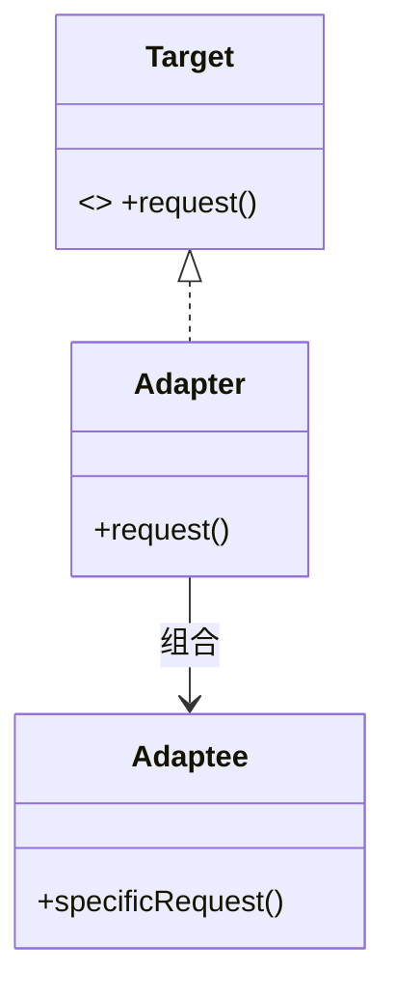

# 适配器（Adapter）

> 一句话意图：把一个类的接口**转换**成客户端期望的另一种接口，让原本不兼容的两个类协同工作。

## 适用场景

- 对接遗留系统、第三方 SDK、异构协议，接口对不上但功能可复用。
- 想复用已有类，又不愿为了匹配接口去改它的源码。
- 统一多个第三方实现的入口（如各家支付/短信 SDK 各不相同）。

## 结构与角色

| 角色 | 职责 |
|------|------|
| `Target` | 客户端期望的接口 |
| `Adaptee` | 已存在但接口不兼容的类 |
| `Adapter` | 组合/继承 `Adaptee`，实现 `Target`，做接口转换 |
| `Client` | 只依赖 `Target` |

两种形态：**类适配器**（继承 Adaptee，Java 单继承受限）与**对象适配器**（组合 Adaptee，更推荐）。



## Java 示例（对象适配器）

```java
// 客户端期望的接口
interface Charger {
    void chargeWithUsbC();
}

// 已有（不兼容）的类：只支持老式接口
class OldCharger {
    public void chargeWithUsbA() {
        System.out.println("通过 USB-A 充电（旧接口）");
    }
}

// 对象适配器：组合旧对象，把旧调用适配成新接口
class ChargerAdapter implements Charger {
    private final OldCharger oldCharger;

    public ChargerAdapter(OldCharger oldCharger) {
        this.oldCharger = oldCharger;
    }

    @Override
    public void chargeWithUsbC() {
        // 转调旧接口（真实场景这里会做协议/数据格式转换）
        oldCharger.chargeWithUsbA();
    }
}

public class Client {
    public static void main(String[] args) {
        Charger charger = new ChargerAdapter(new OldCharger());
        charger.chargeWithUsbC(); // 通过 USB-A 充电（旧接口）
    }
}
```

JDK 中的 `InputStreamReader` 把字节流 `InputStream` 适配为字符流 `Reader`，是标准范例。

## 优缺点

| 优点 | 缺点 |
|------|------|
| 复用已有类，不改源码即可对接 | 引入额外抽象层，调用链变长 |
| 解耦客户端与具体实现 | 类适配器受单继承限制，不够灵活 |
| 便于统一多来源接口 | 适配器过多会显得设计杂乱，需权衡 |

## 与相似模式的区别

- **vs 装饰器**：装饰器**不改变接口**，只叠加职责，接口与被装饰者一致；适配器**改变接口**以适配目标。
- **vs 桥接**：桥接在设计之初就把抽象与实现分离；适配器是事后补救既有接口的不兼容。
- **vs 外观**：外观简化**一组**子系统的调用；适配器转换**单个**对象的接口。

## JDK 与框架中的实例

- `InputStreamReader` / `OutputStreamWriter`：把字节流适配成字符流。
- `Arrays.asList(T...)`：把数组适配成 `List` 视图。
- `Collections.list(Enumeration)`：把老式 `Enumeration` 适配成 `List`。
- Spring MVC 的 `HandlerAdapter`：把各种形态的处理器（注解方法、`Controller`、`HttpRequestHandler`）适配成统一的 `handle` 调用。

## 实践要点与坑

- 优先**对象适配器**（组合）：不受单继承限制，能适配 Adaptee 的多个方法，也更易测试。
- 类适配器（继承 Adaptee 并实现 Target）在 Java 里受单继承掣肘，仅在需要覆写 Adaptee 行为时才用。
- 适配器只做**接口/数据形态转换**，不要夹带业务逻辑，否则职责混乱。
- 双向适配（两个接口都想复用）可用两个适配器或一个双向适配器，注意别绕成循环调用。
- 适配器应保持「薄」；若转换逻辑越来越重，说明该重新设计目标接口，而非继续堆适配。
- 命名上标注被适配者便于识别，如 `UsbAToUsbCAdapter`。

## 一句话记忆

**接口对不上就套个适配器：包装旧对象、暴露新接口，转换语义而非简化调用。**

---

详解见 [结构型适配器模式](../design/adapter.md)。
