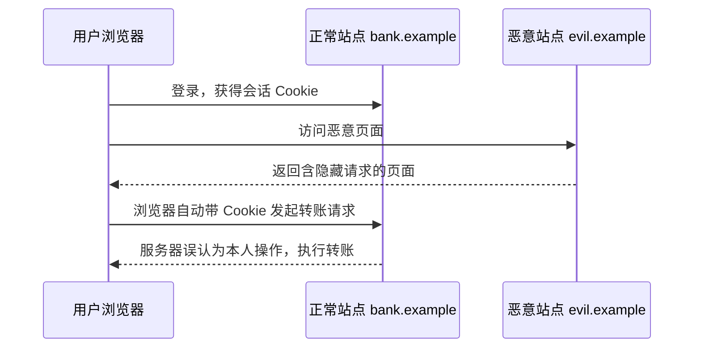

# CSRF 详解 

> CSRF（Cross-Site Request Forgery，跨站请求伪造）是一种借助受害者已登录的凭证，在其不知情的情况下以受害者名义向目标站点发起请求的攻击，也被称为「one click attack」或「session riding」。它曾位列互联网主要安全隐患之一，且比 SQL 注入、XSS 更隐蔽。

CSRF 并不是新问题，早在 2007 年它就被列为互联网主要安全隐患之一，当年就连 Gmail 也出现过 CSRF 漏洞，攻击者可借此造成用户损失。相比被广泛防御的 SQL 注入与 XSS，CSRF 之所以危险，正是因为它「隐蔽」：请求看起来完全合法，日志里也很难与正常操作区分。

## 什么是 CSRF

用户登录 A 站点后，浏览器会拿到一个标识身份的 Cookie，只要未退出登录，之后访问 A 站都会自动带上它。如果用户在访问攻击者构造的 B 站时，B 站让浏览器悄悄向 A 站发起一个请求（例如转账、改密），浏览器会自动附上 A 站的 Cookie，A 站服务器便「以为是用户本人操作」。这就是请求伪造——请求并非用户本意，且由第三方站点发出。

以银行转账为例：Bob 登录银行后，攻击者 Mallory 诱导 Bob 打开一个页面，页面里藏着一个指向银行转账接口的请求（如隐藏图片或自动提交的表单）。由于 Bob 的会话 Cookie 尚未过期，浏览器带着 Cookie 把请求发给银行，钱就被转走，而日志里只留下一条「Bob 本人发起」的合法请求。

这类攻击可怕的地方在于：受害者全程没有点击任何「转账」按钮，甚至没有看到可疑页面，钱就已经被转走；而对银行而言，这条请求带着正确的会话凭证、来自正确的用户，几乎与真实操作无异。

## 攻击原理

CSRF 能够成立，通常需要满足三个条件：

1. 浏览器会自动携带目标站点的会话 Cookie；
2. 请求的参数完全由攻击者掌握，无需用户知晓；
3. 服务端仅凭 Cookie 判断身份，不校验请求的其他来源信息。

### 常见的攻击载体

攻击者构造请求的方式很灵活，典型载体包括：

- **隐藏表单自动提交**：页面一加载就提交 POST 表单，最直接；
- **图片标签**：`` 只能发 GET，适合以 GET 执行写操作的接口；
- **链接诱导**：诱导用户点击链接，同样适合 GET 型接口；
- **XHR / fetch**：受同源策略限制，通常无法携带跨站 Cookie 读取响应，但配合「简单请求」仍可触发写操作。



## 与 XSS 的区别

- **XSS（跨站脚本）**是攻击者把恶意脚本注入到目标站点页面中执行，本质是「在受害者信任的站点上运行攻击者的代码」。
- **CSRF** 并不需要注入脚本，它利用的是浏览器自动携带凭证的机制，本质是「借用受害者的身份」。

两者常被混淆也有联系：XSS 可以读取页面中的 CSRF Token，从而绕过基于 Token 的防护；因此 XSS 与 CSRF 的防御需要配合，详见 [XSS 详解](./dev-security-x-xss.md)。

两者的防御也因此常常配套出现：防住 XSS，能减少 Token 被窃取的风险；防住 CSRF，则能避免「合法身份」被滥用。把二者拆开看，容易遗漏交叉风险。

## 怎么防御

防御的核心思想是：**让攻击者无法构造出「参数正确、来源可信」的请求**。常见手段如下。

### 1. 验证请求来源（Referer / Origin）

浏览器的 `Referer`（以及更现代的 `Origin`）头记录了请求来源地址。服务端可校验来源是否属于本站域名。优点是实现简单；缺点是 `Referer` 可能被用户的隐私设置剔除，历史上也曾出现浏览器漏洞，因此通常作为辅助手段，而非唯一防线。

### 2. CSRF Token

在表单或请求中放入一个攻击者无法预测的随机 Token，服务端比对校验。因为 Token 不存在于 Cookie 中，攻击者无法在 B 站构造出它。

- **同步令牌模式（Synchronizer Token Pattern）**：Token 存在服务端 Session，页面提交时带上并比对。
- **双重提交 Cookie（Double Submit Cookie）**：Token 同时写入 Cookie 与请求参数 / 头，服务端比对两者是否一致——无需服务端存储状态，适合无状态服务。

需要注意：Token 必须**每个会话（或每次请求）随机**，并通过安全渠道传递；若站点存在 XSS，Token 同样可能被窃取。

### 3. SameSite Cookie

`SameSite` 是 Cookie 的一个属性，用来限制跨站请求是否携带该 Cookie：

| 取值 | 行为 |
| --- | --- |
| `Strict` | 跨站请求一律不携带 Cookie（最安全，但可能影响从外站跳转回来的登录态） |
| `Lax` | 顶层导航的 GET 请求携带，跨站的 POST / 子请求不携带（现代浏览器默认值） |
| `None` | 始终携带，但必须配合 `Secure`（仅 HTTPS） |

把会话 Cookie 设为 `SameSite=Lax` 或 `Strict`，能从源头大幅降低 CSRF 风险，是目前性价比最高的基础防护。

### 4. 安全 Cookie 属性

除了 `SameSite`，会话 Cookie 还应设置：

- `Secure`：仅通过 HTTPS 传输；
- `HttpOnly`：禁止 JavaScript 读取，降低被 XSS 窃取的风险。

注意：`HttpOnly` 防的是「读取」，不能阻止浏览器在跨站请求中「携带」Cookie，因此它**不能替代** CSRF 防护。

## 防御策略怎么选

几种防御手段各有取舍，实际落地往往是组合使用：

| 手段 | 优点 | 局限 |
| --- | --- | --- |
| 校验 Referer / Origin | 实现简单、无状态 | 依赖头信息，可能缺失 |
| CSRF Token | 安全性高、可精确控制 | 需要传递与存储，前后端分离下需额外适配 |
| SameSite Cookie | 浏览器原生、成本低 | 依赖浏览器支持，可能影响跨站跳转体验 |

通用建议是：**以 SameSite Cookie 作为基础防护**，再对关键的写操作叠加 CSRF Token；Referer 校验作为补充。单一手段都有被绕过的可能，组合使用才能把风险压到最低。

## 前后端分离下的做法

前后端分离或无状态 API 中，常用的组合是：

1. 使用 `SameSite=Lax` / `Strict` 的会话 Cookie，或干脆不依赖 Cookie 而用 `Authorization` 头承载令牌——此时攻击者无法跨站设置自定义头，可以关闭 CSRF 防护；
2. 若仍用 Cookie 承载会话，则采用「双重提交 Cookie」或自定义头携带 Token（如 `X-XSRF-TOKEN`）；
3. 对**会改变数据的请求**（POST / PUT / DELETE）做校验，读操作的 GET 通常无需防护。

## 实现要点（以 Spring Security 为例）

- 默认开启 CSRF 防护，对 GET / HEAD / TRACE / OPTIONS 之外的方法校验 Token；
- 无状态、纯 API 服务（使用非浏览器客户端）可显式关闭：`http.csrf().disable()`；
- 前后端分离可用 `CookieCsrfTokenRepository.withHttpOnlyFalse()`，把 Token 写入 Cookie，由前端从 Cookie 读出后放进请求头回传；
- **务必限制会改数据接口的 HTTP 方法**：若接口未限制方法（例如 `@RequestMapping` 不加 `method`），仍可能被 GET 方式的请求绕过，导致渗透测试中依然报出 CSRF 漏洞。

### 被忽视的坑：没有限制请求方法

很多团队前端已经用 POST + Token，后端也配了 CSRF 过滤器，渗透测试却仍报出漏洞。常见原因是**接口没有限制 HTTP 方法**：

```java
// 未限定 method，GET 请求也会命中，可能绕过针对 POST 的保护
@RequestMapping("/order/save")
public ResponseData save(OrderParam param) {
    // 写操作……
}
```

当接口既能被 GET 触发、又只在 POST 上校验 Token 时，攻击者用 GET 就可能绕过防护。正确做法是为写接口显式限定 `method = RequestMethod.POST`。

在前后端分离场景中，还要注意 CORS 与 CSRF 的配合：跨域请求若未正确配置 CORS，可能让本应受保护的接口暴露；同时，`CookieCsrfTokenRepository` 会把 Token 写入名为 `XSRF-TOKEN` 的 Cookie，前端需在每次写请求中把它读出来放进 `X-XSRF-TOKEN` 头回传。

## 常见坑

- 只做了 Token 校验，却忽略了对 Cookie 设置 `SameSite`。
- 用 GET 执行写操作，使 CSRF 防护形同虚设。
- 误以为 `HttpOnly` 能防 CSRF（它只防读取，不防携带）。
- Token 长期不变或不随会话更新，削弱防护效果。
- 站点存在 XSS 时，基于 Token 的防线可能被一并绕过。

最后要记住，CSRF 的防护强度取决于最弱的一环：只要有一个写接口没做校验、或用了 GET 执行写操作，整个防线就会出现缺口。

## 小结

- CSRF 的本质是「借用受害者已登录的凭证，伪造其名义的请求」。
- 防御核心是让攻击者无法构造可信请求：来源校验、CSRF Token、SameSite Cookie。
- `SameSite=Lax` / `Strict` 是成本最低的基础防护；Token 适合无状态场景。
- 写操作应使用 POST / PUT / DELETE 并校验，GET 只用于读操作。
- CSRF 与 XSS 需配合防御，`HttpOnly` 不能替代 CSRF 防护。

参见 [XSS 详解](./dev-security-x-xss.md)、[开发安全总览](./dev-security-overview.md)。
