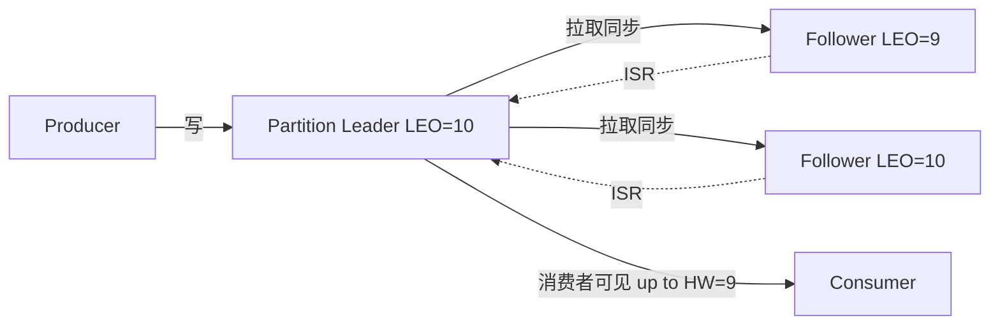
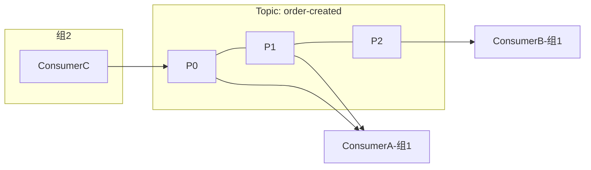

# Kafka 详解

> Kafka 是一个分布式、分区复制的提交日志（Commit Log）平台。它把消息写成**只追加的顺序日志**，靠分区并行与顺序写磁盘做到十万级每秒的吞吐，用副本与 ISR 保证可靠性。它最初服务于日志管道，如今是流处理、事件驱动、CDC 的事实标准。理解「分区 + 副本 + offset」这三个支柱，Kafka 就通了一大半。

## 1. 核心概念

| 概念 | 含义 |
|------|------|
| Topic | 消息的逻辑分类，如 `order-created` |
| Partition | Topic 的物理分片，是并行与有序的单位 |
| Offset | 分区内消息的唯一递增编号，消费者靠它定位进度 |
| Broker | 一个 Kafka 服务节点，多个 Broker 组成集群 |
| Replica | 分区的副本，分为 Leader 与 Follower |
| Producer / Consumer | 生产者与消费者 |
| Consumer Group | 消费者组，组内分摊分区、组间各自消费 |

一条消息的物理位置由「Topic + Partition + Offset」三要素唯一定位。**分区是有序的最小单位**：同一分区内消息按写入顺序排列，跨分区不保证顺序——这是「顺序消息」需求的根源。

## 2. 分区、副本与 ISR

每个分区有一个 **Leader** 副本和若干 **Follower** 副本。读写只走 Leader，Follower 从 Leader 拉取数据做同步。这样做的目的是**容错**：Leader 宕机时从 Follower 中选一个新 Leader，服务不中断。

**ISR（In-Sync Replicas）** 是「与 Leader 保持同步的副本集合」，包含 Leader 自身。判断标准是 Follower 落后 Leader 的时间不超过 `replica.lag.time.max.ms`（超过就被踢出 ISR）。ISR 决定了可靠性：当 `acks=all` 时，消息要写入 ISR 中所有副本才算成功。

| 概念 | 含义 |
|------|------|
| LEO（Log End Offset） | 每个副本下一条要写入的消息 offset |
| HW（High Watermark） | ISR 中最小的 LEO，消费者只能读到 HW 之前的消息 |
| Leader Epoch | Leader 的任期编号，防止旧 Leader 复活后数据错乱 |



::: tip ISR 与可靠性的取舍
`acks=all` + `min.insync.replicas=2` 是生产常见组合：至少 2 个副本确认才认为写成功。若 ISR 缩到只剩 Leader 一个，此时 `acks=all` 也退化为只等 Leader，可靠性下降。因此要**同时监控 ISR 收缩**，不能只看 acks 配置。
:::

## 3. 日志存储：为什么顺序写这么快

Kafka 的高吞吐一半靠分区并行，一半靠**磁盘顺序写**。每个分区对应一个目录，日志被切成多个 **Segment**，每个 Segment 由三部分组成：

| 文件 | 内容 |
|------|------|
| `.log` | 消息本体，顺序追加 |
| `.index` | offset → 物理位置的稀疏索引 |
| `.timeindex` | 时间戳 → offset 索引 |

顺序追加避免了磁盘随机寻道，接近内存带宽；再配合操作系统的 **page cache**（写入先进页缓存，由内核异步刷盘），写入延迟极低。读取时：

- **零拷贝（Zero-Copy）**：消费者读数据走 `sendfile`，数据从页缓存直接到网卡，跳过用户态复制，减少 CPU 与内存带宽开销。
- **稀疏索引 + 二分查找**：先按 offset 定位 Segment，再在 `.index` 里二分，最后在 `.log` 内顺序扫描，O(log n) 找到目标。
- **批量与压缩**：生产者把多条消息打包成 Batch 发送并压缩，减少网络往返与存储。

消息按保留策略清理，常见两类：**基于时间**（`retention.ms`，默认 7 天）和**基于大小**（`retention.bytes`）。清理用 `log.cleanup.policy` 控制：`delete` 按策略删除，`compact` 对同一 key 只保留最新值（适合变更日志、状态快照）。

## 4. 生产者：分区策略与 acks

生产者发送消息时：先选分区 → 批量攒起来 → 发往该分区 Leader。

**分区选择**：指定了 key 就对 key 哈希取模（同 key 必落同分区，这是顺序性的前提）；没指定 key 则轮询或黏性分区（Sticky，把一批消息打到同一分区以提升批量效率）。

**acks** 决定发送端可靠性的底线：

| acks | 含义 | 可靠性 | 性能 |
|------|------|--------|------|
| `0` | 发出即认为成功，不等任何确认 | 最低，可能丢 | 最高 |
| `1` | 等 Leader 写入本地日志即确认 | 中，Leader 宕机可能丢 | 中 |
| `all`（= `-1`） | 等 ISR 中所有副本确认 | 最高 | 最低 |

```yaml
# application.yaml 中的生产者配置示意
spring:
  kafka:
    producer:
      acks: all                          # 最可靠
      retries: 2147483647                # 重试次数；配合幂等保证不重复
      properties:
        enable.idempotence: true         # 开启幂等生产者
        max.in.flight.requests.per.connection: 5
        compression.type: lz4            # 压缩减少网络与存储
```

生产者还有一个易被忽视的配置：`max.in.flight.requests.per.connection`（每个连接未确认请求数）。它 >1 时，重试可能导致**消息乱序**；但只要开启幂等生产者，Kafka 会保证这 5 个在途请求的顺序性。

## 5. 消费者组与 Rebalance

消费者以「组」为单位消费：**同一组内，一个分区只会被一个消费者消费**（分摊负载）；**不同组之间互不影响**（各自完整消费）。理想情况下消费者数 = 分区数，多了会有消费者空闲。



**Rebalance（再均衡）** 是分区归属的重新分配，触发条件：消费者加入/退出、订阅的 Topic 分区数变化、消费者长时间失联被踢出组。Rebalance 期间消费会 **STW（Stop-The-World）**，是延迟毛刺的常见来源。

- **分配策略**：Range（按范围）、RoundRobin（轮询）、Sticky（尽量保持原分配，减少变动）、CooperativeSticky（协作式，减少全局停顿）。
- **心跳与失联**：消费者靠心跳维持成员身份，`session.timeout.ms` 内没心跳会被判定死亡并触发 rebalance。
- **offset 提交**：自动提交简单但可能在处理完成前提交（丢消息风险）或重复消费；手动提交（处理成功后 commit）更可控。

```java
// 手动提交 offset 的消费者示意
@KafkaListener(topics = "order-created", groupId = "order-consumer")
public void onMessage(ConsumerRecord<String, String> record, Acknowledgment ack) {
    // 1. 处理业务（幂等）
    handle(record.value());
    // 2. 处理成功后再提交 offset
    ack.acknowledge();
}
```

更优方案是用 **`AckMode.MANUAL_IMMEDIATE` 之外的批处理提交**，在吞吐与准确之间找平衡。

## 6. 幂等与事务

**幂等生产者**（`enable.idempotence=true`）：Kafka 为每个生产者分配 PID，每条消息带单调递增的序列号。Broker 按「PID + 分区 + 序列号」去重，解决**重试导致的重复**。注意它的去重范围仅限**单个生产者会话、单个分区**。

**事务**（`transactional.id`）：把「向多个分区/Topic 写消息」和「提交消费 offset」组成一个原子操作，实现跨分区的**精确一次**写入。消费者用 `isolation.level=read_committed` 只读已提交事务的消息。

```java
producer.initTransactions();
try {
    producer.beginTransaction();
    producer.send(new ProducerRecord<>("order-created", orderId, payload));
    producer.send(new ProducerRecord<>("order-stat", orderId, stat));
    producer.commitTransaction();       // 两个 Topic 一起可见或一起不可见
} catch (Exception e) {
    producer.abortTransaction();        // 回滚，消费者看不到任何一条
}
```

::: warning 精确一次是有边界的
Kafka 的 EOS 只覆盖「Kafka 内部」：从 Kafka 读、写回 Kafka。一旦落库到 MySQL，就不是端到端精确一次了——仍需业务幂等（唯一键、去重表、状态机）。别把 EOS 当成万能的分布式事务。
:::

## 7. 实践要点与常见坑

| 问题 | 对策 |
|------|------|
| 重复消费 | 消费端幂等：业务唯一键去重、状态机、去重表；不必追求绝对不重 |
| 消息丢失 | 生产者 `acks=all` + 幂等；Broker 副本数 ≥3 且 `min.insync.replicas` ≥2；消费者处理成功后再提交 offset |
| 消息乱序 | 需要顺序的业务让同 key 进同分区；单分区内才有序 |
| 消费堆积 | 扩分区 + 扩消费者（消费者数 ≤ 分区数才有效）；排查消费端慢逻辑；必要时临时降级 |
| Rebalance 抖动 | 合理设置 `session.timeout.ms`/`max.poll.interval.ms`；用 Sticky 分配；避免单次 poll 处理过久 |
| 分区数修改 | 分区只能增不能减，且会打乱按 key 的哈希归属，规划时要留余量 |

**使用建议**：日志采集、埋点、事件总线、CDC、流处理非常适合 Kafka；把 Kafka 当作「强事务 RPC 的替代」要谨慎——它是最终一致的异步通道，不适合请求-响应式强一致调用。

## 8. 小结

- Kafka 的三大支柱是分区（并行与有序单位）、副本（容错）、offset（进度定位）。
- ISR 是可靠性的核心，`acks=all` + `min.insync.replicas` 决定丢不丢。
- 高吞吐来自顺序写磁盘、page cache、零拷贝与批量压缩。
- 消费者组内分摊、组间广播；Rebalance 会 STW，是延迟毛刺来源。
- 幂等生产者解决重试重复（单会话单分区），事务实现 Kafka 内部跨分区精确一次，落库仍需业务幂等。
