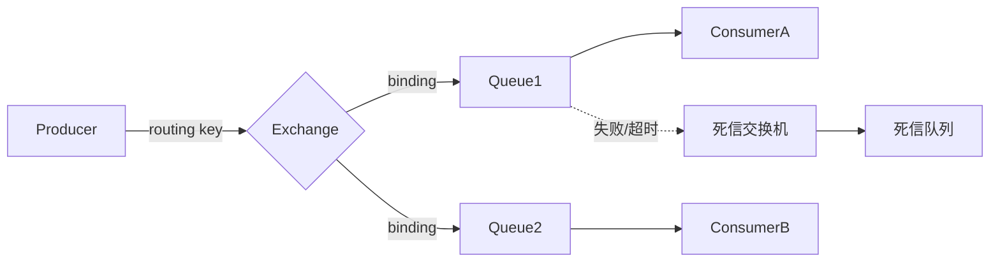

# RabbitMQ 详解

> RabbitMQ 是基于 AMQP 0-9-1 协议的传统消息中间件，用 Erlang 编写，以「交换机（Exchange）+ 队列（Queue）+ 绑定（Binding）」的路由模型著称。相比 Kafka 追求极致吞吐，RabbitMQ 的强项是**灵活的路由**与**贴近业务的语义**（确认、死信、TTL）。它适合消息量中等、路由规则复杂、需要可靠投递的业务解耦场景。

## 1. 消息模型

一条消息从生产者到消费者的完整路径：



关键角色：

| 角色 | 作用 |
|------|------|
| Connection | 客户端到 Broker 的 TCP 连接 |
| Channel | 连接内的轻量级虚拟通道，几乎所有操作在 Channel 上执行 |
| Exchange | 接收消息并按规则路由到队列，**本身不存储消息** |
| Queue | 存储消息的实体，消费者从这里取 |
| Binding | 交换机和队列之间的绑定规则（可带 routing key / headers） |
| Virtual Host | 逻辑隔离单元，类似命名空间 |

::: tip Connection 与 Channel
每条 TCP 连接开销大，**Channel 才是复用的单位**。一个应用通常维护少量 Connection，在其上开多个 Channel 并发操作。Channel 非线程安全，不要跨线程共享。
:::

## 2. 交换机类型

交换机的路由规则决定了消息被投到哪些队列：

| 类型 | 路由规则 | 典型用途 |
|------|----------|----------|
| direct | routing key 完全匹配 | 点对点、精确投递 |
| topic | routing key 通配匹配（`*` 匹配一个词、`#` 匹配零或多个词） | 按业务维度订阅，如 `order.*.created` |
| fanout | 忽略 routing key，广播到所有绑定队列 | 广播通知 |
| headers | 按消息 header 键值匹配（忽略 routing key） | 复杂条件、routing key 不方便表达时 |

```bash
# topic 交换机的通配示例
# 绑定 "order.*.created" 能匹配 order.pay.created、order.ship.created
# 绑定 "order.#"        能匹配 order.created、order.pay.created
```

`direct` 最常用、最易理解；`topic` 表达力最强，是业务按维度订阅的主力；`fanout` 用于广播；`headers` 性能稍差，日常少见但能在条件复杂时派上用场。

还有一类特殊的**默认交换机**（名称为空字符串）：所有队列都会自动以队列名绑定到它，所以向默认交换机发消息、routing key 写队列名，就等价于「直接投递到该队列」，方便入门调试。

## 3. 消息可靠投递：三段保障

一条消息要「不丢」，必须在三个环节都做保证：

**生产端 → Broker**：用**发布确认（Publisher Confirm）**。开启 confirm 模式后，Broker 收到消息会回 `basic.ack`，处理失败回 `basic.nack`。若消息路由不到任何队列，配合 `mandatory` 参数与 `Return` 回调可以感知。

```yaml
spring:
  rabbitmq:
    publisher-confirm-type: correlated   # 开启发布确认
    publisher-returns: true              # 路由失败时触发 Return 回调
    template:
      mandatory: true
```

**Broker 内部**：消息与队列都要**持久化**——队列声明 `durable=true`，消息发送时设置投递模式为持久化（`delivery_mode=2`）。只持久化队列、消息不持久化，重启后消息照样丢。

**Broker → 消费端**：用**手动 ack**。消费成功的业务处理完成后，显式调用 `basicAck`；处理失败则 `basicNack`/`basicReject`（可要求重新入队或进死信）。

```java
@RabbitListener(queues = "order.queue", ackMode = "MANUAL")
public void onMessage(Message message, Channel channel) throws IOException {
    long tag = message.getMessageProperties().getDeliveryTag();
    try {
        handle(message);                 // 处理业务
        channel.basicAck(tag, false);    // 成功：确认
    } catch (Exception e) {
        // 失败：拒绝且不重回队列（交给死信处理），避免死循环
        channel.basicNack(tag, false, false);
    }
}
```

**prefetch（`basic.qos`）** 控制每个消费者一次最多预取多少条未确认消息。设太小吞吐上不去，设太大则一个消费者囤积消息、其他消费者空闲，负载不均。通常设为「消费者一次批量处理条数」的近似值。

::: warning ack 与自动提交的双重陷阱
`ackMode=AUTO`（RabbitMQ 层面的自动确认）会在消息**投递给消费者后立刻确认**，不等业务处理完成——消费者一崩溃消息就丢了。生产务必用手动 ack。另外 `basicNack` 的 `requeue=true` 会把消息重新入队，若失败原因是确定性的（如反序列化错误），会无限循环，应 `requeue=false` 让其进死信。
:::

## 4. 死信队列（DLX）

死信交换机（Dead Letter Exchange, DLX）是 RabbitMQ 处理「无法消费」消息的机制。消息变成死信有三种原因：

1. 消费者 `basicNack`/`basicReject` 且 `requeue=false`；
2. 消息在队列里超过 **TTL**（存活时间）；
3. 队列达到最大长度限制（`x-max-length`），头部消息被挤出。

死信会被重新投递到队列绑定的 DLX（由队列参数 `x-dead-letter-exchange` 指定）。典型用法：给业务队列配一个死信队列，失败消息进 DLQ 后人工排查或定时补偿。

```java
// 声明带死信配置的队列
@Bean
public Queue orderQueue() {
    return QueueBuilder.durable("order.queue")
        .deadLetterExchange("dlx.exchange")     // 死信交换机
        .deadLetterRoutingKey("order.dlq")      // 死信 routing key
        .ttl(60000)                             // 队列级 TTL：60s
        .maxLength(10000)                       // 队列最大长度
        .build();
}

@Bean
public Queue orderDlq() {
    return QueueBuilder.durable("order.dlq").build();
}
```

## 5. TTL 与延迟队列

TTL（Time To Live）让消息「过期即死」。它分两个层级：

| 层级 | 设置位置 | 特点 |
|------|----------|------|
| 消息级 | 发送时设置 `expiration` | 每条消息独立过期时间 |
| 队列级 | 队列参数 `x-message-ttl` | 整个队列统一过期时间 |

::: warning 队列级 TTL 的队头阻塞
RabbitMQ 是**顺序出队**的。若用队列级 TTL 做延迟队列，先入队的长 TTL 消息会挡在队头，后面的短 TTL 消息即使已过期也要等它出队——延迟不精确。正确做法是把消息级 TTL 与死信结合，或使用 `rabbitmq_delayed_message_exchange` 插件。
:::

**延迟队列**有两条路：一是「消息 TTL + DLX」，消息过期后变死信转投到目标队列；二是官方的延迟消息插件（`x-delayed-type` 交换机），精度更好、无需为不同延迟建多个队列。

## 6. 镜像队列与 Quorum 队列

RabbitMQ 单节点有单点风险，高可用靠副本。历史上用**镜像队列（Mirrored Queues）**：把队列镜像到集群多个节点，主节点（master）处理读写，镜像节点同步。它的问题是同步算法在大规模下效率低、脑裂恢复麻烦，官方已不推荐。

**Quorum 队列**（仲裁队列）是新一代高可用队列，基于 Raft 一致性算法，提供更强的一致性与数据安全：

| 对比项 | 镜像队列（Classic Mirrored） | Quorum 队列 |
|--------|------------------------------|-------------|
| 一致性算法 | 自定义主从同步 | Raft |
| 数据安全 | 较弱，脑裂易丢数据 | 强，多数派确认 |
| 使用限制 | 无特殊限制 | 不支持优先级、不持久化 consumer 等部分特性 |
| 现状 | 已弃用，不推荐新用 | **推荐**，新集群默认选择 |

实践建议：高可用队列用 **quorum 队列**（副本数 3 或 5，奇数），临时性、非关键的轻量场景可用经典队列。

## 7. 实践要点与常见坑

1. **声明要幂等**：队列/交换机的 `durable`、参数必须与已存在的一致，否则声明失败报 `PRECONDITION_FAILED`，这是调整队列参数时的常见拦路虎。
2. **死信 + 重试上限**：失败消息进死信前要限制重试次数，避免 `requeue` 无限循环打爆 CPU。
3. **prefetch 要调**：默认不限制预取，大流量下会让单个消费者囤积消息，务必显式设置。
4. **消费者幂等**：at-least-once 语义下消息可能重复，业务需要幂等键。
5. **别用队列级 TTL 做精确延迟**：队头阻塞会让延迟不准，改用插件或消息级 TTL。
6. **连接与 Channel 要复用**：频繁建连代价高；Channel 非线程安全，按线程或按需创建。
7. **监控**：重点看队列积压长度、未确认消息数、连接/Channel 数、内存与磁盘告警（`disk_free_limit` 触发后生产者会被阻塞）。

## 8. 小结

- 路由模型是 Exchange + Queue + Binding，四种交换机满足从精确到广播的不同需求。
- 不丢消息要三段齐保：生产端发布确认、Broker 持久化、消费端手动 ack。
- prefetch 决定消费者负载均衡，手动 ack 保证处理完成才确认。
- 死信队列隔离失败消息，TTL + DLX 或延迟插件实现延迟投递。
- 高可用用 Raft 的 quorum 队列替代已弃用的镜像队列。
