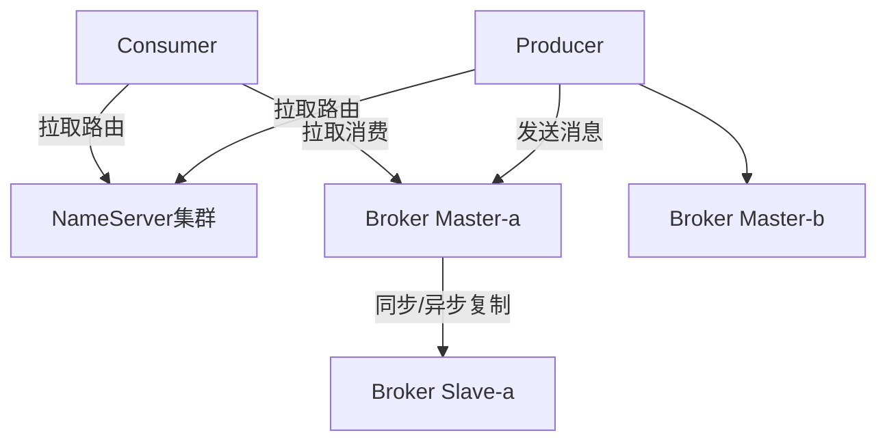
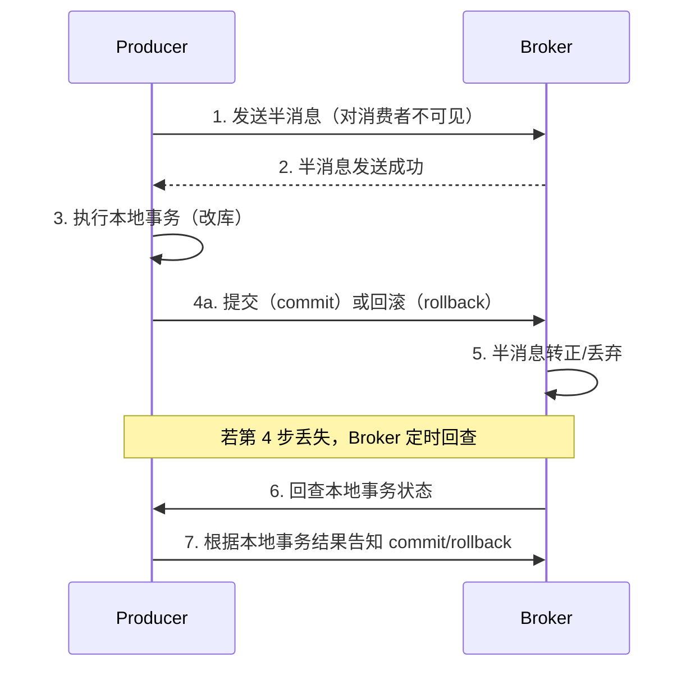

# RocketMQ 详解

> RocketMQ 是阿里巴巴开源的分布式消息中间件，用 Java 编写，为互联网业务消息场景量身定制。它既要有 Kafka 级的吞吐与堆积能力，又要提供业务方最关心的三大特性：**严格顺序消息**、**原生事务消息**、**延迟消息**。电商交易、订单、支付、削峰等场景里，这些特性往往比单纯的高吞吐更有价值。

## 1. 角色与整体架构



四个角色各司其职：

| 角色 | 职责 |
|------|------|
| NameServer | 轻量级注册中心，Broker 向其注册，Producer/Consumer 从中发现路由信息，**无状态、节点间不通信** |
| Broker | 消息存储与转发的主体，分 Master 与 Slave |
| Producer | 生产者，从 NameServer 拿路由后直连 Broker 发消息 |
| Consumer | 消费者，从 NameServer 拿路由后直连 Broker 拉消息 |

NameServer 集群各节点**互不通信、数据独立**，靠 Broker 逐个注册来保持大致一致。这种设计极其轻量，避免了 ZooKeeper 那样的重依赖（早期版本曾用 ZK，后改为自研 NameServer）。

Topic 在存储层面被拆成多个 **MessageQueue**（队列）。生产者的消息按规则落到某个队列，消费者以「一个队列同一时刻只被一个消费者消费」的方式分摊负载——这点与 Kafka 分区模型类似。

## 2. CommitLog 与存储结构

RocketMQ 存储设计的核心思想：**所有 Topic 的消息共用一份物理 CommitLog，逻辑队列单独存索引**。

| 文件 | 内容 |
|------|------|
| CommitLog | 所有消息**顺序追加**写入的物理文件，与 Topic 无关 |
| ConsumeQueue | 每个 MessageQueue 一个，存逻辑索引（物理偏移量 + 消息长度 + tag 哈希），每条定长 |
| IndexFile | 按「消息 key」或「时间区间」建立倒排索引，支持按 key 查询消息 |

写入流程：生产者发来的消息**直接追加到 CommitLog**，再由后台分发线程（ReputMessageService）异步构建 ConsumeQueue 与 IndexFile。

```text
消息 → CommitLog（顺序写，所有 topic 混合）
         │ 异步分发
         ▼
   ConsumeQueue（按 topic+queueId 的逻辑索引，定长）
         │
         ▼
   消费者按 offset 从 ConsumeQueue 找到物理位置，回 CommitLog 取消息体
```

为什么这么设计？**顺序写 + 逻辑索引分离**带来两全其美：CommitLog 顺序写获得极高写入吞吐；ConsumeQueue 体量小、可全量加载入内存，让消费查找接近 O(1)。代价是 CommitLog 一人扛下所有写入压力，需要靠**文件预热 + 内存映射（mmap）+ 页缓存**来扛。

## 3. 刷盘与主从复制

数据要落盘才有持久性，落盘速度与可靠性直接冲突。RocketMQ 提供两个维度的选择：

**刷盘策略**（由 Broker 配置）：

| 策略 | 行为 | 特点 |
|------|------|------|
| 同步刷盘（SYNC_FLUSH） | 消息写入内存后，等落盘成功再返回 producer | 可靠，但写延迟高、吞吐低 |
| 异步刷盘（ASYNC_FLUSH） | 写入内存即返回，后台线程批量刷盘 | 吞吐高，宕机可能丢最后一批 |

**主从复制**（Master → Slave）：

| 模式 | 行为 | 特点 |
|------|------|------|
| 同步复制（SYNC_MASTER） | 等 Slave 复制成功才算写成功 | 强可靠，但增加延迟 |
| 异步复制（ASYNC_MASTER） | 不等 Slave 回应 | 低延迟，主挂可能丢数据 |

四者组合决定可靠性等级。金融交易场景常选「同步刷盘 + 同步复制」（类似 Kafka 的 `acks=all`），日志类场景选「异步刷盘 + 异步复制」换吞吐。

传统主从模式有短板：Master 宕机后 Slave 只能提供**读**，写要等运维切换，无法自动选主。因此有 **DLedger** 模式——基于 Raft 协议实现自动选主与高可用，Master 挂了自动从副本中选出新 Master，写入不中断。

## 4. 顺序消息

「严格顺序」是 RocketMQ 的招牌特性。要保证顺序，必须理解一个前提：**顺序只在同一队列内成立**。RocketMQ 因此提供两种顺序：

- **全局顺序**：整个 Topic 只用一个队列，所有消息串行。代价是并发度等于 1，吞吐极低，只用于极特殊场景。
- **分区顺序**：把需要保序的一组消息（如同一订单号）路由到**同一队列**，不同订单并行。这是绝大多数场景的正确选择。

```java
// 生产者：按订单号选择队列，保证同一订单的消息进同一队列
producer.send(message, (mqs, msg, arg) -> {
    long orderId = (Long) arg;
    int index = (int) (orderId % mqs.size());
    return mqs.get(index);
}, orderId);

// 消费者：用 MessageListenerOrderly（有序消费），单队列串行处理
consumer.registerMessageListener((MessageListenerOrderly) (msgs, context) -> {
    for (MessageExt msg : msgs) {
        handleOrderly(msg);
    }
    return ConsumeOrderlyStatus.SUCCESS;
});
```

::: warning 顺序消费的三条铁律
1. 发送端用 `MessageQueueSelector` 把同组消息打到同一队列；
2. 消费端必须用 `MessageListenerOrderly`（它会给队列加锁，串行消费），普通并发监听器会破坏顺序；
3. 消费过程中**任何异常都不能靠重试蒙混**——一旦 `SUSPEND_CURRENT_QUEUE_A_MOMENT` 会阻塞该队列，要保证处理逻辑快速成功或及时失败。
:::

## 5. 事务消息

事务消息解决「**本地数据库操作与发消息必须一致**」的经典难题：不能出现「库改了但消息没发」或「消息发了但库没改」。RocketMQ 用两阶段提交 + 回查实现：



- **半消息（Half Message）**：先发到 Broker，但对消费者不可见；
- **本地事务**：生产者执行自己的数据库事务；
- **提交/回滚**：本地事务成功后提交（半消息转正、消费者可见），失败则回滚（半消息删除）；
- **事务回查**：若生产者迟迟没提交/回滚（如进程崩溃），Broker 会定时回调生产者的检查方法，让它根据本地事务的实际结果补齐状态。

```java
// 实现 TransactionListener：执行本地事务 + 提供回查逻辑
public class OrderTransactionListener implements TransactionListener {
    @Override
    public LocalTransactionState executeLocalTransaction(Message msg, Object arg) {
        try {
            // 执行本地数据库事务
            orderService.create((Order) arg);
            return LocalTransactionState.COMMIT_MESSAGE;
        } catch (Exception e) {
            return LocalTransactionState.ROLLBACK_MESSAGE;
        }
    }

    @Override
    public LocalTransactionState checkLocalTransaction(MessageExt msg) {
        // 回查：根据业务主键查库，判断本地事务到底成功没有
        boolean exists = orderService.existsById(extractOrderId(msg));
        return exists ? LocalTransactionState.COMMIT_MESSAGE
                      : LocalTransactionState.ROLLBACK_MESSAGE;
    }
}
```

::: important 事务消息不等于分布式事务
RocketMQ 事务消息保证的是「**发消息与本地事务**」的一致，最终结果是下游通过消费达到**最终一致**。它不保证消费者一定会处理成功——消费端的幂等与重试仍要自己设计。
:::

## 6. 延迟消息

延迟消息用于「到点才可被消费」，典型如订单超时未支付自动关闭。RocketMQ 提供**固定延迟级别**：

```java
Message message = new Message("order-topic", "cancel".getBytes());
// 延迟 3 级；级别与延迟时间的映射由 broker 的 messageDelayLevel 配置决定
message.setDelayTimeLevel(3);
producer.send(message);
```

延迟级别由 Broker 的 `messageDelayLevel` 配置（默认形如 `1s 5s 10s 30s 1m 2m 3m 4m 5m 6m 7m 8m 9m 10m 20m 30m 1h 2h`，即 1~18 级对应这些固定时长）。早期版本只支持这些固定档位，**任意时间的精确延迟不支持**。

原理：延迟消息不会立刻进入目标 Topic，而是先暂存到内部 Topic `SCHEDULE_TOPIC_XXXX` 的对应延迟队列；定时服务扫描到期的消息后，再投递到真实 Topic 供消费。

较新版本引入了**定时消息（任意时间戳）**能力，通过内部时间轮与索引实现「精确到指定时刻」的投递，弥补了固定档位的短板。

## 7. 消费重试与死信

消费失败的处理是可靠性的最后一环：

- **并发消费**：失败返回 `RECONSUME_LATER`，消息进入重试队列（内部 Topic `%RETRY%<消费者组>`），按延迟级别逐次重试（延迟时间随重试次数递增）。
- **顺序消费**：失败返回 `SUSPEND_CURRENT_QUEUE_A_MOMENT`，当前队列暂停一小段时间后重试，以保持顺序。
- **死信队列**：当重试达到最大次数（默认 16 次）仍失败，消息进入 `%DLQ%<消费者组>`，需要人工介入或定时补偿。

## 8. 实践要点与常见坑

1. **消费幂等**：RocketMQ 保证 at-least-once，重复不可避免，业务用唯一键去重。
2. **Tag 过滤优于多 Topic**：同一业务不同类型的消息放同一 Topic、用 Tag 区分，减少 Topic 数量，消费端用 Tag 过滤。
3. **顺序消息别滥用**：分区顺序已是并发与保序的平衡，全局顺序几乎总是错的。
4. **监控堆积与耗时**：重点看消费堆积量（Diff）、消费 TPS、消费 RT，堆积往往是消费端慢逻辑而非 Broker 问题。
5. **合理设置消费线程与批量**：`consumeThreadMin/Max`、`consumeMessageBatchMaxSize` 影响吞吐与实时性。
6. **发送结果必须判断**：`SendResult.getSendStatus()` 为 `SEND_OK` 才算成功，失败要有补偿机制，不能发完不管。
7. **NameServer 地址配置**：生产者/消费者只需配置 NameServer 列表，Broker 地址由路由动态获取，运维换 Broker 不影响客户端。

## 9. 小结

- 架构是 NameServer（注册 + 路由）+ Broker（存储转发）+ Producer/Consumer，NameServer 无状态且节点间不通信。
- 存储核心是 CommitLog（顺序写）+ ConsumeQueue（逻辑索引）+ IndexFile，兼顾吞吐与查找效率。
- 可靠性由刷盘策略（同步/异步）与主从复制（同步/异步）组合决定，DLedger 提供自动选主。
- 顺序消息靠「同队列 + 有序监听器」，事务消息靠「半消息 + 两阶段 + 回查」，延迟消息靠固定级别或定时消息。
- 消费失败走重试队列与死信队列，业务仍需幂等。
