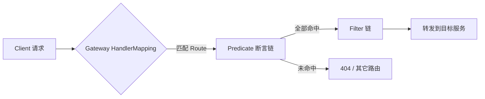

# Spring Cloud Gateway

> Spring Cloud Gateway 是 Spring 官方的 API 网关，基于 Spring WebFlux + Reactor Netty 构建，全程非阻塞。它把「所有外部流量统一入口」这件事做成一串可配置的路由：请求先匹配 `Predicate`，再经 `Filter` 链处理，最后转发到目标服务。

## 1. 定位与核心概念

网关要解决的是：**外部流量如何统一进入系统**——路由到不同后端、统一鉴权、限流、灰度、日志。相比老一代的 Zuul 1.x（阻塞），Gateway 用响应式模型获得了更高的并发能力。

三个核心概念：

| 概念 | 含义 |
|------|------|
| Route（路由） | 网关的基本单元，由 id、目标 uri、predicate 集合、filter 集合组成 |
| Predicate（断言） | 匹配条件，决定请求是否命中这条路由（如路径、方法、Header） |
| Filter（过滤器） | 命中路由后对请求/响应做加工，分 GatewayFilter（局部）与 GlobalFilter（全局） |

匹配流程：



## 2. 路由配置

最基础的配置式路由：

```yaml
spring:
  cloud:
    gateway:
      routes:
        - id: order-service
          uri: lb://order-service          # lb:// 表示走服务发现+负载均衡
          predicates:
            - Path=/api/orders/**
          filters:
            - StripPrefix=1                # 去掉第一段 /api
        - id: user-service
          uri: lb://user-service
          predicates:
            - Path=/api/users/**
            - Method=GET,POST
          filters:
            - StripPrefix=1
```

要点：

- `uri: lb://order-service`：`lb` 前缀触发客户端负载均衡，从注册中心解析实例。
- `uri: http://localhost:8080`：直连固定地址，不经过服务发现。
- 常见 Predicate：`Path`、`Method`、`Header`、`Query`、`Host`、`Cookie`、`After/Before/Between`（时间）。

也可以用 Java DSL 编程式定义路由：

```java
@Bean
public RouteLocator customRoutes(RouteLocatorBuilder builder) {
    return builder.routes()
        .route("order", r -> r.path("/api/orders/**")
            .filters(f -> f.stripPrefix(1))
            .uri("lb://order-service"))
        .build();
}
```

## 3. 过滤器

过滤器是网关的「加工车间」，分两类：

- **GatewayFilter（局部）**：只作用于某条路由，如 `StripPrefix`、`AddRequestHeader`、`RewritePath`。
- **GlobalFilter（全局）**：作用于所有路由，用于统一鉴权、加 traceId、统一日志。

内置过滤器很多，常用的：

| 过滤器 | 作用 |
|--------|------|
| `StripPrefix=n` | 转发前去掉 n 层路径前缀 |
| `AddRequestHeader` | 添加请求头 |
| `RequestRateLimiter` | 限流（配合 Redis） |
| `Retry` | 转发失败重试 |
| `CircuitBreaker` | 熔断（配合 Resilience4j） |
| `RewritePath` | 重写路径 |

自定义全局过滤器（如统一加 traceId 与鉴权）：

```java
@Component
public class AuthGlobalFilter implements GlobalFilter, Ordered {

    @Override
    public Mono<Void> filter(ServerWebExchange exchange, GatewayFilterChain chain) {
        String token = exchange.getRequest().getHeaders().getFirst("Authorization");
        if (!valid(token)) {
            exchange.getResponse().setStatusCode(HttpStatus.UNAUTHORIZED);
            return exchange.getResponse().setComplete();   // 中断，不再转发
        }
        // 校验通过后，把用户信息透传给下游（下游需防伪造）
        ServerHttpRequest req = exchange.getRequest().mutate()
                .header("X-User-Id", parseUserId(token))
                .build();
        return chain.filter(exchange.mutate().request(req).build());
    }

    @Override
    public int getOrder() {
        return -100;   // 越小越靠前执行
    }
}
```

## 4. 限流

Gateway 内置基于 Redis 的 `RequestRateLimiter`（令牌桶算法），关键在三件事：**限流键、速率、超限响应**。

```yaml
spring:
  cloud:
    gateway:
      routes:
        - id: order-service
          uri: lb://order-service
          predicates:
            - Path=/api/orders/**
          filters:
            - name: RequestRateLimiter
              args:
                redis-rate-limiter.replenishRate: 100   # 每秒补充令牌数
                redis-rate-limiter.burstCapacity: 200   # 桶容量（允许的突发）
                key-resolver: "#{@ipKeyResolver}"
```

```java
@Bean
public KeyResolver ipKeyResolver() {
    return exchange -> Mono.just(
        exchange.getRequest().getRemoteAddress().getAddress().getHostAddress());
}
```

- `key-resolver` 决定按什么限流：IP、用户、API 维度都可。限流键选错会误伤或不生效。
- 复杂的限流/熔断策略通常交给 Sentinel（见 [Sentinel 流量治理](./cloud-sentinel.md)），网关侧重入口流量控制。

## 5. 跨域与灰度

- **CORS**：在网关统一配置，避免每个服务各自处理。

```yaml
spring:
  cloud:
    gateway:
      globalcors:
        cors-configurations:
          '[/**]':
            allowedOrigins: "https://example.com"
            allowedMethods: "*"
```

- **灰度**：用 Predicate（如按 Header `X-Gray: true`）+ 路由权重，把一小部分流量导到新版本实例，实现金丝雀发布。

## 6. 实践要点与常见坑

1. **不要在网关堆业务**：网关是入口治理层，业务逻辑下沉到服务。
2. **超时与重试要谨慎**：网关整体超时 + 路由级超时都要设，重试只对幂等请求，防止放大流量。
3. **透传头要防伪造**：网关注入的 `X-User-Id` 之类，必须在下游入口剥离外部同名头，否则可被伪造绕过鉴权。
4. **大文件上传与流式协议**：上传大文件、SSE、WebSocket 需要单独评估缓冲与超时配置，默认参数未必合适。
5. **响应式约束**：Gateway 运行在 WebFlux 上，自定义过滤器里**不能阻塞**（别用阻塞 JDBC/同步调用），阻塞会拖垮事件循环。
6. **全链路 traceId 从网关生成**：入口生成 traceId 并透传，是整个链路可观测的起点。

## 7. 可观测与定制扩展

网关是全站流量的必经点，天然适合做统一观测的起点：

- **访问日志**：在全局过滤器里记录「路由、耗时、状态码、traceId、客户端 IP」，注意脱敏，别把完整 Token/参数写入日志。
- **指标**：暴露请求量、P95/P99 耗时、错误率、限流触发次数等，接入 Prometheus 报警。
- **链路追踪**：入口生成 traceId 并透传到下游，是整个链路可观测的前提。

定制扩展的边界要清楚：**全局过滤器做「横切」（鉴权、traceId、统一日志），断言与路由做「分流」（路径、Header、灰度）**，真正的业务逻辑留在后端服务。这样网关才能保持「薄」——越薄越稳定，越薄越好维护。

## 8. 小结

- Gateway 基于 WebFlux，非阻塞；核心是 Route = Predicate + Filter + uri。
- `lb://` 走服务发现，`http://` 直连；断言决定命中，过滤器决定加工。
- 全局过滤器做统一鉴权与 traceId，限流用 `RequestRateLimiter`（配 Redis）。
- 网关不写业务，注意超时/重试、头透传防伪造、响应式不可阻塞。
- 它与注册发现、配置中心、容错组件共同构成微服务入口治理层，见 [Spring Cloud 详解](./spring-cloud.md)。
