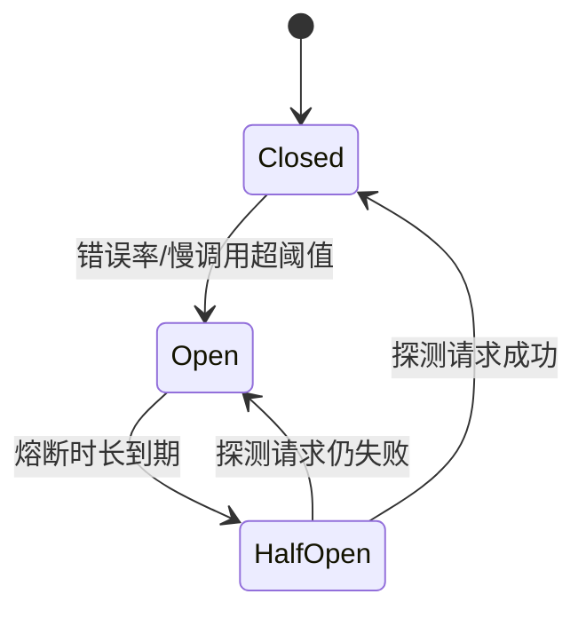

# Sentinel 流量治理

> Sentinel 是阿里巴巴开源的流量治理组件，以「资源」为中心，围绕流量提供限流、熔断降级、系统自适应保护等能力。它的定位不是把系统变快，而是**在流量异常时保住核心链路不被拖垮**。

## 1. 解决什么问题

当依赖变慢、流量突增或出错率上升时，如果什么都不做，故障会沿调用链放大：一个慢依赖占满线程池 → 上游排队 → 雪崩。Sentinel 通过四类手段切断这种放大：

- **限流（Flow Control）**：入口流量超过阈值就拒绝，保护自身不被打垮。
- **熔断降级（Circuit Breaking）**：依赖错误率/慢调用比例超标时快速失败，给下游恢复窗口。
- **隔离**：线程池/信号量舱壁，把故障限制在单个依赖内。
- **降级（Fallback）**：被限流或熔断后返回兜底结果，保体验。

Sentinel 与 Hystrix 的关键差异在于：Sentinel 用**滑动窗口**做实时统计，规则**可动态推送**，且不只做熔断，还把限流、系统保护、热点防护统一到一套资源模型下。

## 2. 核心概念：资源

Sentinel 把需要保护的东西抽象为**资源（Resource）**。资源粒度通常按**接口**或**关键业务方法**切；资源名要清晰、稳定，因为规则、监控、链路都挂在这个名字上。

```java
// 编程式定义资源
try (Entry entry = SphU.entry("queryOrder")) {
    // 受保护的业务逻辑
    return orderService.query(id);
} catch (BlockException ex) {
    // 被限流/熔断/系统保护拒绝
    return fallback();
}
```

Spring Cloud 场景下，引入 `spring-cloud-starter-alibaba-sentinel` 后，**Web 接口会自动成为资源**（资源名通常是 URL），无需手写 `SphU.entry`。若想用注解定义资源与降级，用 `@SentinelResource`：

```java
@SentinelResource(value = "queryOrder",
        blockHandler = "queryBlocked",   // 被限流/熔断时调用
        fallback = "queryFallback")      // 业务异常时的兜底
public OrderVO query(Long id) {
    return orderService.query(id);
}

public OrderVO queryBlocked(Long id, BlockException ex) {
    return OrderVO.empty();              // 方法签名需与原方法一致(可多一个 BlockException)
}
```

## 3. 规则类型

| 规则 | 说明 | 典型参数 |
|------|------|----------|
| 流量控制 | 按 QPS 或并发数限流 | 阈值、流控模式（直接/关联/链路）、流控效果（快速失败/预热/排队） |
| 熔断降级 | 依赖不稳时熔断 | 慢调用比例、异常比例、异常数；熔断时长 |
| 热点参数限流 | 按具体参数值限流 | 参数索引、单值阈值（如某商品 ID 单独限流） |
| 系统自适应保护 | 按系统整体负载保护 | LOAD、CPU 使用率、入口 QPS、线程数 |
| 来源授权 | 黑白名单 | 调用来源、通过/拒绝 |

熔断器状态机（与主流实现一致）：



## 4. 流控模式与效果

- **流控模式**：直接（对自己限流）、关联（关联资源超阈值时限制自己）、链路（只统计某条入口链路）。
- **流控效果**：快速失败（超阈值直接拒）、Warm Up（冷启动预热，阈值从低爬升）、匀速排队（漏桶，让请求匀速通过，适合削峰填谷）。

选择建议：突发流量用快速失败保护；上游有稳定处理能力、想平滑流量时用排队；服务刚启动、缓存未热时用预热。

## 5. 接入与规则动态化

配置示例（application.yml）：

```yaml
spring:
  cloud:
    sentinel:
      transport:
        dashboard: 127.0.0.1:8080   # Sentinel 控制台地址
      eager: true                   # 提前初始化，避免首次调用才加载
```

接入要点：

- **资源名设计清晰**：按接口/业务命名，避免一个巨型资源让规则无法精细控制。
- **规则动态推送**：生产上不要用代码硬编码规则，应通过控制台 + Nacos 等数据源实现规则的持久化与动态下发。
- **阻塞后的行为**：默认抛 `BlockException`，可通过 `BlockExceptionHandler` 自定义统一响应（返回限流提示而非 500）。

```java
@Component
public class SentinelBlockHandler implements BlockExceptionHandler {
    @Override
    public void handle(HttpServletRequest req, HttpServletResponse resp,
                       String resourceName, BlockException ex) throws IOException {
        resp.setStatus(429);
        resp.setContentType("application/json;charset=UTF-8");
        resp.getWriter().write("{\"code\":\"RATE_LIMITED\",\"message\":\"请求过于频繁\"}");
    }
}
```

规则持久化到 Nacos 后，控制台改动的规则会同步写入 Nacos，应用重启后从 Nacos 重新加载，避免「重启丢规则」。配合 OpenFeign 还能对下游调用做熔断降级，`@FeignClient` 指定 `fallback` 类返回兜底结果。

## 6. 与业务结合：限流不是目标

限流只是手段，**保核心链路**才是目标。上线前先定义清楚：

- **核心接口名单**：哪些接口绝不能挂（下单、支付、登录）。
- **可降级功能名单**：推荐、评论、积分等非核心，忙时可降级。
- **压测基线**：通过压测得到每个接口的真实容量，阈值才有依据，不能拍脑袋。

没有基线的阈值不是保护，是随机限流。

## 7. 常见坑

1. **阈值拍脑袋**：没压测就设阈值，不是太松（没保护）就是太紧（误伤）。
2. **规则不持久化**：只在控制台改、没接数据源，重启后规则丢失。
3. **资源粒度太粗**：整个 Controller 一个资源，无法对单个接口精细控制。
4. **只看限流不看降级**：被拒后没有兜底，用户体验比限流本身更差。
5. **熔断时长过短**：时长太短会导致下游还没恢复就再次放流量，熔断形同虚设。

## 8. 集群流控与规则持久化

单机限流在实例数动态变化的微服务里并不够用：每台机器各限一份阈值，实例扩容后总容量飘忽。**集群流控**引入一个 Token Server 统一发放令牌，让整个集群共享一个总阈值，适合对总量精度要求高的入口限流。

规则持久化则是另一条硬线。Sentinel 控制台默认把规则存在内存，**应用重启规则即丢失**。生产做法是把规则推送到 Nacos 等外部数据源，应用启动时从数据源回读，控制台改动再同步写回，形成闭环。缺少这一步，精心配置的限流规则在每次发布后都会「归零」，等于没有防护。

## 9. 小结

- Sentinel 以「资源」为中心，提供限流、熔断、系统保护、热点限流、来源授权。
- 流控看模式（直接/关联/链路）与效果（快速失败/预热/排队）；熔断看慢调用比例/异常比例。
- 生产要点：资源名清晰、规则持久化动态下发、自定义阻塞响应、配合 OpenFeign 降级。
- 阈值要来自压测基线，先定核心链路与可降级清单，见 [Spring Cloud 详解](./spring-cloud.md)。
