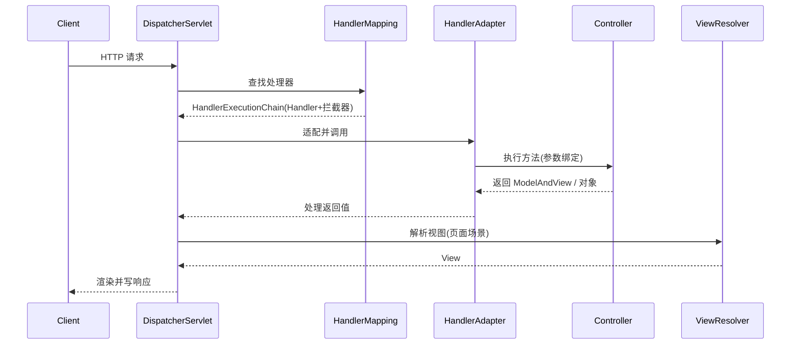

# Spring MVC 详解

> Spring MVC 是 Spring Framework 的 Web 层实现，围绕一个前端控制器 `DispatcherServlet` 组织：它接收所有请求，把请求分派给处理器，再统一负责参数绑定、返回值处理、异常解析与视图渲染。

## 1. 请求处理链路

一个 HTTP 请求进入 Spring MVC 后，大致经过这些环节：



核心组件职责：

| 组件 | 作用 |
|------|------|
| `DispatcherServlet` | 前端控制器，编排整个流程 |
| `HandlerMapping` | 根据 URL/注解找到处理器与拦截器链 |
| `HandlerAdapter` | 屏蔽处理器类型差异，执行并处理返回值 |
| `HttpMessageConverter` | REST 场景下把对象序列化成 JSON、或反之 |
| `ViewResolver` | 页面场景下按逻辑视图名解析出 `View` |
| `HandlerExceptionResolver` | 统一处理处理器抛出的异常 |

::: tip REST 与页面两条路
返回 `@ResponseBody`（或 `@RestController`）时走 `HttpMessageConverter` 直接写响应体，不经过视图解析；返回视图名时走 `ViewResolver` 渲染页面。现代前后端分离项目中，前者是主流。
:::

## 2. REST 控制器

```java
@RestController
@RequestMapping("/api/orders")
public class OrderController {

    private final OrderService orderService;

    public OrderController(OrderService orderService) {
        this.orderService = orderService;
    }

    @GetMapping("/{id}")
    public OrderVO get(@PathVariable Long id) {
        return OrderVO.from(orderService.find(id));
    }

    @PostMapping
    @ResponseStatus(HttpStatus.CREATED)
    public OrderVO create(@Valid @RequestBody CreateOrderReq req) {
        return OrderVO.from(orderService.create(req));
    }

    @GetMapping
    public List<OrderVO> list(@RequestParam(defaultValue = "0") int page,
                              @RequestParam(defaultValue = "20") int size) {
        return orderService.page(page, size);
    }
}
```

## 3. 参数绑定与校验

常用注解：

| 注解 | 来源 | 用途 |
|------|------|------|
| `@RequestParam` | 查询串 / 表单 | 单个参数，可设默认值 |
| `@PathVariable` | URL 路径 | RESTful 路径变量 |
| `@RequestBody` | 请求体 | JSON/XML 反序列化成对象 |
| `@ModelAttribute` | 表单 | 绑定到对象 |
| `@RequestHeader` | 请求头 | 读取 header |
| `@CookieValue` | Cookie | 读取 Cookie |

参数校验用 Bean Validation（`jakarta.validation`）：

```java
public class CreateOrderReq {
    @NotNull
    private Long userId;

    @NotEmpty
    private List<OrderItem> items;

    @Positive
    private BigDecimal amount;
}
```

控制器上标注 `@Valid`（或 `@Validated`）即触发校验，校验失败会抛 `MethodArgumentNotValidException`，通常由全局异常处理器统一转换为错误响应。复杂场景可自定义 `Converter` / `Formatter` 完成类型转换。

## 4. 统一异常处理

```java
@RestControllerAdvice
public class GlobalExceptionHandler {

    @ExceptionHandler(MethodArgumentNotValidException.class)
    public ResponseEntity<ApiError> handleValidation(MethodArgumentNotValidException e) {
        String msg = e.getBindingResult().getFieldErrors().stream()
                .map(f -> f.getField() + ": " + f.getDefaultMessage())
                .collect(Collectors.joining("; "));
        return ResponseEntity.badRequest().body(ApiError.of("PARAM_INVALID", msg));
    }

    @ExceptionHandler(BizException.class)
    public ResponseEntity<ApiError> handleBiz(BizException e) {
        return ResponseEntity.status(e.getStatus()).body(ApiError.of(e.getCode(), e.getMessage()));
    }

    @ExceptionHandler(Exception.class)
    public ResponseEntity<ApiError> handleUnknown(Exception e) {
        // 记录完整堆栈到日志，但不把堆栈回给前端
        log.error("unexpected error", e);
        return ResponseEntity.internalServerError().body(ApiError.of("INTERNAL_ERROR", "系统繁忙"));
    }
}
```

`@ControllerAdvice` / `@RestControllerAdvice` 让异常处理集中，避免每个 Controller 里散落 `try-catch`。要点：**业务异常与系统异常分层**，系统异常只回笼统提示，细节留在日志。

## 5. 拦截器 vs 过滤器

| 维度 | Filter | HandlerInterceptor |
|------|--------|--------------------|
| 规范 | Servlet 规范 | Spring MVC |
| 位置 | 更靠前，在 `DispatcherServlet` 之前 | 在处理器调用前后 |
| 可见信息 | 只看到 `ServletRequest` | 能拿到 `Handler`（知道是哪个方法） |
| 典型用途 | 编码、跨域、请求包装 | 登录校验、权限、日志、traceId |

拦截器三个回调点：

```java
public class AuthInterceptor implements HandlerInterceptor {
    @Override
    public boolean preHandle(HttpServletRequest req, HttpServletResponse resp, Object handler) {
        // 返回 false 即中断后续处理
        return checkToken(req);
    }
    @Override
    public void postHandle(HttpServletRequest req, HttpServletResponse resp,
                           Object handler, ModelAndView mv) { }
    @Override
    public void afterCompletion(HttpServletRequest req, HttpServletResponse resp,
                                Object handler, Exception ex) { }
}
```

典型架构是**网关鉴权 + 服务内拦截器做细粒度权限**：网关校验 token 合法性、剥离敏感头，服务内拦截器根据业务权限点做授权。

## 6. 内容协商与文件上传

- **内容协商**：`@RequestMapping(produces = "application/json")` 声明产出类型，`consumes` 声明可接受的请求体类型；`Accept` 头决定最终格式。
- **文件上传**：参数用 `MultipartFile` 接收，单文件与多文件（`List<MultipartFile>`）均可。

```yaml
spring:
  servlet:
    multipart:
      max-file-size: 10MB        # 单文件上限
      max-request-size: 20MB     # 整个请求上限
```

大文件要留意：默认上传会**先落到临时目录**再处理，磁盘与临时目录清理策略要规划；超大文件或断点续传场景应改用分片上传。

## 7. 实践要点与常见坑

1. **不要用 `@Autowired` 字段注入 Controller**，构造器注入便于测试。
2. **区分 `@Valid` 与 `@Validated`**：前者来自 Bean Validation，`@Validated` 是 Spring 的，支持分组校验。
3. **统一返回结构**要包含可追踪字段（如 `traceId`），否则线上排障困难。
4. **异步与超时**：`@Async`、`Callable`、`DeferredResult` 能提升并发，但线程池要隔离配置，避免拖垮容器。
5. **别把业务写进 Controller**：Controller 只做参数绑定、调用 Service、组装返回。

## 8. 小结

- `DispatcherServlet` 是核心，`HandlerMapping` 找方法、`HandlerAdapter` 执行、`HttpMessageConverter` 出参。
- 参数绑定按来源选注解，校验靠 Bean Validation，异常靠 `@RestControllerAdvice` 集中。
- 拦截器能拿到 Handler 信息，比 Filter 更适合做服务内鉴权。
- Spring MVC 是 Boot Web 应用的底座，与 IoC/AOP 一脉相承，见 [Spring Framework 核心](./spring-framework.md)。
