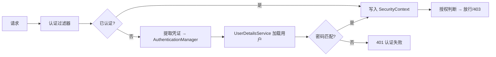

# Spring Security

> Spring Security 是 Spring 生态的安全框架，核心是一整条 Servlet 过滤器链：请求进来先经过一串过滤器，依次完成认证（Authentication，你是谁）、授权（Authorization，你能做什么）、以及 CSRF、CORS、会话管理等横切安全能力。

## 1. 核心概念

| 概念 | 含义 |
|------|------|
| Authentication | 认证：确认「你是谁」，产出 `Authentication` 对象 |
| Authorization | 授权：判断「你能做什么」，决定放行或拒绝 |
| `SecurityFilterChain` | 过滤器链，安全逻辑的实际执行者 |
| `SecurityContext` | 保存当前请求的认证信息（通常放 `ThreadLocal`） |
| `UserDetailsService` | 加载用户及其权限的接口 |
| `PasswordEncoder` | 口令编码器（如 BCrypt） |
| `AuthenticationManager` | 认证的总入口，编排认证流程 |

认证的大致流程：



## 2. 过滤器链配置（新式写法）

新版本 Spring Security 用 `SecurityFilterChain` Bean 配置，已不再用旧式的 `WebSecurityConfigurerAdapter`：

```java
@Configuration
@EnableWebSecurity
public class SecurityConfig {

    @Bean
    public SecurityFilterChain filterChain(HttpSecurity http) throws Exception {
        http
            .csrf(csrf -> csrf.disable())                 // 纯 API 无状态时可关
            .sessionManagement(sm -> sm.sessionCreationPolicy(SessionCreationPolicy.STATELESS))
            .authorizeHttpRequests(auth -> auth
                .requestMatchers("/api/public/**").permitAll()
                .requestMatchers("/api/admin/**").hasRole("ADMIN")
                .anyRequest().authenticated())
            .oauth2ResourceServer(oauth2 -> oauth2.jwt(Customizer.withDefaults()));
        return http.build();
    }

    @Bean
    public PasswordEncoder passwordEncoder() {
        return new BCryptPasswordEncoder();
    }
}
```

要点：`permitAll` 放行公开接口，`hasRole` / `hasAuthority` 做权限判断，`anyRequest().authenticated()` 兜底。规则**自上而下匹配，先命中先生效**，具体规则要放在宽泛规则之前——否则一个宽泛的 `permitAll` 可能把后面的精细规则全部短路。

## 3. 常见方案

| 方案 | 适用 | 说明 |
|------|------|------|
| Session + Form Login | 传统后台管理 | 服务端会话，天然支持 CSRF 防护 |
| OAuth2 / JWT 资源服务器 | 前后端分离 / 微服务 API | 无状态，token 自包含，验签即认证 |
| 网关统一认证 + 下游信任头 | 微服务 | 网关验 token，下游只信任网关注入的头 |

无状态 API 最小链路：

1. 登录接口校验凭证，签发 JWT（含用户标识与权限）。
2. 客户端后续请求携带 `Authorization: Bearer <token>`。
3. 资源服务器验签、解析权限、注入 `SecurityContext`，交给授权规则判断。

```yaml
# 作为 OAuth2 资源服务器时
spring:
  security:
    oauth2:
      resourceserver:
        jwt:
          issuer-uri: https://auth.example.com
```

## 4. 权限模型

- **角色（Role）**：如 `ROLE_ADMIN`，`hasRole("ADMIN")` 会自动补 `ROLE_` 前缀。
- **权限点（Authority）**：细粒度，如 `order:read`、`order:write`，用 `hasAuthority("order:read")`。
- **方法级**：`@PreAuthorize` / `@PostAuthorize`（需 `@EnableMethodSecurity`）。

```java
@Service
public class OrderService {

    @PreAuthorize("hasAuthority('order:read') or hasRole('ADMIN')")
    public OrderVO find(Long id) {
        // ...
    }
}
```

角色适合粗粒度分层，权限点适合按资源动作精确授权。二者通常混用：角色做入口门槛，权限点做操作级校验。方法级注解让权限声明贴近业务代码，比集中在一处配置更易维护。

## 5. 密码与令牌

- **密码哈希**：用 `BCryptPasswordEncoder`（自带盐、可调强度），**绝不存明文或简单 MD5/SHA1**。
- **JWT 要点**：签名算法选 `HS256`（对称密钥，需妥善保管）或 `RS256`（非对称，便于校验方只持公钥）；设置合理过期时间；敏感信息不入 payload（payload 仅 base64 编码，并非加密）。
- **密钥轮换**：签名密钥要有轮换与失效机制，避免长期不变。

## 6. 网关注入头的防伪问题

微服务里常见「网关统一认证 + 下游信任头」的模式：网关验 token，把用户信息放进 `X-User-Id` 等头透传给下游，下游不再重复认证。

::: danger 必须防伪造
如果下游无条件信任 `X-User-Id`，攻击者只要绕过网关直连服务、或自己伪造这个头，就能冒充任意用户。防护手段：
- 网络层限制：下游服务**只允许网关访问**（内网隔离/安全组）。
- 服务入口**剥离**外部传入的同名头，再由网关重新注入。
- 或改用服务间签名（如 mTLS / 内部 token）校验来源。
:::

## 7. 常见配置坑

1. **规则顺序**：宽泛规则写在前面会覆盖后面的精细规则，`permitAll` 一个 `/**` 就能让整条链形同虚设。
2. **无状态下别用 Session**：API 场景应显式设 `SessionCreationPolicy.STATELESS`，否则会意外创建会话、放大内存压力。
3. **CSRF 开关要按场景**：浏览器 + Cookie 场景必须开；纯 Bearer Token 无状态 API 才可关。
4. **放行清单要谨慎**：放行静态资源、健康检查、登录接口时，路径要精确到具体前缀，避免放行了不该放行的接口。

## 8. 安全清单

- [ ] 密码用 BCrypt 等强哈希，不存明文。
- [ ] 浏览器会话场景开启 CSRF 防护；纯无状态 API 且不用 Cookie 才关闭。
- [ ] CORS 最小化：只放行可信来源、必要方法与头。
- [ ] 令牌/签名密钥有轮换机制，不硬编码在代码里。
- [ ] 关键操作留审计日志（谁、何时、做了什么）。
- [ ] 权限规则自上而下匹配，避免宽泛规则覆盖精细规则。
- [ ] 网关透传头做防伪造处理。

## 9. 小结

- Spring Security 的骨架是 `SecurityFilterChain`，认证与授权由过滤器链完成。
- 新式配置用 `SecurityFilterChain` Bean，规则自上而下匹配，先命中先生效。
- 无状态 API 用 OAuth2/JWT 资源服务器；传统后台用 Session + Form Login。
- 权限模型混用角色与权限点，方法级用 `@PreAuthorize`。
- 密码强哈希、CORS 最小化、网关头防伪造，是三条安全硬线。
