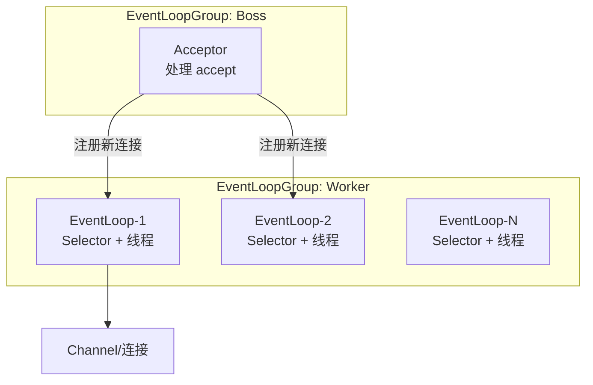

# Netty 详解

> Netty 是基于 Java NIO 的高性能异步网络框架，用一套优雅的抽象屏蔽了 NIO 的繁琐与陷阱。它把「事件循环、通道、管道、缓冲区」这些原语组织成可组合的组件，广泛用于 RPC 框架（Dubbo、gRPC-Java）、API 网关、即时通信、游戏服务端。理解 Netty 的五件套——Channel、EventLoop、Pipeline、ByteBuf、编解码——是掌握它的核心。

## 1. 从 NIO 三件套说起

JavaScript 的 NIO 有三大核心抽象，Netty 正是对它们的高阶封装：

| NIO 原语 | 含义 | Netty 对应 |
|----------|------|-----------|
| Channel | 可读写的通道（连接/文件） | `io.netty.channel.Channel` |
| Buffer | 数据容器（`ByteBuffer`） | `ByteBuf` |
| Selector | IO 多路复用器，一个线程管多个连接 | `EventLoop`（内部封装 Selector） |

裸写 NIO 的痛点在 Netty 里都被抹平了：

- `ByteBuffer` 读写共用指针、需手动 `flip()`，容易出错 → `ByteBuf` 读写指针分离；
- 空轮询 bug（Selector 无事件却返回）→ Netty 用计数规避；
- 半包/粘包要自己处理 → 内置解码器开箱即用；
- API 繁琐、异常处理分散 → 统一的 Pipeline 与 Future/Promise 模型。

## 2. EventLoop 与线程模型

**EventLoop（事件循环）** 是 Netty 的心脏：每个 EventLoop 内部持有一个 Selector 和一个任务队列，在一个线程里不断「轮询 IO 事件 → 处理 → 执行排队任务」。



典型服务端用**两个** EventLoopGroup：

- **BossGroup**：通常 1 个线程（或几个），只负责 `accept` 新连接，把 `Channel` 注册到 Worker；
- **WorkerGroup**：默认线程数为 `2 × CPU 核数`，负责已建立连接的读写、编解码与业务 handler 执行。

关键约束：**一个 `Channel` 一生只绑定一个 `EventLoop`**（一个线程）。因此同一个 Channel 上的事件处理天然是**串行**的——这既是 Netty 免锁设计的来源（无并发竞争），也是**不能在 ChannelHandler 里做耗时阻塞操作**的原因：它会卡住该 EventLoop 上所有 Channel 的事件。耗时业务要投递到独立业务线程池。

```java
EventLoopGroup boss = new NioEventLoopGroup(1);
EventLoopGroup worker = new NioEventLoopGroup(); // 默认 2 * CPU
try {
    ServerBootstrap b = new ServerBootstrap();
    b.group(boss, worker)
     .channel(NioServerSocketChannel.class)
     .childHandler(new ChannelInitializer<SocketChannel>() {
         @Override
         protected void initChannel(SocketChannel ch) {
             ch.pipeline().addLast(new MyDecoder(), new MyHandler());
         }
     });
    ChannelFuture f = b.bind(8080).sync();
    f.channel().closeFuture().sync();
} finally {
    boss.shutdownGracefully();
    worker.shutdownGracefully();
}
```

## 3. ChannelPipeline 与 Handler

**ChannelPipeline（管道）** 是 Netty 最精妙的设计：每个 `Channel` 有一条 Pipeline，里面按顺序挂着若干 `ChannelHandler`。数据像流水一样经过 Handler 链被逐层处理。

Handler 分两类，方向相反：

| 类型 | 接口 | 处理方向 |
|------|------|----------|
| 入站 | `ChannelInboundHandler` | 从网络到应用（读数据、连接建立） |
| 出站 | `ChannelOutboundHandler` | 从应用到网络（写数据、连接关闭） |

Pipeline 里 Handler 的**顺序决定执行顺序**：入站事件从**头部往尾部**传播（`addLast` 加的靠后执行），出站事件反过来从**尾部往头部**传播。


`ChannelInboundHandlerAdapter` 是入站的便捷基类。其 `channelRead` 方法处理数据后，**必须**决定是否把事件传给下一个 Handler：

```java
public class MyHandler extends ChannelInboundHandlerAdapter {
    @Override
    public void channelRead(ChannelHandlerContext ctx, Object msg) {
        // 处理 msg（此处假设已被前置解码器解成对象）
        System.out.println("收到: " + msg);
        ReferenceCountUtil.release(msg); // 若未传递，需自行释放 ByteBuf
    }

    @Override
    public void exceptionCaught(ChannelHandlerContext ctx, Throwable cause) {
        cause.printStackTrace();
        ctx.close(); // 异常后关闭连接
    }
}
```

::: warning 事件传递与资源释放
`channelRead` 默认不会自动把消息传给下一个 Handler，需要显式 `ctx.fireChannelRead(msg)` 或调用 `super.channelRead`。若消费了消息且不再传递，必须释放引用计数的对象（`ReferenceCountUtil.release`），否则会内存泄漏（Netty 用 `ResourceLeakDetector` 检测）。
:::

## 4. ByteBuf：读写分离的缓冲区

`ByteBuf` 取代了 JDK 的 `ByteBuffer`，核心改进是**读指针与写指针分离**，不需要 `flip()`：

```text
+-------------------+------------------+-------------------+
|  已读（丢弃）      |   可读（readable）|   可写（writable） |
+-------------------+------------------+-------------------+
               readerIndex        writerIndex        capacity
```

- `readXxx()` 移动 `readerIndex`，`writeXxx()` 移动 `writerIndex`；
- `readableBytes()` = `writerIndex - readerIndex`；
- `discardReadBytes()` 回收已读空间，`clear()` 重置两个指针。

按内存位置和分配方式分：

| 维度 | 类型 | 特点 |
|------|------|------|
| 内存位置 | Heap `ByteBuf` | 分配在 JVM 堆，GC 管理，访问快 |
| | Direct `ByteBuf` | 堆外内存，减少一次拷贝，适合网络传输 |
| 分配方式 | Unpooled | 每次新建，简单但有 GC / 分配开销 |
| | Pooled | 内存池复用，减少分配与 GC，Netty 4 默认推荐 |

Netty 4 起默认用**池化的直接内存** `PooledByteBufAllocator`，兼顾性能与 GC 压力。`ByteBuf` 采用**引用计数**管理生命周期：`retain()` 加一、`release()` 减一，减到 0 才真正回收。谁最后使用谁释放，是全链路编码里最易出错的地方。

## 5. 粘包与拆包

TCP 是**字节流**协议，没有消息边界：一次 `read` 读到的可能是半个消息、一个消息、或多条消息粘在一起。这就是「粘包/半包」问题，必须在应用层划出边界。

Netty 提供了基于**帧解码器**的解决方案，直接加在 Pipeline 前端：

| 解码器 | 边界规则 | 适用 |
|--------|----------|------|
| `FixedLengthFrameDecoder` | 固定长度 | 定长协议 |
| `LineBasedFrameDecoder` | 换行符 | 文本行协议 |
| `DelimiterBasedFrameDecoder` | 自定义分隔符 | 带特殊分隔符 |
| `LengthFieldBasedFrameDecoder` | 长度字段 | 最常用，二进制协议 |

`LengthFieldBasedFrameDecoder` 是最通用的方案：消息头部带一个长度字段，解码器按它切出完整帧。

```java
// 消息结构：[4字节魔数][4字节长度][负载]
// 从偏移 4 处读 4 字节长度字段；长度字段本身也计入该帧
pipeline.addLast(new LengthFieldBasedFrameDecoder(
    1024 * 1024, // 最大帧长，防止超长帧撑爆内存
    4,           // lengthFieldOffset：长度字段起始偏移
    4,           // lengthFieldLength：长度字段占几字节
    0,           // lengthAdjustment：长度字段值到负载的修正值
    8            // initialBytesToStrip：解码后丢弃的头部字节数
));
```

::: tip 为什么很多框架自定义协议头
生产级 RPC 协议通常自带「魔数 + 版本 + 序列化方式 + 长度 + 请求 id」的协议头。魔数用于快速识别非法包，长度字段用于拆包，请求 id 用于把响应关联到请求。理解了 `LengthFieldBasedFrameDecoder` 的参数，就能读懂大多数私有协议的编解码实现。
:::

## 6. 零拷贝

「零拷贝」指减少数据在用户态与内核态之间、或多个缓冲区之间的复制次数。Netty 层面有几层含义：

1. **操作系统级零拷贝**：`FileRegion` 封装了 `FileChannel.transferTo()`，底层用 `sendfile`，文件数据从磁盘到网卡不经用户态，用于文件传输。
2. **`CompositeByteBuf`**：把多个 `ByteBuf` 逻辑拼成一个，避免合并时的内存拷贝。
3. **`slice()` / `duplicate()` / `wrap()`**：返回共享底层内存的视图，不复制数据。
4. **直接内存（Direct Buffer）**：读写直接在堆外缓冲进行，避免堆内存 → 直接内存的额外拷贝。

以文件传输为例：

```java
// 用 FileRegion 走 sendfile 零拷贝
FileChannel fileChannel = new FileInputStream(file).getChannel();
ctx.writeAndFlush(new DefaultFileRegion(fileChannel, 0, file.length()))
   .addListener(ChannelFutureListener.CLOSE);
```

## 7. 实践要点与常见坑

1. **不要在 EventLoop 线程里阻塞**：耗时操作（数据库、外部调用）会卡住该线程上所有 Channel，务必提交到业务线程池，并给业务线程池加 `DefaultEventExecutorGroup` 或自定义。
2. **正确管理引用计数**：编解码器、Handler 里对 `ByteBuf` 的 `retain`/`release` 要配对，开启 `ResourceLeakDetector`（`-Dio.netty.leakDetection.level=paranoid`）排查泄漏。
3. **超长帧要有上限**：`LengthFieldBasedFrameDecoder` 的最大长度参数防止畸形包导致 OOM。
4. **心跳与空闲检测**：用 `IdleStateHandler` 检测空闲，配合超时关闭，避免大量僵尸连接。
5. **写操作要刷**：`write()` 只是入队，`writeAndFlush()` 才真正发送；批量写可以合并刷以减少系统调用。
6. **优雅关闭**：`shutdownGracefully()` 让 EventLoop 处理完在途任务再退出，避免直接 `shutdown` 丢数据。
7. **HTTP 等上层协议用现成 codec**：`HttpServerCodec`、`HttpObjectAggregator` 等能省下大量手写解析代码，不要重复造轮子。

## 8. 小结

- Netty 封装 NIO 三件套（Channel/Buffer/Selector），提供更安全易用的抽象。
- EventLoop 是「Selector + 单线程」，一个 Channel 绑定一个 EventLoop，处理天然串行，禁止阻塞。
- ChannelPipeline 用入站/出站 Handler 链组织数据处理，顺序决定传播方向。
- ByteBuf 读写指针分离、支持池化与直接内存、用引用计数管理生命周期。
- 粘包拆包靠帧解码器（最常用 `LengthFieldBasedFrameDecoder`），零拷贝靠 `sendfile`、`CompositeByteBuf` 与直接内存。
