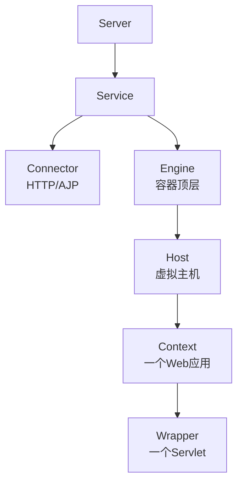
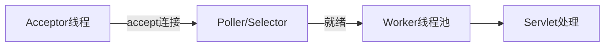

# Tomcat 详解

> Tomcat 是最常用的 Servlet 容器，负责把 HTTP 请求翻译成 Servlet 调用并返回响应。理解它的架构（Connector + Container）、类加载器体系和线程模型，是排查「请求卡住」「线程打满」「类冲突」这类线上问题的基础。Spring Boot 内嵌的默认容器就是 Tomcat。

## 1. 整体架构：Server / Service / Connector / Container

Tomcat 的组件是层层嵌套的树形结构：



| 组件 | 职责 |
|------|------|
| Server | 最顶层，代表整个 Tomcat 实例，管理多个 Service |
| Service | 把 Connector 与一个 Engine 组合起来 |
| Connector | 负责**连接与协议**：接收网络字节、按 HTTP 解析、交给容器 |
| Engine | 容器顶层，处理它收到的所有请求 |
| Host | 虚拟主机，按域名路由（如 `localhost`） |
| Context | 一个 Web 应用（一个 WAR/部署单元） |
| Wrapper | 对单个 Servlet 的封装，是容器的最底层 |

**Connector 与 Container 的分工**是理解 Tomcat 的关键：Connector 只管「网络与协议」，把 HTTP 报文变成 `ServletRequest`；Container 只管「业务与 Servlet」，不关心协议细节。这种解耦让 Tomcat 能同时支持多种协议连接器。

## 2. 请求处理流程

一个 HTTP 请求进入 Tomcat 后大致经历：

```text
客户端连接
   ▼
Connector（Acceptor 接收 → Poller 就绪 → Worker 处理）
   ▼（解析 HTTP，封装 Request/Response）
Engine Pipeline → Host Pipeline → Context Pipeline → Wrapper Pipeline
   ▼（Valve 链，类似过滤器的处理步骤链）
Filter 链 → Servlet.service()
   ▼
响应写回
```

每层容器都有一个 **Pipeline**（管道），Pipeline 里挂着一串 **Valve**（阀门）。请求像水流过管道一样依次经过各 Valve，最终到达 Wrapper 内的 Servlet。`StandardEngineValve`、`StandardHostValve`、`StandardContextValve`、`StandardWrapperValve` 是各级的默认阀门，决定了请求如何往下一层传递。

Filter 与 Valve 的区别：**Valve 是容器级的处理步骤**（偏基础设施，如访问日志、远程地址过滤），配置在 `server.xml`/`context.xml`；**Filter 是 Servlet 规范级的**，定义在应用里（`web.xml`/注解），可跨容器移植。日常开发写 Filter，容器级拦截才用 Valve。

## 3. 连接器与线程模型

Tomcat 支持多种协议实现（IO 模型）：

| 连接器 | IO 模型 | 说明 |
|--------|---------|------|
| BIO | 阻塞 IO，一连接一线程 | 已淘汰，并发差 |
| NIO | 非阻塞 IO，基于 JDK NIO | 现代默认，通用性好 |
| NIO2 | 异步 IO（JDK 7+ AIO） | 特定场景 |
| APR | 依赖本地库的 IO | 曾用于高性能场景，依赖平台 |

NIO 连接器内部有三个关键角色：

- **Acceptor**：负责 `accept()` 新连接，把连接交给 Poller；
- **Poller**：基于 `Selector` 轮询就绪事件，把可读的连接交给 Worker 线程池；
- **Worker（Executor 线程池）**：真正执行请求解析与 Servlet 调用。



这意味着**请求处理受 Worker 线程池大小限制**：`maxThreads` 满了，后续请求就在 `acceptCount` 排队；队列也满了，新连接直接被拒。

## 4. 类加载器体系

Tomcat 的类加载器是「打破双亲委派」的典型案例——为了让**每个 Web 应用能加载自己版本的类库**，而不互相干扰：

| 类加载器 | 加载内容 |
|----------|----------|
| Bootstrap | JDK 核心类（`java.*`） |
| System | `CLASSPATH` 上的类 |
| Common | Tomcat 自身与所有 Web 应用共享的类（`/lib`） |
| Webapp（每个应用一个） | 该应用的 `WEB-INF/classes` 与 `WEB-INF/lib` |

**加载顺序**是重点：Webapp 类加载器在加载非 JDK 类时，**优先从自己的 `WEB-INF/classes`、`WEB-INF/lib` 加载**，找不到才委派给父加载器。这违反了标准的「先父后子」双亲委派，目的就是让应用用上自己打包的依赖版本。

::: warning 类冲突的典型来源
两个 Web 应用依赖同一个库的不同版本时，各自的 Webapp 类加载器会分别加载，互不干扰——这通常是优点。但如果某段逻辑把对象存进了**跨应用共享的位置**（如 Common 类加载器加载的缓存、线程上下文类加载器 `Thread.currentThread().getContextClassLoader()` 混淆），就可能出现 `ClassCastException: X cannot be cast to X`。排查类冲突时要先确认类是被哪个加载器加载的。
:::

## 5. server.xml 与调优

核心连接器配置集中在 `server.xml` 的 `<Connector>` 元素：

```xml
<!-- 参数含义见下方表格；此处给出一个 NIO 连接器的典型配置 -->
<Connector port="8080" protocol="org.apache.coyote.http11.Http11NioProtocol"
           maxThreads="500"
           minSpareThreads="50"
           acceptCount="200"
           maxConnections="10000"
           connectionTimeout="20000"
           keepAliveTimeout="15000"
           compression="on"
           compressionMinSize="2048"
           compressibleMimeType="text/html,text/xml,text/css,application/json"
           redirectPort="8443" />
```

各参数含义：

| 参数 | 含义 |
|------|------|
| `maxThreads` | Worker 线程池最大线程数，同时处理的请求上限 |
| `minSpareThreads` | 最小空闲线程数 |
| `acceptCount` | 等待队列长度，满了拒绝新连接 |
| `maxConnections` | 最大同时可接受的连接数 |
| `connectionTimeout` | 连接建立后等待请求行的超时（毫秒） |
| `keepAliveTimeout` | 长连接空闲超时 |
| `compression` | 开启响应压缩，`compressionMinSize` 为压缩阈值 |


调优可从几个维度入手：

| 维度 | 关键参数 | 说明 |
|------|----------|------|
| 并发处理 | `maxThreads` | 按「QPS × 平均耗时」估算，过大会加剧上下文切换 |
| 连接排队 | `acceptCount` | 队列太大会让请求长时间等待后超时，掩盖下游问题 |
| 连接复用 | `keepAliveTimeout`、`maxKeepAliveRequests` | 长连接减少握手开销，但会占用线程 |
| 内存 | JVM `-Xmx`、`-XX:MaxMetaspaceSize` | 堆与元空间要留余量 |
| 响应 | `compression` | 文本类响应压缩能显著减小传输量 |

**`maxThreads` 该怎么定？** 常被误以为越大越好。线程本身有栈内存开销、且线程过多会导致 CPU 在上下文切换上浪费。经验做法是压测得出单请求平均 RT，用「目标 QPS × RT」估算线程需求，再结合 CPU 核数（CPU 密集型线程数接近核数即可，IO 密集型可放大）。

## 6. 与 Spring Boot 内嵌容器

Spring Boot 默认内嵌 Tomcat，用 `ServletWebServerFactory` 自动配置启动，不需要独立的 Tomcat 安装。相关定制：

```yaml
server:
  port: 8080
  tomcat:
    threads:
      max: 500          # 对应 maxThreads
      min-spare: 50     # 对应 minSpareThreads
    accept-count: 200   # 对应 acceptCount
    max-connections: 10000
    connection-timeout: 20s
  compression:
    enabled: true
    mime-types: text/html,text/css,application/json
    min-response-size: 2048
```

Spring Boot 3 起的配置前缀体系有调整，`accept-count`、`connection-timeout` 等直接挂在 `server.tomcat`/`server` 下，写配置时应以当前版本的官方属性为准。

**切换容器**：排除默认的 Tomcat 起步依赖、引入对应容器即可：

```xml
<dependency>
    <groupId>org.springframework.boot</groupId>
    <artifactId>spring-boot-starter-web</artifactId>
    <exclusions>
        <exclusion>
            <groupId>org.springframework.boot</groupId>
            <artifactId>spring-boot-starter-tomcat</artifactId>
        </exclusion>
    </exclusions>
</dependency>
<!-- 换成 Undertow -->
<dependency>
    <groupId>org.springframework.boot</groupId>
    <artifactId>spring-boot-starter-undertow</artifactId>
</dependency>
```

Jetty、Undertow 各有取舍：Undertow 内存占用较低、在高并发长连接场景有一定优势；Jetty 更轻量、嵌入式友好。**选择依据是压测数据，不是名录**。

外置部署仍可用传统方式：把打包类型设为 `war`、`SpringBootServletInitializer` 作为入口，部署到独立 Tomcat——适用于需要统一容器管理的传统运维体系。

## 7. 实践要点与常见坑

1. **线程打满先找慢点**：`maxThreads` 打满十有八九是慢 SQL 或外部依赖超时，扩容线程治标不治本。
2. **内存泄漏常见于类加载器**：热部署/频繁重载应用时，旧 Webapp 类加载器若被 `ThreadLocal`、JDBC 驱动、日志框架持有引用，就无法回收，导致 Metaspace 溢出（`OutOfMemoryError: Metaspace`）。
3. **合理关闭长连接**：`keepAliveTimeout` 太长会维持大量空闲连接占用资源；太短则频繁重建连接。
4. **静态资源交给前置**：生产环境静态资源通常由 Nginx 直接服务，Tomcat 只处理动态请求。
5. **别忽略 `maxConnections` 与 `maxThreads` 的区别**：前者是「能同时接受的连接数」，后者是「能同时处理请求的线程数」，两者配合 `acceptCount` 共同决定过载行为。
6. **超时要有层级**：连接超时、读超时、下游调用超时层层设置，避免请求在某一环无限等待。

## 8. 小结

- 架构是 Server → Service → Connector + Container（Engine/Host/Context/Wrapper）。
- Connector 管网络与协议，Container 管 Servlet；请求经 Pipeline 的 Valve 链与 Filter 到达 Servlet。
- NIO 连接器的 Acceptor → Poller → Worker 模型决定并发能力，Worker 线程池是瓶颈所在。
- Webapp 类加载器打破双亲委派，让每个应用加载自己的依赖版本，也是类冲突排查的重点。
- Spring Boot 默认内嵌 Tomcat，可通过属性或换 starter 切换 Undertow/Jetty。
