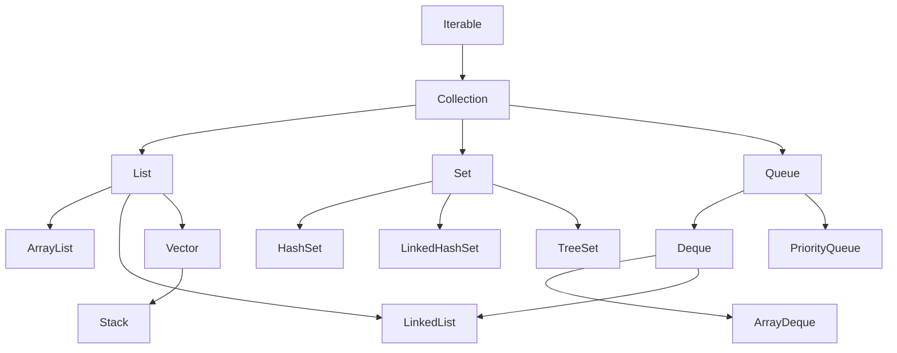
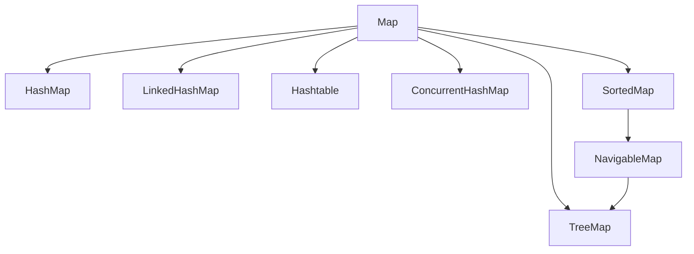

# Collection 类关系图

> Java 集合框架（Java Collections Framework, JCF）是 JDK 对「一组对象」和「键值对」两类数据结构的标准化封装。本文给出整体类关系、遍历方式与选型地图，具体实现的源码解析见各子篇。

## 1. 为什么要有集合框架

在 JCF 出现之前，Java 只有数组，以及 `Vector`、`Hashtable` 这类零散容器：数组长度固定、没有统一的遍历协议，而 `Vector`、`Hashtable` 又把「线程安全」硬编码进实现里。JCF 自 JDK 1.2 起，用一套统一接口抽象了容器的增删改查、遍历和批量操作，带来四点收益：

- **统一 API**：无论底层是数组、链表还是红黑树，都通过 `Collection` / `Map` 接口操作，降低学习与记忆成本。
- **可替换性**：面向接口编程后，`ArrayList` 换成 `LinkedList` 不必改调用方代码。
- **复用已有的算法**：排序、二分查找、洗牌等以静态方法集中在 `Collections` 工具类，与具体数据结构解耦。
- **互操作**：集合之间、集合与数组之间可以互相转换。

一个必须记住的前提：**容器只能装对象**。`int`、`long`、`double` 等基本类型要先装箱成 `Integer`、`Long`、`Double` 才能放入容器，取出时再拆箱。自动装箱让代码简洁，但会带来额外的对象分配与 GC 压力——这正是 `Stream`、`Optional` 等新 API 反复强调「避免无谓装箱」的出发点。

## 2. 两大顶层体系

JCF 的顶层只有两条线：

- **`Collection`**：单个元素的集合（一组对象）。
- **`Map`**：键值对的映射表（两个对象一组）。





注意区分 **`Collection` 与 `Collections`**：前者是接口，后者是操作集合的工具类（`Collections.sort`、`Collections.unmodifiableList` 等）。`Map` 不继承 `Collection`，因为它的元素是「键值对」而非单纯对象；`Set` 可以用 `Map` 的键集合来实现，`HashSet` 内部就是一个 `HashMap`。所有 `Collection` 都实现了 `Iterable`，因此都能用 for-each 遍历——这是整个框架的遍历协议基础。

## 3. Collection 的三个分支

### 3.1 List：有序、可重复

| 实现 | 底层结构 | 随机访问 | 中间增删 | 说明 |
|------|----------|----------|----------|------|
| `ArrayList` | 动态数组 | O(1) | O(n) | 最常用；扩容时按约 1.5 倍增长并复制数组 |
| `LinkedList` | 双向链表 | O(n) | O(1)* | 同时实现 `Deque`，可当栈/队列；命中节点前仍需 O(n) 遍历 |
| `Vector` | 动态数组 | O(1) | O(n) | 方法级 `synchronized`，遗留类，基本被淘汰 |

\* 链表「增删快」的前提是已经持有目标位置的节点，按索引定位仍是 O(n)。

实践提示：能预估元素数量时给 `ArrayList` 传入初始容量（如 `new ArrayList<>(expected)`），可以避免多次扩容与数组复制；`LinkedList` 的每个节点都额外持有前后指针，内存开销通常高于 `ArrayList`，因此除非确有在已知位置频繁增删的需求，列表场景优先用 `ArrayList`。

### 3.2 Set：不重复

| 实现 | 底层结构 | 顺序 | 复杂度 |
|------|----------|------|--------|
| `HashSet` | `HashMap` | 无（依赖 hashCode） | 增删查平均 O(1) |
| `LinkedHashSet` | `LinkedHashMap` | 插入顺序 | 平均 O(1)，额外维护双向链表 |
| `TreeSet` | 红黑树 | 排序（`Comparable`/`Comparator`） | O(log n) |

`Set` 判重的依据是 `equals` 与 `hashCode` 的契约：两个对象 `equals` 相等，`hashCode` 必须相等。只重写其一，`HashSet` 就会失效——例如把可变对象当作键，修改它的字段后再 `contains`，往往就找不到了。

### 3.3 Queue / Deque：队列与双端队列

| 实现 | 特点 |
|------|------|
| `LinkedList` | 兼作 `Deque` |
| `ArrayDeque` | 循环数组实现，作为栈/队列的首选（比 `Stack`、`LinkedList` 更快） |
| `PriorityQueue` | 二叉堆，出队按优先级而非插入顺序 |

`Queue` 的两套方法要分清：**抛异常**的 `add`/`remove`/`element`，与**返回特殊值**的 `offer`/`poll`/`peek`。队列场景应优先用后者，避免异常控制流。`Deque` 作为栈时用 `push`/`pop`/`peek`，作为队列时用带 `First`/`Last` 的方法。

### 3.4 遍历方式

同一批元素，通常有四种遍历方式：

```java
List<String> list = new ArrayList<>(List.of("a", "b", "c"));

// 1. for-each：最简洁，编译后即 Iterator
for (String s : list) {
    System.out.println(s);
}

// 2. Iterator：可在遍历中安全删除
Iterator<String> it = list.iterator();
while (it.hasNext()) {
    String s = it.next();
    if ("b".equals(s)) {
        it.remove(); // 安全；用 list.remove(s) 会抛 CME
    }
}

// 3. ListIterator：可双向移动，支持 set/add
ListIterator<String> lit = list.listIterator();
while (lit.hasNext()) {
    lit.set(lit.next().toUpperCase());
}

// 4. Stream：函数式管道，惰性求值，只能消费一次
list.stream().filter(s -> s.length() > 1).forEach(System.out::println);
```

`for-each` 是 `Iterator` 的语法糖，因此在 for-each 循环体里直接调用集合的 `add`/`remove` 会抛 `ConcurrentModificationException`；需要边遍历边删除时，必须显式使用 `Iterator.remove()`。

## 4. Map 体系

| 实现 | 底层结构 | 键顺序 | 线程安全 |
|------|----------|--------|----------|
| `HashMap` | 数组 + 链表/红黑树 | 无 | 否 |
| `LinkedHashMap` | HashMap + 双向链表 | 插入或访问顺序（可做 LRU） | 否 |
| `TreeMap` | 红黑树 | 键排序 | 否 |
| `Hashtable` | 哈希表 | 无 | 是（全表锁），遗留类 |
| `ConcurrentHashMap` | 分段/CAS + 桶级锁 | 无 | 是，并发性能远优于 `Hashtable` |

`LinkedHashMap` 通过构造函数第三参数 `accessOrder=true` 并重写 `removeEldestEntry`，即可实现一个简单的 LRU 缓存。

遍历 `Map` 有三种写法，推荐用 `entrySet` 避免二次查找：

```java
Map<String, Integer> map = new HashMap<>();

// 推荐：一次拿到键值对
for (Map.Entry<String, Integer> e : map.entrySet()) {
    System.out.println(e.getKey() + "=" + e.getValue());
}

// 只命中有值的情况，等价于 get + 判空 + put
map.computeIfAbsent("k", k -> computeExpensiveValue());

// 函数式遍历
map.forEach((k, v) -> System.out.println(k + "=" + v));
```

## 5. 选型速查

1. 绝大多数「列表」需求：`ArrayList`。只有频繁在已知位置增删时才考虑 `LinkedList`。
2. 「去重」：`HashSet`；要保插入顺序用 `LinkedHashSet`；要排序用 `TreeSet`。
3. 「映射」：`HashMap`；要顺序用 `LinkedHashMap`/`TreeMap`。
4. 「栈/队列」：`ArrayDeque`（不要用遗留的 `Stack`）。
5. 「优先级队列」：`PriorityQueue`。
6. **不要为了线程安全直接上 `Vector`/`Hashtable`**，见下一节。

性能速查（平均复杂度，n 为元素数量）：

| 实现 | `get(index)` | `add(end)` | `remove(mid)` | `contains` |
|------|------|------|------|------|
| `ArrayList` | O(1) | 均摊 O(1) | O(n) | O(n) |
| `LinkedList` | O(n) | O(1) | O(1)* | O(n) |
| `HashSet` | — | O(1) | O(1) | O(1) |
| `TreeSet` | — | O(log n) | O(log n) | O(log n) |

## 6. 数组与集合互转

互转看似简单，却有几个高频坑：

```java
// Arrays.asList：返回的是「固定大小」的 List（视图），增删会抛 UnsupportedOperationException
List<String> fixed = Arrays.asList("a", "b");      // fixed.add("c") 会抛异常
fixed.set(0, "x");                                  // 改元素是允许的（写回原数组）

// 基本类型数组要小心：这里会得到「一个元素」的 List，而非 3 个
List<int[]> wrong = Arrays.asList(new int[]{1, 2, 3});

// 要可变副本
List<String> mutable = new ArrayList<>(Arrays.asList("a", "b"));

// 集合转数组：传入长度为 0 的数组即可
String[] arr = mutable.toArray(new String[0]);
```

**不可变集合**也有区别：`Collections.unmodifiableList(list)` 返回的是**只读视图**，原集合被改动它也会跟着变；而 `List.of(...)`、`Set.of(...)`、`Map.of(...)` 以及 `Collectors.toUnmodifiableList()` 返回的是**真正不可变**的集合（且不允许 `null` 元素）。

另外两个经常踩的**视图（view）**陷阱：

- `list.subList(from, to)` 返回的是原列表的视图，而非副本：修改子列表会写回原列表，原列表发生结构性修改后子列表会失效，后续操作抛 `ConcurrentModificationException`。
- `Arrays.asList`、`Collections.unmodifiableList` 返回的都是视图；真正需要独立副本时，用 `new ArrayList<>(...)` 或 `List.copyOf(...)`。

需要空集合时，优先用 `Collections.emptyList()` / `List.of()` 这类共享常量，而不是 `new ArrayList<>()`，可以省掉一次分配。

## 7. 线程安全集合

单线程实现都不是线程安全的：并发写 `HashMap` 在扩容时可能出现数据丢失，甚至（JDK 7 及以前）形成环形链表导致 CPU 打满。需要并发时有三种选择：

- **遗留同步类**：`Vector`、`Hashtable`——全表加锁，性能差，仅兼容老代码。
- **同步包装器**：`Collections.synchronizedList`、`Collections.synchronizedMap`——把普通集合包一层互斥锁。注意其迭代器**不**加锁，遍历时仍需手动在集合上 `synchronized`。
- **并发集合（`java.util.concurrent`）**：
  - `ConcurrentHashMap`：读几乎无锁，写按桶加锁 + CAS，是并发映射的首选。
  - `CopyOnWriteArrayList` / `CopyOnWriteArraySet`：写时复制，读多写少场景（如监听器列表）。
  - `ConcurrentSkipListMap` / `ConcurrentSkipListSet`：并发且有序。
  - 阻塞队列：`ArrayBlockingQueue`、`LinkedBlockingQueue`、`PriorityBlockingQueue`、`SynchronousQueue`、`DelayQueue` 等，是生产者-消费者模型的基础。

## 8. fail-fast 与 fail-safe

**fail-fast（快速失败）**：`ArrayList`、`HashMap` 等普通集合的迭代器在遍历中若检测到**结构性修改**（增删元素），会抛 `ConcurrentModificationException`。实现方式是在集合里维护一个修改计数 `modCount`，迭代器每次 `next()` 都比对其与期望值。注意：

- 它只是**尽力而为**的检测，不保证一定触发，因此不能把它当作并发正确性的保障。
- 迭代器自身的 `remove()` 是允许的（它会同步更新期望计数），但用集合的 `add`/`remove` 则不行。

**fail-safe（安全失败）**：`CopyOnWriteArrayList`、`ConcurrentHashMap` 的迭代器基于快照或并发安全结构，遍历中修改不会抛异常，但可能读到的是**弱一致**的旧数据。二者不是「谁更好」，而是取舍不同。

## 9. 再谈选型决策

选型可以按一条决策路径走：

1. **是键值对还是一组元素？** 键值对 → `Map`；一组元素 → `Collection`。
2. **元素是否允许重复、是否需要顺序？** 要重复且按索引 → `List`；要去重 → `Set`；按进出规则 → `Queue`。
3. **是否需要排序？** 需要 → 选 `Tree*`（注意 O(log n) 的代价）。
4. **读写比例如何？** 读多写少且需并发 → `CopyOnWriteArrayList`；并发映射 → `ConcurrentHashMap`。
5. **是否需要缓存淘汰？** → `LinkedHashMap`（`accessOrder=true`）。

三个容易忽略的常识：

- **排序相关**：`Collections.sort` 与 `List.sort` 都要求元素可比较；`TreeMap`/`TreeSet` 的键在**插入时**就要求可比较，否则抛 `ClassCastException`。
- **自定义对象入 `HashSet`/`HashMap`，必须同时正确重写 `equals` 和 `hashCode`**，否则会出现「明明放进去却 `contains` 不到」。
- **不要用可变对象做 `Map` 的键**：键的 hash 变了，就再也找不回来了。

与 `Stream` 的衔接：集合是数据源，`Stream` 是惰性的处理管道。`list.stream()` 得到顺序流，`parallelStream()` 得到并行流——并行流只在元素多、计算重、且操作无状态时才划算，盲目使用往往因线程协调开销反而更慢。

## 10. 小结

- JCF 顶层只有 `Collection` 与 `Map` 两条线，其余都是接口与实现的层层细化。
- 选型先看「是否要顺序、是否要排序、读写比例」，再看是否并发。
- 遍历统一用 `Iterator`（for-each 是它的语法糖）；边遍历边删要用 `Iterator.remove`。
- 并发场景优先 `java.util.concurrent` 的并发集合，而非给普通集合加锁。
- fail-fast 是「早暴露 bug」的检测机制，不是同步手段。

> 延伸阅读：本目录下的 `java-collection-ArrayList.md`、`java-collection-LinkedList.md`、`java-collection-Queue&Stack.md`、`java-map-HashMap&HashSet.md`、`java-map-TreeMap&TreeSet.md`、`java-map-LinkedHashMap&LinkedHashSet.md`、`java-map-WeakHashMap.md` 分别给出对应实现的源码级剖析。
