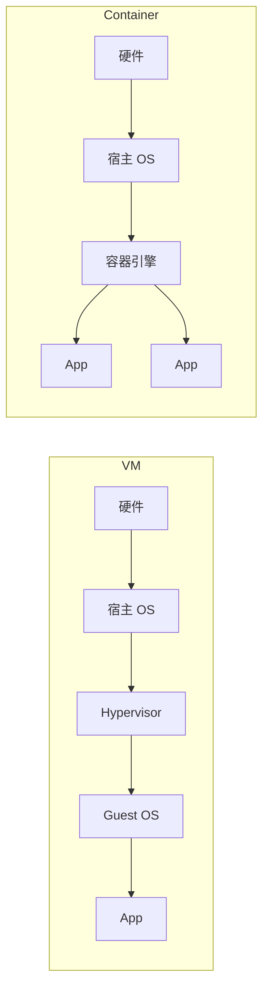

# Docker 详解

> Docker 用「镜像 + 容器」把应用和它依赖的运行环境打包成一个可移植的单元，从而解决「在我机器上是好的」这类环境不一致问题。理解它的核心机制——**分层镜像、写时复制、命名空间与 cgroups 隔离**——是写出小而快、安全可控的镜像的前提。

## 1. 为什么用容器

传统部署把应用直接装在服务器上，问题在于：环境漂移（开发机是 JDK 17，服务器是 8）、依赖冲突（两个服务要不同版本的库）、扩缩容慢（克隆整台机器）。虚拟机能隔离但这层太「重」——每台 VM 都带一个完整操作系统，启动以分钟计、资源开销大。

容器站在操作系统的**内核共享**之上：多个容器共用同一个内核，只隔离进程、网络、文件系统等视图。所以容器镜像只有几十到几百 MB、启动以秒计、单机能跑成百上千个。代价是隔离强度弱于虚拟机（内核是共享的），但对「跑一个后端服务」这个场景，收益远大于代价。



## 2. 镜像与容器

- **镜像（Image）**：只读的模板，由若干**层**叠加而成，包含运行应用所需的一切（代码、运行时、库、环境变量、配置）。镜像是不可变的，一旦构建就固定。
- **容器（Container）**：镜像的一个**运行实例**，在只读镜像之上加一层可写的容器层。

「镜像 = 类，容器 = 实例」是最直观的类比。一个镜像可以同时跑出多个互不影响的容器。

容器生命周期大致为：`created → running → (paused) → exited → removed`。进程退出，容器就停止（`docker run` 的前台进程结束 = 容器结束），这点常让新手困惑——容器不是「后台常驻的机器」，而是「围绕一个主进程的封装」。

## 3. 分层与写时复制

镜像的每一层对应 Dockerfile 中的一条构建指令，层与层之间通过 **UnionFS** 叠加成一个完整文件系统。这套设计带来两个关键收益：

- **共享与复用**：多个镜像若基于同一个基础层（如 `eclipse-temurin:17-jre`），磁盘上只存一份，下载也按层缓存。
- **写时复制（Copy-on-Write）**：容器运行时对文件的修改发生在最上层的可写层，下面的只读层保持不动。多个容器共享同一镜像，互不污染。

由此推出最重要的实践：**把变化频率低、体积大的指令放前面，变化频繁的放后面**。Dockerfile 从上到下逐条构建，一旦某层变化，它**及其后续所有层**都要重建。所以「先 `COPY pom.xml` 装依赖，再 `COPY src` 编译」能让改代码时复用依赖层缓存，构建从几分钟降到几秒。

## 4. Dockerfile 最佳实践

一个多阶段构建的 Java 服务示例：

```dockerfile
# ---- 构建阶段 ----
FROM maven:3.9-eclipse-temurin-17 AS build
WORKDIR /build
COPY pom.xml .
RUN mvn -B dependency:go-offline        # 依赖层单独缓存
COPY src ./src
RUN mvn -B -DskipTests package

# ---- 运行阶段 ----
FROM eclipse-temurin:17-jre
WORKDIR /app
RUN groupadd -r app && useradd -r -g app app
COPY --from=build /build/target/app.jar app.jar
USER app
EXPOSE 8080
ENTRYPOINT ["java", "-jar", "/app/app.jar"]
```

要点逐条：

1. **多阶段构建**：构建工具（Maven、JDK、源码）只留在构建阶段，最终镜像只拷贝产物，镜像体积可从近 1G 降到两百 MB 级。
2. **选精简基础镜像**：能用 `-jre` 就不用 `-jdk`，能用 alpine/distroless 就更小；但要注意 alpine 用 musl libc，个别依赖 glibc 的库不兼容。
3. **利用层缓存**：先拷依赖描述文件（`pom.xml`/`package.json`）并单独安装依赖，再拷源码。
4. **`.dockerignore`**：排除 `target/`、`.git/`、`node_modules/`、`.env`，既减小构建上下文，又避免把敏感文件或无用文件拷进镜像。
5. **RUN 合并**：同一目的的 `apt install && rm -rf /var/lib/apt/lists/*` 写进一条 `RUN`，因为多一条 `RUN` 就多一层，且删除操作只在同一层内才真正减小体积。
6. **不要把密钥写进镜像层**：镜像层是持久且可被 `docker history` 查看的，`ENV SECRET=xxx` 或 `COPY .env` 会把密钥永久留在镜像里。构建期需要密钥用 BuildKit 的 secret 挂载，运行时用环境变量或挂载。
7. **用非 root 用户运行**：默认 root 运行放大了容器逃逸的风险。创建普通用户并 `USER` 切换。
8. **固定基础镜像版本**：避免用 `latest`，否则同一份 Dockerfile 在不同时间构建出不同结果，破坏可复现性。
9. **正确区分 `CMD` 与 `ENTRYPOINT`**：`ENTRYPOINT` 是固定入口，`CMD` 提供默认参数（可被 `docker run` 覆盖）。用 **exec 形式**（`["java","-jar",...]`）而非 shell 形式，保证 PID 1 是应用本身，能正确接收 `SIGTERM` 优雅退出。

## 5. 网络

Docker 默认创建几种网络驱动，常用三种：

| 驱动 | 特点 | 场景 |
|------|------|------|
| `bridge`（默认） | 容器接入虚拟网桥，通过 NAT 出网；需 `-p` 映射端口才对外可见 | 单机上的多个容器 |
| `host` | 直接用宿主网络，无隔离，性能最好 | 对网络性能敏感、端口不冲突 |
| `none` | 无网络 | 完全隔离的批处理 |

```bash
docker network create mynet
docker run --network mynet --name db -d postgres:16
docker run --network mynet --name app -e DB_HOST=db myapp
```

**关键机制**：在**同一个自定义 bridge 网络**里，容器可以用**容器名做 DNS 解析**互访——这正是 Compose 里用服务名当主机名的原理。而默认的 `bridge` 网络不支持容器名解析，只能用 IP，所以实践中倾向于自建网络。

端口映射 `-p 宿主端口:容器端口` 把容器端口暴露到宿主机；`EXPOSE` 只是文档性声明，不实际发布端口。

## 6. 数据卷

容器可写层**随容器删除而消失**，且写入可写层走的是存储驱动、性能低于直接写宿主磁盘。需要持久化的数据（数据库、上传文件）必须用卷：

| 类型 | 语法 | 特点 |
|------|------|------|
| 命名卷（volume） | `-v mydata:/var/lib/postgresql/data` | 由 Docker 管理，推荐用于数据持久化 |
| 绑定挂载（bind mount） | `-v /host/path:/app/config` | 直接挂宿主目录，适合配置与开发时挂代码 |
| 临时文件系统（tmpfs） | `--tmpfs /tmp` | 只存内存，容器停止即消失 |

```bash
docker run -v mydata:/data -d myapp
docker run -v "$(pwd)/config:/app/config:ro" myapp   # :ro 只读挂载
```

命名卷由 Docker 统一管理、可移植性好；绑定挂载依赖宿主路径，适合挂配置。挂载只读（`:ro`）能防止容器误改宿主文件，是安全加固的常用手段。

## 7. 资源限制

默认情况下容器能吃掉宿主机所有资源，一个内存泄漏的容器可能拖垮整台机器。用 cgroups 限制：

```bash
docker run --memory=512m --cpus=1.5 -d myapp
docker run --memory=512m --memory-swap=512m myapp   # 禁用 swap
docker stats                                        # 实时查看资源占用
docker update --memory=1g --cpus=2 <container>      # 动态调整
```

JVM 尤其要注意：容器里若没识别到 `--memory` 限制，JVM 会按宿主机内存算默认堆，可能导致容器被 OOM 杀掉。现代 JDK（8u191+ / 10+）已默认感知容器内存限制，但显式设置 `-XX:MaxRAMPercentage=75` 比 `-Xmx` 固定值更稳妥。

## 8. 常用命令与生命周期

```bash
docker build -t myapp:1.0 .            # 构建镜像
docker images                          # 列出镜像
docker run -d --name app -p 8080:8080 myapp:1.0
docker ps                              # 运行中的容器（-a 含已停止）
docker exec -it app /bin/sh            # 进入容器执行命令（不影响主进程）
docker logs -f app                     # 跟日志
docker inspect app                     # 查看详细配置（网络、挂载、环境变量）
docker stop app                        # 发 SIGTERM，超时后 SIGKILL
docker rm app / docker rmi myapp:1.0   # 删容器 / 删镜像
docker system prune -a                 # 清理无用资源（谨慎，-a 会删未使用镜像）
```

区分 `run` 与 `exec`：`run` 启动**新容器**，`exec` 在**已运行**的容器里执行命令。排查容器时 `docker exec -it ... sh` 进去看现场，`docker inspect` 看配置，`docker logs` 看输出，这三条覆盖大部分场景。

## 9. 实践要点与常见坑

1. **镜像打了 `latest`**：无法追溯到底跑的哪个版本，回滚失去依据。一律用明确版本号或提交哈希。
2. **把容器当「小虚拟机」**：在容器里装 systemd、跑多个进程、ssh 进去长期操作——这违背了容器「一进程一容器」的模型。多进程编排交给 Compose/K8s，临时操作交给 `exec`。
3. **数据写进容器层**：重启或重建容器后数据丢失。有状态的数据一律用卷。
4. **镜像里含密钥**：`docker history` 就能看到。用 secret/环境变量注入。
5. **安全扫描缺失**：基础镜像和依赖会带 CVE，应在 CI 里用 `trivy`、`grype` 之类工具扫描镜像。
6. **构建上下文过大**：没有 `.dockerignore` 时，`docker build .` 会把 `.git/`、`target/` 全发给守护进程，构建变慢。检查构建时输出的「Sending build context」大小。
7. **`docker system prune -a` 误删**：`-a` 会删除所有未被容器使用的镜像（包括准备发布但尚未运行的那批）。生产机上执行前先 `docker image ls` 确认。

## 10. 小结

- 容器共享宿主内核、只隔离视图，因此比虚拟机轻得多，代价是隔离强度较弱。
- 镜像是分层只读模板，容器在其上加可写层；**写时复制**让多容器共享同一镜像。
- Dockerfile 把稳定指令放前面、易变指令放后面以命中层缓存；用多阶段构建、非 root、`.dockerignore`、exec 形式的 entrypoint。
- 自定义 bridge 网络支持容器名解析；端口映射用 `-p`；持久化数据用卷。
- 用 `--memory`/`--cpus` 限制资源，避免单容器拖垮宿主；注意 JVM 的容器内存感知。
- 镜像禁 `latest`、密钥不进层、有状态数据用卷、CI 中扫 CVE。

编排多个容器的本地开发环境，见 [Docker Compose](./compose.md)。
