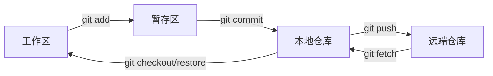

# Git 详解

> Git 是分布式版本控制系统（Distributed Version Control System, DVCS）：每个克隆都是一份带完整历史的仓库，不依赖中央服务器也能提交、查看历史、创建分支。它真正解决的问题不是「存副本」，而是「让多人在同一份代码上并行改动、且任何一步都能回退」。

## 1. 为什么是 Git

初级做法是给目录加时间戳备份（`code_final_v2.zip`），问题很快暴露：

- 找不到「谁、在什么时间、为什么」改了某一行，无法追责与追溯。
- 两个人改同一文件只能人工合并，冲突时容易覆盖对方的修改。
- 想试验一个新方案，只能复制整个目录；试错成本高，就不敢改。
- 想回滚到「上周三能用的版本」，只能靠记忆和运气。

Git 用**快照 + 内容寻址**解决这些问题：每次提交记录的是整棵项目树在该时刻的**快照**，而不是逐行差异；文件名之外的「内容」本身也有哈希，内容不变就不会重复存储。

另一点常被忽略：Git 存储的是**快照**，但展示 diff 时才按需计算差异。所以「Git 只存差异」是常见误解——它存快照，靠内容寻址和打包压缩省空间。

## 2. 三个区与对象模型

理解 Git 的第一把钥匙是「三个区」：

| 区域 | 英文 | 存什么 |
|------|------|--------|
| 工作区 | Working Directory | 你正在编辑的文件 |
| 暂存区 | Index / Staging Area | `git add` 后待提交的内容清单 |
| 本地仓库 | Repository（`.git`） | 已提交的历史快照 |

加上远端（Remote），一条典型的流转是：



第二把钥匙是**对象模型**。`.git` 里其实只有四类不可变对象，都用内容哈希（SHA-1，新版本已支持 SHA-256）寻址：

- **blob**：文件内容。
- **tree**：目录，记录「文件名 → 子对象」的映射。
- **commit**：一次提交，指向一棵 tree，并记录父提交、作者、时间、提交信息。
- **tag（附注标签）**：指向某个 commit 的命名引用。

分支（branch）和 HEAD 都不是对象，而是**可移动的引用**：分支是指向某个 commit 的指针，HEAD 指向当前所在的分支。这正是「Git 分支只是创建了一个 41 字节文件、因此创建和切换几乎零成本」的原因，也是理解下面所有操作的基础。

## 3. 常用命令

日常提交与查看：

```bash
git status              # 看工作区/暂存区状态
git add -p              # 交互式逐块暂存，便于把一次改动拆成多个提交
git commit -m "feat: 增加登录校验"
git log --oneline --graph --decorate -20
git diff                # 工作区 vs 暂存区
git diff --staged       # 暂存区 vs 最新提交
```

一次典型的特性分支流程：

```bash
git switch -c feature/login      # 新建并切到分支
# ...开发...
git add -p && git commit -m "feat: 登录接口"
git fetch origin                 # 拉取远端最新，不改动工作区
git rebase origin/main           # 把自己的提交挪到最新主干之上
git push -u origin HEAD          # 首次推送并建立上游跟踪
```

## 4. 撤销与回退

这是最容易出错、也最需要分清的一块。按「影响范围」从轻到重：

| 目标 | 命令 | 说明 |
|------|------|------|
| 丢弃某文件的工作区改动 | `git restore <file>` | 用暂存区内容覆盖工作区，改动丢失 |
| 取消暂存（保留改动） | `git restore --staged <file>` | 把文件从暂存区退回工作区 |
| 改最后一次提交信息或内容 | `git commit --amend` | 生成**新** commit 替换旧的，勿用于已推送历史 |
| 撤销最近提交但保留改动 | `git reset --soft HEAD~1` | 提交取消，改动回到暂存区 |
| 撤销提交并取消暂存 | `git reset HEAD~1`（默认 mixed） | 改动回到工作区 |
| 彻底丢弃提交与改动 | `git reset --hard HEAD~1` | **危险**，未提交改动一并丢失 |
| 撤销已推送的提交 | `git revert <commit>` | 生成一个「反向」新提交，历史不被改写，团队安全 |

`git reset` 与 `git revert` 的分野，本质是**是否改写历史**：`reset` 移动分支指针、丢弃后续提交，只适合尚未推送的本地提交；`revert` 通过新增提交抵消旧提交，历史只增不改，适合公共分支。

万一 `reset --hard` 后追悔，`git reflog` 是唯一的救命稻草——它记录了 HEAD 移动的每一步：

```bash
git reflog
# 找到误删前的提交哈希，然后
git reset --hard <hash>     # 或 git branch rescue <hash>
```

::: warning reflog 也有保质期
未被引用的对象默认约 30 天后会被 `git gc` 回收（`gc.reflogExpire` 等配置可调）。发现丢东西要尽早处理，不要拖。
:::

## 5. merge 与 rebase

把一条分支的改动并入另一条，有两种语义：

- **merge**：新建一个「合并提交」，保留两条分支的完整历史。适合公共分支、需要保留真实开发轨迹的场景。
- **rebase**：把你的提交逐个「摘下来」，重新嫁接到目标分支的最新提交之上，历史变成**一条直线**。适合整理自己尚未推送的本地提交。

```bash
# 方案一：合并（产生合并提交）
git switch main
git merge feature/login

# 方案二：变基（生成线性历史）
git switch feature/login
git rebase main
```

**黄金法则：不要对已经推送到公共分支的提交做 rebase。** 因为 rebase 会重写提交哈希，别人基于旧提交的工作会瞬间「对不上」，只能靠强推（`push --force`）覆盖，进而破坏他人的历史。个人分支随手 rebase 没问题，公共分支一律用 merge。

PR/MR 合并时还有一种常见的 **squash**：把一条分支上的多个提交压成一个再并入主干，让主干的每个提交都对应一个完整特性，便于回滚。代价是丢失细粒度的开发过程，因此多用于「合并即验收」的团队。

## 6. 暂存与标签

**stash** 用来临时保存未完成的改动，好让你干净地切分支救急：

```bash
git stash            # 保存已跟踪文件的改动
git stash -u         # 连同未跟踪文件一起保存
git stash list
git stash pop        # 恢复并删除该 stash
git stash apply      # 恢复但保留 stash
```

**tag** 用于给特定提交打上「版本锚点」，常用于发布：

```bash
git tag v1.2.0                       # 轻量标签（只是指针）
git tag -a v1.2.0 -m "发布 1.2.0"     # 附注标签（含作者、时间、说明，推荐）
git push origin v1.2.0               # 推送单个标签
git push --tags                      # 推送所有本地标签
```

发布版本建议一律用附注标签，因为它带有作者与说明，可被 `git describe` 正确利用，也便于审计。

## 7. 远端协作

远端操作的核心是把「拉取」拆成两步：

- `git fetch`：只把远端最新对象下载到本地，**不动**工作区和当前分支。
- `git pull`：等价于 `fetch` + `merge`（或 `rebase`，取决于 `pull.rebase` 配置）。

想保持线性历史，可配置 `git config --global pull.rebase true`，让 `pull` 默认走变基。首次推送分支时用 `-u`/`--set-upstream` 建立跟踪关系，之后直接 `git push` 即可。

多远端（如 `origin` 与 `fork`）场景下，`git remote -v` 查看、`git remote add` 新增、`git push fork HEAD` 定向推送都是常备操作。

## 8. 实践要点与常见坑

1. **提交原子化**：一个提交只做一件事，用 `git add -p` 把大改动拆开。原子提交让 review、回滚、二分定位（`git bisect`）都变得可行。
2. **提交前先看 diff**：`git diff --staged` 确认没有误加的文件、调试残留和密钥。
3. **绝不提交密钥**：`.env`、私钥、Token 一旦进入历史就很难彻底清除（即便删除也要重写历史并强推）。用 `.gitignore` + pre-commit 扫描（如 gitleaks）在源头拦截。
4. **别用 `reset --hard` 收拾烂摊子**：先 `git stash` 或建临时分支保存现场，再动手。
5. **`.gitignore` 尽早写**：`target/`、`node_modules/`、IDE 配置、构建产物都应排除，避免把噪声带进历史。
6. **提交信息用祈使句且可检索**：`fix: 修正分页越界` 优于「改了点东西」，便于日后 `git log --grep` 定位。

## 9. 小结

- Git 存的是**快照**，用内容哈希寻址；分支只是**可移动的指针**，因此极轻量。
- 三个区（工作区 / 暂存区 / 本地仓库）是理解一切操作的框架。
- 撤销要分清是否**改写历史**：未推送用 `reset`，已推送用 `revert`；`reflog` 是最后的保险。
- merge 保留历史、rebase 制造线性历史；**公共分支不要 rebase**。
- fetch 与 pull 的区别，是「下载」与「下载并合并」的区别。

想继续了解分支模型与团队协作，见 [Git 分支模型与协作](./branching.md)。
