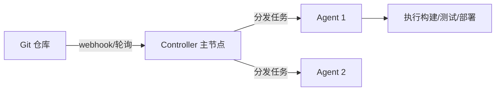

# Jenkins 持续集成

> 持续集成（Continuous Integration, CI）的核心约定是：开发者频繁地把改动合回主干，每次合入都自动触发「编译 + 测试 + 检查」，让问题在几分钟内暴露。Jenkins 是最老牌、插件最丰富的 CI 服务器之一，而 **Pipeline as Code** 让构建流程本身也进了版本控制、可评审、可追溯。

## 1. CI/CD 是什么

三个常被混用的概念：

- **CI（持续集成）**：频繁合并 + 自动验证。目标是「主干始终是可构建、可测试的」。
- **CD（持续交付，Continuous Delivery）**：在 CI 基础上，让每个通过验证的版本都**随时可发布**（发布动作仍可能手动点一下）。
- **CD（持续部署，Continuous Deployment）**：进一步，通过验证的版本**自动**上生产。

自动化流程的价值是消除了「手工发布」的不确定性：谁在什么时间、用哪个提交、执行了哪些步骤，全部有记录，回滚也有依据。

## 2. Jenkins 的定位与架构

Jenkins 是自建、可无限扩展的 CI 服务器，用**插件**适配几乎任何语言、工具与平台。它的基本架构是：



- **Controller（主节点）**：调度任务、管理配置、提供 Web UI。不应跑重型构建，免得被构建拖垮。
- **Agent（节点）**：真正执行构建的工作节点，可水平扩展、可按标签（label）区分能力（如 `linux`、`docker`、`gpu`）。

任务由**触发器**驱动：代码推送到 Git 后，通过 **webhook** 通知 Jenkins（比定时轮询 `poll SCM` 更实时、更省资源）。

## 3. Pipeline as Code

早期 Jenkins 靠界面点选配置（Freestyle Job），配置存在 Jenkins 里、无法评审、迁移困难。**Pipeline** 把流程写进代码仓库里一个名为 **`Jenkinsfile`** 的文本文件，随代码一起版本控制。收益很直接：

- **可评审**：构建流程的改动和代码一样走 PR。
- **可复用**：多分支、多项目共用同一套流程定义。
- **可追溯**：某次构建用的 `Jenkinsfile` 版本，就是那次提交的版本。
- **多分支流水线**：仓库里每个分支/PR 自动获得一条独立流水线。

## 4. 声明式与脚本式

Pipeline 有两种语法：

- **声明式（Declarative）**：结构固定、以 `pipeline {}` 开头，用 `stages`/`steps` 描述，可读性强、内置对错误处理和阶段的规范。**新项目首选**。
- **脚本式（Scripted）**：以 `node {}` 开头，是完整的 Groovy 代码，灵活但结构松散、更难维护。

下面以声明式为主线。

## 5. Jenkinsfile 结构

```groovy
pipeline {
    agent { label 'linux' }                 // 在哪个节点上跑

    options {
        timestamps()                        // 日志带时间戳
        timeout(time: 30, unit: 'MINUTES')  // 整体超时，防卡死
        buildDiscarder(logRotator(numToKeepStr: '20'))  // 只留最近 20 次
    }

    parameters {
        booleanParam(name: 'DEPLOY', defaultValue: false, description: '是否部署')
    }

    environment {
        APP_ENV = 'test'
    }

    stages {
        stage('Checkout') {
            steps { checkout scm }
        }
        stage('Build') {
            steps { sh 'mvn -B -DskipTests package' }
        }
        stage('Test') {
            steps { sh 'mvn -B test' }
            post {
                always {
                    junit 'target/surefire-reports/*.xml'   // 收集测试报告
                }
            }
        }
        stage('Docker') {
            when { branch 'main' }              // 只在 main 分支执行
            steps {
                sh 'docker build -t myapp:$GIT_COMMIT .'
            }
        }
        stage('Deploy') {
            when { expression { params.DEPLOY } }   // 由参数控制
            steps {
                withCredentials([usernamePassword(
                    credentialsId: 'registry', usernameVariable: 'USER', passwordVariable: 'PASS')]) {
                    sh 'echo "$PASS" | docker login -u "$USER" --password-stdin registry.example.com'
                    sh './deploy.sh'
                }
            }
        }
    }

    post {
        success { echo '构建成功' }
        failure { echo '构建失败，通知相关同学' }
    }
}
```

各块的作用：

| 块 | 作用 |
|----|------|
| `agent` | 指定执行节点：`any` / `none` / `label` / `docker` / `kubernetes` |
| `options` | 超时、时间戳、日志保留策略、并发控制等 |
| `parameters` | 声明构建参数，触发时由用户或 API 传入 |
| `environment` | 定义环境变量，供 `steps` 使用 |
| `stages` / `stage` | 逻辑阶段划分，UI 上分段展示，失败定位快 |
| `steps` | 每个阶段具体执行的命令（`sh`、`bat`、`echo`、插件步骤） |
| `when` | 条件执行：按分支、标签、参数、表达式决定跳过与否 |
| `post` | 阶段或流水线结束后的处理：`always`/`success`/`failure`/`unstable` |

常用步骤（steps）：`sh`/`bat` 执行 shell；`checkout scm` 拉代码；`withCredentials` 安全注入凭证；`junit` 收集测试结果；`archiveArtifacts` 归档产物（jar、报告）；`stash`/`unstash` 在阶段间传递文件；`build` 触发下游任务。

## 6. 凭证与产物

两个必须做对的地方：

- **凭证（Credentials）**：绝不把密码、Token 写进 `Jenkinsfile`。用 Jenkins 的 Credentials 存储保存，代码里通过 `withCredentials` 的变量引用（如 `$PASS`）。Jenkins 会在日志里自动**打码**这些变量，防止泄漏。
- **产物（Artifacts）**：用 `archiveArtifacts` 把构建产物保留下来，用 `junit` 把测试报告可视化。这样「某次构建到底产出了什么、哪些用例失败」都能回溯。

## 7. 共享库

多个项目流程相似时，把公共逻辑抽成 **Shared Library**（一个独立的 Groovy 仓库），在 Jenkins 配置后于 Jenkinsfile 顶部引用：

```groovy
@Library('my-shared-lib') _

pipeline {
    agent any
    stages {
        stage('Build') {
            steps { standardBuild() }   // 来自共享库的方法
        }
    }
}
```

共享库把「怎么构建、怎么发布」的规范集中到一处，升级流程只需改一个仓库，避免每个项目各写一套、各自跑偏。

## 8. 与 GitLab CI / GitHub Actions 对比

| 维度 | Jenkins | GitLab CI | GitHub Actions |
|------|---------|-----------|----------------|
| 部署方式 | 自建 | 随 GitLab（SaaS/自建） | GitHub 托管（可自建 runner） |
| 配置 | `Jenkinsfile`（Groovy） | `.gitlab-ci.yml` | `.github/workflows/*.yml` |
| 执行单元 | agent/节点 | runner | runner |
| 生态 | 插件海量、几乎无所不能 | 内建、覆盖常用场景 | Marketplace 丰富 |
| 上手成本 | 高（要自己搭、自己维护） | 低 | 低 |
| 维护负担 | 自己升级、备份、扩容 | 平台托管或随 GitLab | 平台托管 |

选择逻辑：**已经重度用 GitLab/GitHub 且不想自建，优先平台自带的 CI**（配置更简单、与仓库天然集成）；**需要高度定制、跨平台、复杂流水线或历史包袱重**，Jenkins 的插件生态与灵活性仍有优势。很多团队是混合的：日常 CI 用平台自带，复杂发布用 Jenkins 兜底。

## 9. 实践要点与常见坑

1. **凭证走 Credentials**：任何密钥都用 `withCredentials` 注入，绝不硬编码。
2. **`Jenkinsfile` 进仓库**：Pipeline as Code 的意义就在于此，别把流程留在 UI 里。
3. **给流水线设超时**：`options { timeout(...) }` 能防住「卡在某个步骤一天不动」。
4. **构建环境要干净**：用 `agent { docker {...} }` 或每次清理工作区，避免上一次构建的残留污染结果。
5. **失败要有通知**：`post { failure {...} }` 里接邮件/IM 通知，否则失败的构建会悄悄堆着。
6. **不要在主节点跑重活**：Controller 只做调度，重构建分发到 agent，否则容易把 CI 拖垮。
7. **留够产物保留策略**：`buildDiscarder` 控制历史占用，避免磁盘被旧构建塞满。
8. **把慢检查做成并行**：声明式的 `parallel` 能让单测、静态检查、构建并行跑，缩短反馈时间。

## 10. 小结

- CI 的本质是「频繁合并 + 自动验证」，主干始终可构建、可测试；CD 在此基础上做到随时/自动可发布。
- Jenkins 采用 Controller + Agent 架构，靠插件适配各种工具，靠 webhook 触发构建。
- **Pipeline as Code** 把流程写进仓库的 `Jenkinsfile`，可评审、可追溯；新项目用**声明式**语法。
- 凭证用 Credentials + `withCredentials`，产物用 `archiveArtifacts`/`junit` 归档回溯。
- 公共流程抽成 Shared Library 统一规范；自建还是用平台自带 CI，取决于是否重度绑定 GitLab/GitHub。

用来构建和部署的产物多为容器镜像，相关机制见 [Docker 详解](../docker/overview.md)。
